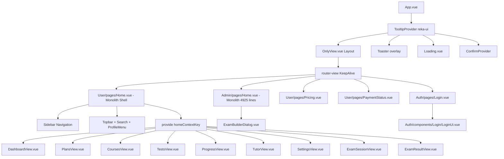
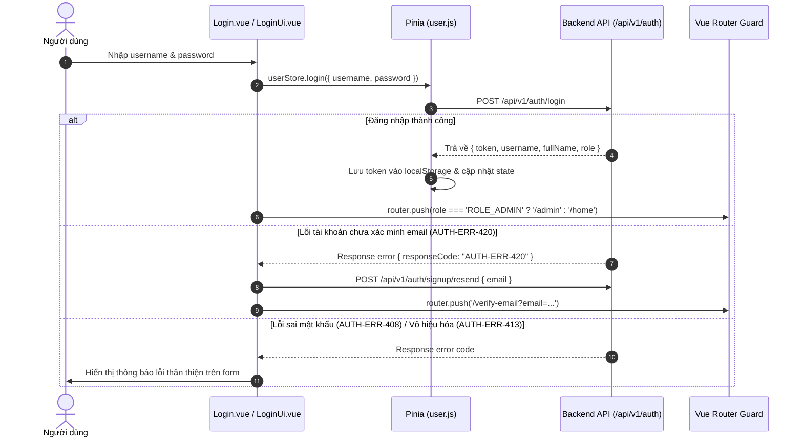

# BÁO CÁO PHÂN TÍCH KIẾN TRÚC FRONTEND
**Dự án:** Adaptive Learning Web Client  
**Thư mục mã nguồn:** `AdaptiveLearningFE/`  
**Vai trò:** Senior Frontend Engineer & Software Architect  
**Mục đích:** Đánh giá toàn diện kiến trúc frontend hiện tại trước khi triển khai thiết kế giao diện theo phong cách **Light AI Education**.

---

## 1. Tổng quan công nghệ

Dựa trên phân tích [package.json](file:///d:/AdaptiveLearning/AdaptiveLearningFE/package.json), [vite.config.js](file:///d:/AdaptiveLearning/AdaptiveLearningFE/vite.config.js), [tailwind.config.js](file:///d:/AdaptiveLearning/AdaptiveLearningFE/tailwind.config.js) và [components.json](file:///d:/AdaptiveLearning/AdaptiveLearningFE/components.json):

| Hạng mục | Công nghệ / Thư viện | Phiên bản | Ghi chú & Trách nhiệm |
| :--- | :--- | :--- | :--- |
| **Framework** | Vue 3 | `^3.4.21` | Composition API (`<script setup>`), Single File Components (`.vue`). |
| **Build Tool** | Vite | `^7.1.12` | Plugin `@vitejs/plugin-vue` (`^6.0.10`), hỗ trợ HMR siêu nhanh. |
| **Language** | JavaScript (ES Modules) | ES2022+ | Có cài `typescript` (`^7.0.2`) cho type definitions; dự án chạy JS kết hợp cấu hình [jsconfig.json](file:///d:/AdaptiveLearning/AdaptiveLearningFE/jsconfig.json). |
| **Routing** | Vue Router | `^4.3.0` | Quản lý điều hướng, dynamic view mapping, route guards. |
| **State Management** | Pinia | `^2.1.7` | Store chính quản lý user auth, token, role và thông tin phiên. |
| **HTTP Client** | Axios | `^1.6.7` | Cấu hình trong [Axios.js](file:///d:/AdaptiveLearning/AdaptiveLearningFE/src/services/Axios.js) với interceptors, auth headers, loading tracking, paywall redirection. |
| **Form & Validation** | Vee-Validate & Zod | `^4.12.6` / `^3.22.4` | `@vee-validate/zod` dùng cho form validation schema (như [Login.vue](file:///d:/AdaptiveLearning/AdaptiveLearningFE/src/features/Auth/pages/Login.vue)). |
| **CSS Framework** | Tailwind CSS | `^3.4.1` | Kết hợp `tailwindcss-animate` (`^1.0.7`), PostCSS và `autoprefixer` (`^10.4.18`). |
| **UI Primitives** | Reka UI (Radix Vue) | `^2.11.0` | Thư viện headless UI primitives; kết hợp `class-variance-authority` (`^0.7.0`), `clsx` (`^2.1.0`), `tailwind-merge` (`^2.2.1`). |
| **Overlay System** | Custom Overlay Suite | Nội bộ | Bộ component lớp phủ tự xây dựng tại [src/components/ui/overlay/](file:///d:/AdaptiveLearning/AdaptiveLearningFE/src/components/ui/overlay/) (Modal, Drawer, Popover, Dropdown, Tooltip, Toast, Confirm). |
| **Icon Library** | Lucide Vue Next | `^0.356.0` | Bộ icon SVG đồng nhất cho toàn bộ hệ thống. |
| **Progress Indicator**| NProgress | `^0.2.0` | Hiển thị thanh tiến trình top bar khi chuyển route. |
| **Utilities** | VueUse / JS-Cookie | `^10.9.0` / `^3.0.5` | Hỗ trợ tương tác browser và thao tác Cookie. |
| **Lint & Format** | ESLint / Prettier | `^8.x` / `^3.2.5` | [.eslintrc.js](file:///d:/AdaptiveLearning/AdaptiveLearningFE/.eslintrc.js), [.prettierrc](file:///d:/AdaptiveLearning/AdaptiveLearningFE/.prettierrc), Husky pre-commit format. |

### Cấu hình môi trường & Alias
- **Path Aliases:**
  - `@` trỏ tới `./src` (cấu hình tại [vite.config.js](file:///d:/AdaptiveLearning/AdaptiveLearningFE/vite.config.js#L25-L27) và [jsconfig.json](file:///d:/AdaptiveLearning/AdaptiveLearningFE/jsconfig.json)).
  - `components` trỏ tới `@/components` và `utils` trỏ tới `@/lib/utils` (trong [components.json](file:///d:/AdaptiveLearning/AdaptiveLearningFE/components.json)).
- **Vite Dev Server:**
  - Cổng mặc định: `3000` (`host: true`).
  - Reverse Proxy: `/api` chuyển tiếp tới `process.env.VITE_BACKEND_URL || 'http://localhost:9090'`.

---

## 2. Cấu trúc thư mục thực tế

Cấu trúc mã nguồn thực tế tại `AdaptiveLearningFE/src`:

```
AdaptiveLearningFE/src/
├── assets/                       # Tài nguyên tĩnh và CSS toàn cục
│   ├── images/                   # Hình ảnh minh họa (Login.png)
│   ├── index.css                 # Tailwind directives, CSS variables (HSL) và Design Tokens hex
│   └── vue.svg                   # Logo SVG
├── components/                   # Components dùng chung toàn ứng dụng
│   ├── Loading.vue               # Overlay loading toàn màn hình (gắn theo ref isLoading)
│   └── ui/                       # Thư mục UI primitives
│       ├── accordion/            # Boilerplate Radix/shadcn (chưa dùng trong views)
│       ├── button/               # Button.vue + buttonVariants CVA
│       ├── card/                 # Card primitives (Card, CardHeader, CardTitle...)
│       ├── dialog/               # Radix Dialog primitives (chưa dùng, thay bằng overlay/Modal)
│       ├── dropdown-menu/        # Radix Dropdown primitives (chưa dùng, thay bằng overlay)
│       ├── form/                 # Vee-Validate form wrapper (dùng trong LoginUi.vue)
│       ├── input/                # Input.vue (dùng trong LoginUi.vue)
│       ├── label/                # Label.vue
│       ├── navigation-menu/      # Radix navigation menu (dùng ở Header.vue)
│       ├── overlay/              # BỘ OVERLAY TẬP TRUNG THỰC TẾ ĐANG DÙNG
│       │   ├── ConfirmDialog.vue / ConfirmProvider.vue / useConfirm.ts
│       │   ├── Drawer.vue / Modal.vue / Popover.vue / Tooltip.vue
│       │   ├── DropdownMenu*.vue (Group, Item, Label, Separator, Shortcut)
│       │   ├── Toaster.vue / toast.ts / types.ts
│       │   └── overlays.css      # CSS hiệu ứng và layout riêng cho overlay
│       ├── resizable/            # Split pane primitives (chưa dùng)
│       ├── select/               # Select primitives (chưa dùng)
│       ├── tabs/                 # Tabs primitives (chưa dùng)
│       ├── toast/                # Boilerplate toast (chưa dùng, thay bằng overlay/toast)
│       └── tooltip/              # Boilerplate tooltip (chưa dùng, thay bằng overlay/Tooltip)
├── config/                       # Cấu hình runtime và bảo vệ tuyến đường
│   ├── net.config.js             # Cấu hình network: baseURL, timeout, status codes
│   ├── permission.js             # Navigation guards (beforeEach), NProgress, role redirection
│   ├── setting.config.js         # Cấu hình app: routerMode, storage key, whitelist, debounce
│   └── settings.js               # Hợp nhất network & setting config
├── features/                     # Tổ chức mã nguồn theo Feature-Driven Architecture
│   ├── Admin/                    # Phân hệ Quản trị viên
│   │   ├── components/
│   │   │   └── ExamBuilderDialog.vue   # Modal soạn thảo và mô phỏng đề thi (52KB, 789 dòng)
│   │   └── pages/
│   │       ├── Home.vue          # Dashboard Quản trị đa chức năng (205KB, 4.925 dòng)
│   │       └── OverlayDemo.vue   # Màn hình test & demo toàn bộ hệ thống overlay (/dev/overlays)
│   ├── Auth/                     # Phân hệ Xác thực
│   │   ├── components/Login/LoginUi.vue # Giao diện đăng nhập, form Zod, Google Sign-in button
│   │   └── pages/
│   │       ├── Login.vue         # Logic đăng nhập, xử lý mã lỗi AUTH-ERR
│   │       ├── Register.vue      # Đăng ký tài khoản, điều khoản, gửi mã OTP
│   │       └── VerifyEmail.vue   # Xác minh mã OTP email, bộ đếm ngược resend cooldown
│   ├── InappropriatePath/        # Phân hệ Điều hướng lỗi
│   │   └── pages/404.vue         # Trang báo lỗi 404 Not Found kèm minh họa điều hướng
│   └── User/                     # Phân hệ Người học (Học viên)
│       ├── components/views/     # Các sub-view nội bộ của Dashboard người học
│       │   ├── CoursesView.vue       # Danh sách chứng chỉ, tỷ lệ hoàn thành
│       │   ├── DashboardView.vue     # Tổng quan học tập, banner, quick stats, gợi ý AI
│       │   ├── ExamResultView.vue    # Kết quả sau khi nộp bài thi
│       │   ├── ExamSessionView.vue   # Phòng thi, đếm ngược thời gian, lưu đáp án real-time
│       │   ├── PlansView.vue         # Lộ trình học tập, form tạo kế hoạch, roadmap track
│       │   ├── ProgressView.vue      # Thống kê tiến độ, biểu đồ điểm, mức độ thành thạo
│       │   ├── SettingsView.vue      # Thông tin tài khoản, quyền và nút đăng xuất
│       │   ├── TestsView.vue         # Danh sách đề thi, tạo đề từ template, hạn mức Free
│       │   └── TutorView.vue         # Chatbot gia sư AI, danh sách hội thoại, prompts gợi ý
│       ├── composables/
│       │   └── homeContext.js    # Định nghĩa Symbol injection key `homeContextKey`
│       └── pages/
│           ├── Home.vue          # Shell điều hướng người học (81KB, 819 dòng, chứa layout + state)
│           ├── PaymentStatus.vue # Trạng thái thanh toán (polling kiểm tra giao dịch)
│           └── Pricing.vue       # Bảng giá gói học (Free vs Premium, paywall comparison)
├── hooks/                        # Vue Custom Directives & reactive state
│   ├── clickOutsideDirective.js  # v-click-outside
│   ├── debounce.js               # v-debounce
│   ├── infiniteScroll.js         # v-infinite-scroll
│   └── isLoading.js              # Ref `isLoading = ref(false)` chia sẻ trạng thái loading
├── layouts/                      # Layout wrappers toàn ứng dụng
│   ├── Default.vue               # Layout mẫu chứa Header + Slot + Footer (hiện không route nào dùng)
│   ├── OnlyView.vue              # Layout trong suốt chỉ render `<slot></slot>` (dùng cho 100% routes)
│   └── components/default/
│       ├── Footer.vue            # Footer mẫu
│       └── Header.vue            # Header mẫu với link tài liệu primitive
├── lib/
│   └── utils.js                  # Hàm tiện ích `cn()` kết hợp `clsx` và `twMerge`
├── locales/                      # Đa ngôn ngữ (chưa kích hoạt trong main.js)
│   ├── en.js / vi.js             # Dữ liệu locale mẫu
├── router/                       # Cấu hình Vue Router
│   ├── Admin/admin.js            # Routes dành cho ROLE_ADMIN
│   ├── Auth/auth.js              # Routes xác thực công khai
│   ├── InappropriatePath/inappropiratePath.js # Route 404
│   ├── User/user.js              # Routes dành cho ROLE_USER
│   └── index.js                  # Khởi tạo router, scrollBehavior, history mode
├── services/                     # Lớp kết nối API Backend
│   ├── Axios.js                  # Axios client, interceptors, error toasts, paywall handler
│   ├── adminService.js           # API quản trị (users, billings, templates, questions, knowledge)
│   ├── learningService.js        # API học tập (exams, attempts, recommendations, progress, tutor)
│   ├── paymentService.js         # API thanh toán (checkout, status, history, entitlements)
│   └── userService.js            # API xác thực (login, signup, verify, googleConfig)
├── stores/                       # Quản lý state toàn cục (Pinia)
│   └── user.js                   # Store `user`: token, role, username, fullName, getInfo, login
└── utils/                        # Các hàm tiện ích dùng chung
    ├── auth.js                   # Thao tác đọc/ghi token từ localStorage / Cookie
    ├── changeLanguage.js         # Hàm đổi ngôn ngữ (skeleton)
    ├── get-page-title.js         # Xây dựng document.title động
    ├── handleRouter.js           # Dynamic import helper `loadView(feature, view)`
    ├── helper.js                 # `genernateUUID()`
    ├── import.js                 # Đăng ký global components layout (`registerGlobalComponent`)
    ├── performance.js            # Hàm `debounce()`, `stringConcatenation()`
    └── validate.js               # Các hàm kiểm tra regex: `isExternal`, `isPassword`, `isArray`...
```

---

## 3. Danh sách route và layout tìm thấy

### A. Cơ chế Layout
- Trong [App.vue](file:///d:/AdaptiveLearning/AdaptiveLearningFE/src/App.vue#L11-L13), layout được xác định động:
  ```javascript
  const layout = computed(() => (currentRoute.meta.layout || "only-view") + "-layout")
  ```
- Các layout được đăng ký toàn cục tại [src/utils/import.js](file:///d:/AdaptiveLearning/AdaptiveLearningFE/src/utils/import.js):
  - `only-view-layout` trỏ tới [src/layouts/OnlyView.vue](file:///d:/AdaptiveLearning/AdaptiveLearningFE/src/layouts/OnlyView.vue).
  - `default-layout` trỏ tới [src/layouts/Default.vue](file:///d:/AdaptiveLearning/AdaptiveLearningFE/src/layouts/Default.vue).
- **Thực tế:** **100% routes hiện tại đều dùng `layout: 'only-view'`**. Layout `Default.vue` (với Header/Footer mẫu) không được bất kỳ route nào sử dụng.

### B. Danh sách Routes đầy đủ

| STT | Đường dẫn (Path) | Tên Route (Name) | Component thực tế | Meta & Quyền (allowedRoles) | Phân loại |
| :---: | :--- | :--- | :--- | :--- | :--- |
| 1 | `/` | — | Redirect `/home` | Whitelist công khai | Redirect |
| 2 | `/login` | `Login` | `Auth/pages/Login.vue` | `layout: 'only-view'`, Whitelist | Công khai |
| 3 | `/register` | `Register` | `Auth/pages/Register.vue` | `layout: 'only-view'`, Whitelist | Công khai |
| 4 | `/verify-email` | `VerifyEmail` | `Auth/pages/VerifyEmail.vue` | `layout: 'only-view'`, Whitelist | Công khai |
| 5 | `/home` | `UserHome` | `User/pages/Home.vue` | `ROLE_USER`, view: `'dashboard'` | Đăng nhập |
| 6 | `/plans` | `LearningPlans` | `User/pages/Home.vue` | `ROLE_USER`, view: `'plans'` | Đăng nhập |
| 7 | `/courses` | `LearningCourses` | `User/pages/Home.vue` | `ROLE_USER`, view: `'courses'` | Đăng nhập |
| 8 | `/tests` | `LearningTests` | `User/pages/Home.vue` | `ROLE_USER`, view: `'tests'` | Đăng nhập |
| 9 | `/history` | `LearningHistory` | `User/pages/Home.vue` | `ROLE_USER`, view: `'history'` | Đăng nhập |
| 10 | `/progress` | `LearningProgress` | `User/pages/Home.vue` | `ROLE_USER`, view: `'progress'` | Đăng nhập |
| 11 | `/tutor` | `LearningTutor` | `User/pages/Home.vue` | `ROLE_USER`, view: `'tutor'` | Đăng nhập |
| 12 | `/settings` | `LearningSettings` | `User/pages/Home.vue` | `ROLE_USER`, view: `'settings'` | Đăng nhập |
| 13 | `/pricing` | `LearningPricing` | `User/pages/Pricing.vue` | `ROLE_USER` | Đăng nhập |
| 14 | `/payment/success` | `PaymentSuccess` | `User/pages/PaymentStatus.vue` | `ROLE_USER` | Đăng nhập |
| 15 | `/payment/cancel` | `PaymentCancel` | `User/pages/PaymentStatus.vue` | `ROLE_USER` | Đăng nhập |
| 16 | `/dev/overlays` | `OverlayDemo` | `Admin/pages/OverlayDemo.vue` | `ROLE_ADMIN` | Quản trị |
| 17 | `/admin` | `AdminHome` | `Admin/pages/Home.vue` | `ROLE_ADMIN` | Quản trị |
| 18 | `/404` | `NotFound` | `InappropriatePath/pages/404.vue` | `layout: 'only-view'`, Whitelist | Lỗi |
| 19 | `/:pathMatch(.*)*` | — | Redirect `{ name: 'NotFound' }` | Bắt route sai | Fallback |

> [!NOTE]
> **Đặc điểm kiến trúc điều hướng của phân hệ Người học:** Các đường dẫn `/home`, `/plans`, `/courses`, `/tests`, `/history`, `/progress`, `/tutor`, `/settings` đều ánh xạ về cùng một component cha là [User/pages/Home.vue](file:///d:/AdaptiveLearning/AdaptiveLearningFE/src/features/User/pages/Home.vue). Component cha này đọc `route.meta.view` để render view con tương ứng và chia sẻ dữ liệu qua `provide(homeContextKey)`.

### C. Route Guard & Phân quyền
Được quản lý tại [src/config/permission.js](file:///d:/AdaptiveLearning/AdaptiveLearningFE/src/config/permission.js):
- **Danh sách trắng (`routesWhiteList`):** `['/login', '/register', '/verify-email', '/404', '/']`.
- **Nếu chưa có token:**
  - Nếu route nằm trong whitelist: Cho phép tiếp tục (`next()`).
  - Nếu không: Chuyển hướng về `/login?redirect=${to.path}`.
- **Nếu đã có token:**
  - Nếu người dùng cố vào `/login`: Tự động điều hướng về màn hình đích theo vai trò (`/admin` nếu là `ROLE_ADMIN`, `/home` nếu là `ROLE_USER`).
  - Nếu store chưa có thông tin vai trò: Tự động gọi `userStore.getInfo()` trước khi cho phép vào trang. Nếu token hết hạn hoặc không xác thực được, xóa token và đưa về `/login`.
  - Hàm `roleRedirect(to, role)` đối soát `to.meta.allowedRoles`: Nếu role không hợp lệ, chuyển hướng người dùng về landing page của role họ đang sở hữu hoặc chuyển sang `/404`.

---

## 4. Kiến trúc Component

### A. Phân cấp Component trong ứng dụng



### B. Nhận xét về cấu trúc Component
1. **Kiến trúc Monolith ở cấp Page:**
   - [User/pages/Home.vue](file:///d:/AdaptiveLearning/AdaptiveLearningFE/src/features/User/pages/Home.vue) đóng vai trò vừa là Dashboard Shell (Sidebar, Topbar, Modals), vừa là state container tập trung toàn bộ dữ liệu (plans, exams, attempts, history, tutor, timer). Nó truyền xuống các view con bằng `provide(homeContextKey)`.
   - [Admin/pages/Home.vue](file:///d:/AdaptiveLearning/AdaptiveLearningFE/src/features/Admin/pages/Home.vue) có dung lượng lên đến 4.925 dòng mã, gom toàn bộ 7 phân hệ quản trị (Tổng quan, Tài khoản, Thanh toán, Kết quả, Chứng chỉ, Đề thi, Kho tri thức) trong một file duy nhất.
2. **Sự tách biệt giữa Smart và Dumb component:**
   - Trong `User/components/views/*`, các view con hầu như là presentation/dumb component nhận state và gọi hàm thông qua `inject(homeContextKey)`.
   - Phân hệ Auth được tách tốt: `Login.vue` (Smart container xử lý logic API & redirect) bọc `LoginUi.vue` (Dumb presentation form).
3. **Hiện tượng trùng lặp Component:**
   - Tồn tại hai hệ thống overlay song song: các file sinh từ mẫu shadcn trong `src/components/ui/` (`dialog`, `dropdown-menu`, `toast`, `tooltip`) hoàn toàn không được dùng; thay vào đó, toàn bộ ứng dụng dùng `src/components/ui/overlay/`.
   - Các modal cơ bản (Đổi mật khẩu, Hỗ trợ, Giới thiệu) được viết lặp lại độc lập ở cả `User/pages/Home.vue` và `Admin/pages/Home.vue`.
   - Nút bấm (Button) trong các trang chủ yếu là thẻ HTML thuần `<button class="primary-button">` hoặc `<button class="outline-button">` thay vì sử dụng component `src/components/ui/button/Button.vue`.

---

## 5. Cách gọi API và quản lý State

### A. HTTP Client & Interceptors ([Axios.js](file:///d:/AdaptiveLearning/AdaptiveLearningFE/src/services/Axios.js))
- **Base URL:** Lấy từ `settings.baseURL`, ưu tiên `import.meta.env.VITE_API_BASE_URL` hoặc `import.meta.env.VITE_API_KEY`.
- **Request Interceptor:**
  - Tự động gắn header `Authorization: Bearer <token>` (lấy từ [src/utils/auth.js](file:///d:/AdaptiveLearning/AdaptiveLearningFE/src/utils/auth.js)).
  - Bỏ qua header auth cho các public request xác thực (khớp regex `/api/v1/auth/(login|google|signup...)`).
  - Quản lý biến đếm `pendingRequests`: khi có request đang chạy, đặt `isLoading.value = true` để hiển thị overlay loading toàn cục.
- **Response Interceptor:**
  - Giảm biến đếm `pendingRequests`, cập nhật `isLoading.value = false`.
  - **Paywall Interception:** Kiểm tra `data.responseCode`. Nếu là `PREMIUM_REQUIRED` hoặc `FREE_LIMIT_REACHED`, tự động điều hướng sang `/pricing?reason=<CODE>`.
  - **Mã thành công:** Kiểm tra mã phản hồi thuộc `[200, 201, 202, 0]`. Hỗ trợ cả trường `code` và `statusCode` từ backend.
  - **Xử lý lỗi HTTP:**
    - `401 Unauthorized`: Xóa token, gọi `userStore.resetToken()`, điều hướng về `/login`.
    - `403 Forbidden`: Điều hướng về `/403`.
    - Các lỗi khác: Hiển thị thông báo tiếng Việt qua `toast.error` kèm cơ chế chống spam toast (cooldown 2.5 giây cho cùng một nội dung lỗi).

### B. Quản lý State ([src/stores/user.js](file:///d:/AdaptiveLearning/AdaptiveLearningFE/src/stores/user.js))
- Sử dụng Pinia với Setup Store (`defineStore('user', () => { ... })`).
- Quản lý state người dùng: `accessToken`, `username`, `fullName`, `role`, `avatar`, `permissions`.
- Chuẩn hóa vai trò người dùng qua hàm `normalizeRole`: đảm bảo prefix `ROLE_` (ví dụ `ROLE_USER`, `ROLE_ADMIN`).
- Đồng bộ thông tin nhanh với `localStorage`: lưu `adaptive-learning-fullname` và `adaptive-learning-role` để giữ hiển thị khi reload trang trước khi API profile phản hồi.

---

## 6. Luồng Authentication đã xác minh từ mã nguồn

Dưới đây là các luồng xác thực thực tế đã đối soát chi tiết:



### Các luồng chi tiết đã kiểm chứng:
1. **Đăng nhập truyền thống:**
   - Form xác thực qua Zod (`username`, `password` tối thiểu 1 ký tự).
   - Gọi `userService.login` -> `POST /api/v1/auth/login`.
   - Nếu lỗi `AUTH-ERR-420` (email chưa xác minh): Tự động gọi gửi lại mã xác thực `resendVerification` và đẩy người dùng sang trang `/verify-email`.
2. **Đăng nhập Google (Google Identity Services - GSI):**
   - Khi mount component `LoginUi.vue`, gọi `GET /api/v1/auth/google/config` để lấy `clientId`.
   - Tự động chèn dynamic script `https://accounts.google.com/gsi/client` vào `<head>`.
   - Khởi tạo nút Google chuẩn qua `window.google.accounts.id.renderButton`.
   - Nhận `idToken` từ Google, gọi `userStore.loginWithGoogle(idToken)` -> `POST /api/v1/auth/google`.
3. **Đăng ký tài khoản ([Register.vue](file:///d:/AdaptiveLearning/AdaptiveLearningFE/src/features/Auth/pages/Register.vue)):**
   - Kiểm tra họ tên, email chuẩn, độ dài mật khẩu 8-72 ký tự, khớp xác nhận mật khẩu, đồng ý điều khoản.
   - Gọi `userService.signUp` -> `POST /api/v1/auth/signup`.
   - Chuyển hướng sang `/verify-email` kèm theo `expiresAt` và `resendAvailableAt`.
4. **Xác minh Email ([VerifyEmail.vue](file:///d:/AdaptiveLearning/AdaptiveLearningFE/src/features/Auth/pages/VerifyEmail.vue)):**
   - Giao diện nhập mã OTP kèm bộ đếm ngược thời gian hết hạn mã và thời gian được phép gửi lại (resend cooldown).
   - Gọi `userService.verifyEmail` (`POST /api/v1/auth/signup/verify`) hoặc `resendVerification` (`POST /api/v1/auth/signup/resend`).
5. **Đăng xuất:**
   - Hàm `logout()` gọi `userStore.resetToken()`, xóa token và thông tin profile khỏi `localStorage`, xóa state Pinia và chuyển hướng về `/login`.
6. **Token Refresh:**
   - **Xác nhận từ mã nguồn:** Frontend **không có cơ chế refresh token ngầm (silent refresh)**. Khi token hết hạn (HTTP 401), interceptor trong `Axios.js` xóa phiên đăng nhập và đưa người dùng về `/login`.

---

## 7. Cách tổ chức CSS và Responsive

### A. Kiến trúc Stylesheet
Hệ thống CSS hiện tại gồm 4 tầng:
1. **Tầng Design Tokens cơ bản ([src/assets/index.css](file:///d:/AdaptiveLearning/AdaptiveLearningFE/src/assets/index.css)):**
   - Định nghĩa font chính: `--font-sans: 'Be Vietnam Pro', system-ui...`
   - Biến màu sắc theo chuẩn Shadcn HSL trong `:root` và `.dark`.
   - Bổ sung bảng màu Design System tùy biến theo mã hex:
     - Thương hiệu / Nút hành động: `--ds-primary: #0F766E` (Teal), hover `--primary-hover: #115E59`, nền nhẹ `--primary-soft: #E6F7F3`.
     - Nền trang & bề mặt: `--bg-page: #F5F7FB`, `--surface: #FFFFFF`, `--surface-subtle: #F8FAFC`.
     - Màu chức năng: Blue (`#2563EB`), Violet (`#7C3AED`), Amber (`#D97706`), Rose/Danger (`#E11D48`).
2. **Tầng Overlay Stylesheet ([overlays.css](file:///d:/AdaptiveLearning/AdaptiveLearningFE/src/components/ui/overlay/overlays.css)):**
   - Định dạng chuyên sâu cho dialog, backdrop blur, drawer trượt, tooltip mũi tên, toast card.
3. **Tầng Component Scoped Styles:**
   - [Admin/pages/Home.vue](file:///d:/AdaptiveLearning/AdaptiveLearningFE/src/features/Admin/pages/Home.vue) có hơn 2.000 dòng CSS cục bộ `<style scoped>`.
   - [404.vue](file:///d:/AdaptiveLearning/AdaptiveLearningFE/src/features/InappropriatePath/pages/404.vue), [Pricing.vue](file:///d:/AdaptiveLearning/AdaptiveLearningFE/src/features/User/pages/Pricing.vue), [PaymentStatus.vue](file:///d:/AdaptiveLearning/AdaptiveLearningFE/src/features/User/pages/PaymentStatus.vue) có `<style scoped>` riêng biệt.
4. **Vấn đề CSS rò rỉ toàn cục từ User Home:**
   - Trong [User/pages/Home.vue](file:///d:/AdaptiveLearning/AdaptiveLearningFE/src/features/User/pages/Home.vue#L758), thẻ style là `<style>` **không có thuộc tính `scoped`**.
   - Hàng chục class như `.app-shell`, `.sidebar`, `.workspace`, `.topbar`, `.continue-card`, `.skill-overview`, `.metric-grid`, `.tutor-workspace`... bị đẩy lên phạm vi global của trình duyệt khi vào màn hình học tập. Các component con trong `components/views/*` phụ thuộc vào các class global này để hiển thị.

### B. Breakpoints và Responsive
Các điểm ngắt (breakpoints) được viết thủ công trong media query:
- `1200px`: Thu gọn sidebar về 220px, chuyển grid dashboard về tỷ lệ nhỏ hơn.
- `900px` (Tablet): Sidebar ẩn khỏi màn hình (`transform: translateX(-100%)`), xuất hiện nút hamburger trên topbar; khi mở sidebar hiển thị lớp nền mờ `.mobile-scrim`.
- `680px` / `768px` (Mobile):
  - Chuyển toàn bộ grid 2-3 cột (thống kê, danh sách chứng chỉ, bảng giá) thành dạng 1 cột xếp dọc.
  - Topbar rút gọn (ẩn tên tài khoản, chỉ hiện avatar).
  - Khung chat gia sư AI chuyển danh sách hội thoại lên thanh trượt ngang trên đầu.

---

## 8. Những component có thể tái sử dụng để xây dựng UI Kit

Khi chuẩn hóa sang phong cách **Light AI Education**, các thành phần sau có chất lượng tốt và giá trị tái sử dụng cao:

1. **Hệ thống Overlay (`src/components/ui/overlay/`):**
   - [Modal.vue](file:///d:/AdaptiveLearning/AdaptiveLearningFE/src/components/ui/overlay/Modal.vue): Hộp thoại đa kích thước (`sm`, `md`, `lg`, `xl`), hỗ trợ icon header, slot actions chuẩn.
   - [Drawer.vue](file:///d:/AdaptiveLearning/AdaptiveLearningFE/src/components/ui/overlay/Drawer.vue): Bảng trượt slide-over cực kỳ thích hợp cho chi tiết người dùng, lịch sử thanh toán hoặc cấu hình AI.
   - [ConfirmDialog.vue](file:///d:/AdaptiveLearning/AdaptiveLearningFE/src/components/ui/overlay/ConfirmDialog.vue) & [useConfirm.ts](file:///d:/AdaptiveLearning/AdaptiveLearningFE/src/components/ui/overlay/useConfirm.ts): API gọi hộp thoại xác nhận dạng Promise (`const ok = await confirm({ ... })`).
   - [Toaster.vue](file:///d:/AdaptiveLearning/AdaptiveLearningFE/src/components/ui/overlay/Toaster.vue) & [toast.ts](file:///d:/AdaptiveLearning/AdaptiveLearningFE/src/components/ui/overlay/toast.ts): Hệ thống thông báo toast hiện đại với `toast.success`, `toast.error`, `toast.info`.
   - [DropdownMenu.vue](file:///d:/AdaptiveLearning/AdaptiveLearningFE/src/components/ui/overlay/DropdownMenu.vue): Menu dropdown tùy biến với header, switch, separators.
2. **Bộ Primitives từ Reka UI / shadcn:**
   - [Button](file:///d:/AdaptiveLearning/AdaptiveLearningFE/src/components/ui/button/): Component `Button.vue` với CVA variants (`default`, `destructive`, `outline`, `secondary`, `ghost`, `link`). Cần áp dụng rộng rãi thay vì viết class `<button>` thủ công.
   - [Input](file:///d:/AdaptiveLearning/AdaptiveLearningFE/src/components/ui/input/) & [Form](file:///d:/AdaptiveLearning/AdaptiveLearningFE/src/components/ui/form/): Bộ điều khiển input và form liên kết Vee-Validate.
3. **Component hiển thị trạng thái:**
   - [Loading.vue](file:///d:/AdaptiveLearning/AdaptiveLearningFE/src/components/Loading.vue): Spinner loading toàn màn hình (có thể tinh chỉnh thẩm mỹ nhẹ nhàng hơn).
   - [404.vue](file:///d:/AdaptiveLearning/AdaptiveLearningFE/src/features/InappropriatePath/pages/404.vue): Bố cục trang lỗi 404 hoàn chỉnh, có sẵn phong cách điều hướng hiện đại.

---

## 9. Vấn đề kiến trúc và UX nhận diện từ mã nguồn

1. **Monolithic Components quá lớn:**
   - File [Admin/pages/Home.vue](file:///d:/AdaptiveLearning/AdaptiveLearningFE/src/features/Admin/pages/Home.vue) có tới 4.925 dòng mã và [User/pages/Home.vue](file:///d:/AdaptiveLearning/AdaptiveLearningFE/src/features/User/pages/Home.vue) có 819 dòng. Việc dồn toàn bộ giao diện, modal, form và logic gọi API vào một file gây khó khăn lớn cho việc bảo trì, tối ưu hiệu năng và chia việc khi redesign.
2. **Xung đột bảng màu nhận diện thương hiệu:**
   - Trong file cấu hình token [index.css](file:///d:/AdaptiveLearning/AdaptiveLearningFE/src/assets/index.css), màu `--ds-primary` được định nghĩa là màu **Xanh ngọc / Teal (`#0F766E`)**.
   - Tuy nhiên, trong [User/pages/Home.vue](file:///d:/AdaptiveLearning/AdaptiveLearningFE/src/features/User/pages/Home.vue), code lại khai báo biến `--blue: #2d68f3` và hardcode màu **Xanh dương (`#2868f4`, `#3476f1`)** cho toàn bộ nút bấm, active sidebar, thanh tiến độ. Giao diện hiện tại thiếu sự nhất quán về màu chủ đạo.
3. **Mã nguồn rác / Thư mục mồ côi (Dead Code):**
   - Hơn 10 thư mục trong `src/components/ui/` (như `dialog`, `dropdown-menu`, `toast`, `tooltip`, `accordion`, `resizable`, `tabs`...) sinh ra từ template mẫu không hề được import trong bất kỳ view hoạt động nào.
   - Layout [src/layouts/Default.vue](file:///d:/AdaptiveLearning/AdaptiveLearningFE/src/layouts/Default.vue) và Header của nó chứa các đường link tài liệu giả định (`/docs/primitives/...`) không thuộc về nghiệp vụ học tập.
4. **Thiếu Route `/403`:**
   - Trong [Axios.js](file:///d:/AdaptiveLearning/AdaptiveLearningFE/src/services/Axios.js#L58), khi gặp lỗi 403, mã nguồn thực hiện `router.push({ path: '/403' })`. Tuy nhiên trong [src/router/](file:///d:/AdaptiveLearning/AdaptiveLearningFE/src/router/) không hề đăng ký route `/403`, dẫn đến việc bị đẩy sang trang `404 Not Found`.
5. **Cơ chế Điều hướng nội bộ (Sub-routing):**
   - Người học điều hướng giữa Dashboard, Lộ trình, Khóa học, Bài kiểm tra, Trợ lý AI dựa vào việc hoán đổi biến `activeView` trong component cha [User/pages/Home.vue](file:///d:/AdaptiveLearning/AdaptiveLearningFE/src/features/User/pages/Home.vue) thay vì sử dụng cấu trúc route con (`children: []` với `<router-view>`). Khi người dùng đang làm bài thi (`activeView === 'taking'`), nếu bấm F5 reload trang, view sẽ bị reset về trang chủ và phải bấm "Tiếp tục" từ danh sách bài đang làm.
6. **Thư viện chưa sử dụng:**
   - `vue-i18n` và `yup` đã được cài đặt trong `package.json` nhưng không được sử dụng thực tế trong luồng runtime của ứng dụng.

---

## 10. Rủi ro khi Redesign và các hành vi cần bảo toàn

Khi tiến hành thiết kế lại giao diện theo phong cách **Light AI Education**, các logic nghiệp vụ sau **bắt buộc phải bảo toàn nguyên vẹn**:

| Hạng mục | Rủi ro nếu bị thay đổi sai | Hành vi bắt buộc phải bảo toàn |
| :--- | :--- | :--- |
| **Phòng thi & Đếm giờ** ([ExamSessionView.vue](file:///d:/AdaptiveLearning/AdaptiveLearningFE/src/features/User/components/views/ExamSessionView.vue)) | Mất bài làm của học viên, tính sai giờ thi | • Cơ chế auto-save đáp án với debounce 350ms lên backend.<br>• Bộ đếm ngược thời gian `secondsLeft`, hiển thị cảnh báo gấp khi `< 300s`.<br>• Hộp thoại xác nhận `confirm()` khi người dùng bấm rời bài thi.<br>• Tự động thu bài khi hết giờ (mã lỗi `ATTEMPT-ERR-410`). |
| **Cơ chế Paywall & Quota** ([Axios.js](file:///d:/AdaptiveLearning/AdaptiveLearningFE/src/services/Axios.js), [Pricing.vue](file:///d:/AdaptiveLearning/AdaptiveLearningFE/src/features/User/pages/Pricing.vue)) | Người dùng Free dùng vượt hạn mức hoặc bị kẹt luồng | • Interceptor tự bắt mã `PREMIUM_REQUIRED` và `FREE_LIMIT_REACHED` để đẩy sang `/pricing`.<br>• Hiển thị thanh tiến độ hạn mức tạo đề Free (`examsUsed` / `examLimit`).<br>• Khóa tính năng Trợ lý AI đối với gói Free (`!isPremium`). |
| **Xác thực Google GSI** ([LoginUi.vue](file:///d:/AdaptiveLearning/AdaptiveLearningFE/src/features/Auth/components/Login/LoginUi.vue)) | Nút đăng nhập Google bị vỡ hoặc không hoạt động | • Giữ nguyên luồng lấy config qua API `userService.googleConfig()` và chèn script Google GSI động.<br>• Giữ callback xác thực `onGoogleSignIn(idToken)`. |
| **Xác minh Email OTP** ([VerifyEmail.vue](file:///d:/AdaptiveLearning/AdaptiveLearningFE/src/features/Auth/pages/VerifyEmail.vue)) | Người dùng không nhận được mã hoặc spam gửi mã | • Giữ đồng hồ đếm ngược hết hạn OTP và thời gian chờ được gửi lại (`resendAvailableAt`).<br>• Luồng tự động chuyển sang trang xác minh khi đăng nhập gặp mã lỗi `AUTH-ERR-420`. |
| **Cơ chế Route Guard** ([permission.js](file:///d:/AdaptiveLearning/AdaptiveLearningFE/src/config/permission.js)) | Lộ trang quản trị hoặc lặp vô tận (infinite redirect) | • Bảo toàn danh sách trắng `routesWhiteList`.<br>• Bảo toàn kiểm tra quyền `allowedRoles` và điều hướng đúng `landingPath` theo vai trò (`ROLE_ADMIN` -> `/admin`, `ROLE_USER` -> `/home`). |
| **Bản nháp Exam Builder** ([ExamBuilderDialog.vue](file:///d:/AdaptiveLearning/AdaptiveLearningFE/src/features/Admin/components/ExamBuilderDialog.vue)) | Admin mất dữ liệu cấu hình đề đang soạn dở | • Giữ nguyên cấu trúc lưu trữ bản nháp tạm vào `localStorage` theo `draftKey`. |

---

## 11. Danh sách file quan trọng kèm đường dẫn cụ thể

| Tên File | Đường dẫn cụ thể | Trách nhiệm chính |
| :--- | :--- | :--- |
| **App.vue** | [App.vue](file:///d:/AdaptiveLearning/AdaptiveLearningFE/src/App.vue) | Gốc ứng dụng, dynamic layout injector, Toaster, Loading & ConfirmProvider. |
| **main.js** | [main.js](file:///d:/AdaptiveLearning/AdaptiveLearningFE/src/main.js) | Khởi tạo app, nạp Pinia, Router, directives, global overlay styles. |
| **permission.js** | [permission.js](file:///d:/AdaptiveLearning/AdaptiveLearningFE/src/config/permission.js) | Middleware kiểm tra token, phân quyền `ROLE_USER` / `ROLE_ADMIN`, NProgress. |
| **user.js (Store)** | [user.js](file:///d:/AdaptiveLearning/AdaptiveLearningFE/src/stores/user.js) | Store Pinia xác thực, lưu token, role normalization, getInfo, logout. |
| **Axios.js** | [Axios.js](file:///d:/AdaptiveLearning/AdaptiveLearningFE/src/services/Axios.js) | HTTP Client, tự động gắn token, loading bar, bắt lỗi, paywall redirect. |
| **index.css** | [index.css](file:///d:/AdaptiveLearning/AdaptiveLearningFE/src/assets/index.css) | Toàn bộ Design Tokens, Tailwind layers, biến màu HSL và hex. |
| **overlays.css** | [overlays.css](file:///d:/AdaptiveLearning/AdaptiveLearningFE/src/components/ui/overlay/overlays.css) | Stylesheet cho hệ thống Modal, Drawer, Toast, Dropdown. |
| **User Home.vue** | [Home.vue](file:///d:/AdaptiveLearning/AdaptiveLearningFE/src/features/User/pages/Home.vue) | Shell điều hướng, state store người học, cung cấp `homeContextKey`. |
| **Admin Home.vue** | [Home.vue](file:///d:/AdaptiveLearning/AdaptiveLearningFE/src/features/Admin/pages/Home.vue) | Trung tâm điều hành quản trị viên (4.925 dòng mã, 7 module nghiệp vụ). |
| **LoginUi.vue** | [LoginUi.vue](file:///d:/AdaptiveLearning/AdaptiveLearningFE/src/features/Auth/components/Login/LoginUi.vue) | Giao diện form đăng nhập chuẩn với Vee-Validate và Google Identity Services. |
| **ExamSessionView.vue**| [ExamSessionView.vue](file:///d:/AdaptiveLearning/AdaptiveLearningFE/src/features/User/components/views/ExamSessionView.vue)| Giao diện phòng thi trực tuyến, lưu đáp án real-time và đếm giờ. |
| **Pricing.vue** | [Pricing.vue](file:///d:/AdaptiveLearning/AdaptiveLearningFE/src/features/User/pages/Pricing.vue) | Màn hình nâng cấp gói Premium và theo dõi hạn mức tạo đề. |
| **Overlay Suite Index**| [index.ts](file:///d:/AdaptiveLearning/AdaptiveLearningFE/src/components/ui/overlay/index.ts) | Điểm xuất nhập duy nhất cho toàn bộ hệ thống lớp phủ UI. |

---

## 12. Những nội dung chưa đủ bằng chứng để kết luận

1. **Cơ chế Silent Refresh Token:** Trong toàn bộ mã nguồn frontend, không tìm thấy endpoint hoặc hàm nào liên quan đến việc làm mới JWT token. Hiện tại chưa thể kết luận backend có hỗ trợ refresh token hay bắt buộc đăng nhập lại khi token hết hạn.
2. **Kế hoạch hỗ trợ Đa ngôn ngữ (i18n):** Dự án có cài đặt `vue-i18n` và có thư mục `src/locales/` chứa skeleton, tuy nhiên i18n chưa được đăng ký vào Vue app trong `main.js`. Cần làm rõ dự án có kế hoạch đa ngôn ngữ thực sự hay chỉ sử dụng tiếng Việt.
3. **Mục đích của các thư mục UI chưa sử dụng:** Các thư mục `accordion`, `card`, `dialog`, `dropdown-menu`, `resizable`, `tabs`, `toast` trong `src/components/ui/` hiện là code mẫu chưa dùng tới. Cần quyết định dọn dẹp để giảm kích thước dự án hay tích hợp vào UI Kit mới.
