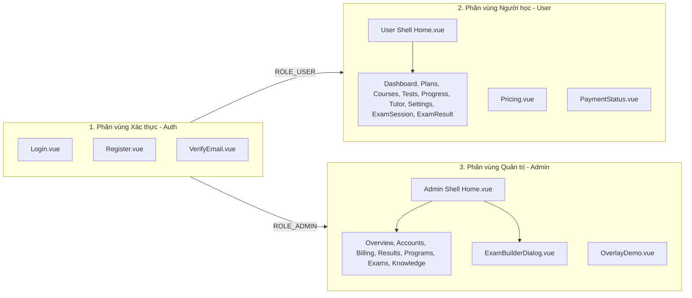
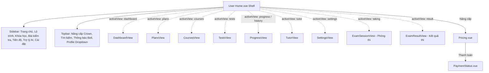
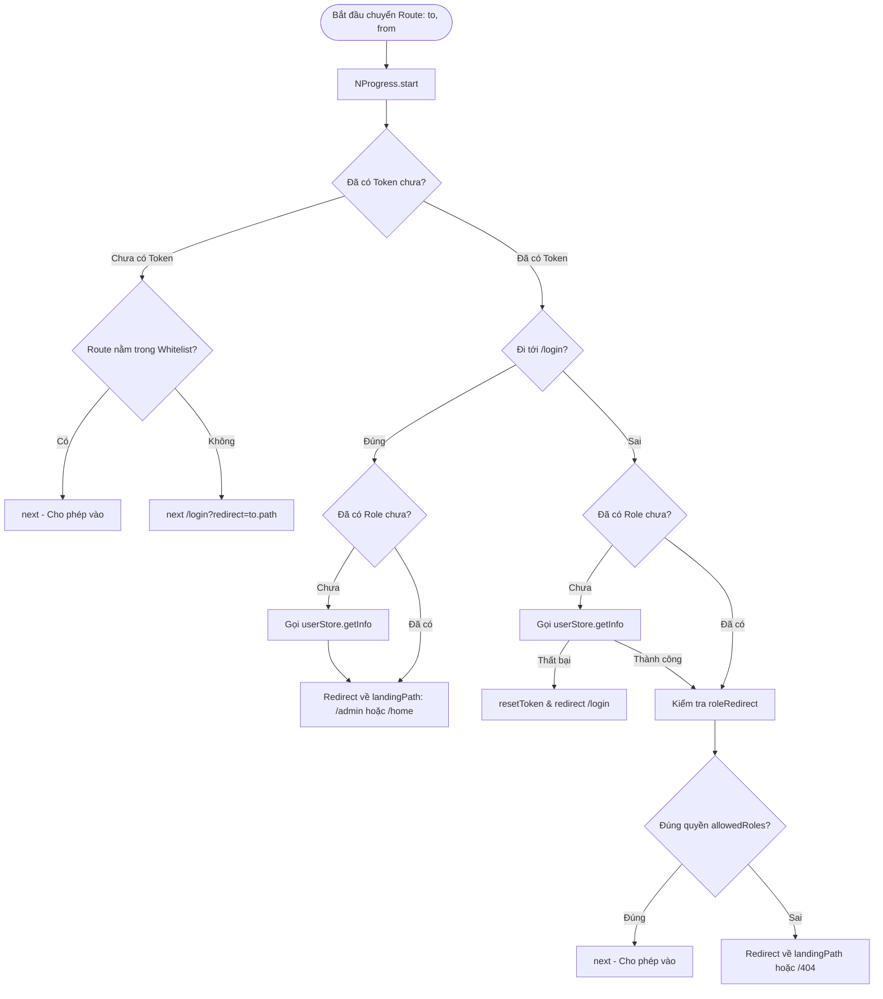

# BẢN ĐỒ GIAO DIỆN, ĐIỀU HƯỚNG VÀ PHÂN QUYỀN (AUTH, USER, ADMIN)
**Dự án:** Adaptive Learning Web Client  
**Thư mục mã nguồn:** `AdaptiveLearningFE/`  
**Tài liệu tham chiếu:** [FRONTEND_ARCHITECTURE.md](file:///d:/AdaptiveLearning/AdaptiveLearningFE/FRONTEND_ARCHITECTURE.md)  
**Định hướng thiết kế:** Light AI Education (Giao diện sáng, hiện đại, tối ưu trải nghiệm học tập và quản trị)  
**Vai trò:** Senior Frontend Architect & EdTech System Specialist  

---

## 1. Tổng quan ba khu vực: Auth, User và Admin

Ứng dụng frontend của Adaptive Learning được chia tách thành 3 phân vùng giao diện rõ rệt về đối tượng người dùng, đặc thù nghiệp vụ và cơ chế bảo vệ:



1. **Phân vùng Auth (Xác thực):**
   - Đảm nhận chu trình định danh người dùng: đăng nhập truyền thống, đăng ký tài khoản, gửi và xác minh OTP qua email, đăng nhập một chạm qua Google Identity Services (GSI).
   - Hoạt động ở chế độ công khai (nằm trong `routesWhiteList`), không yêu cầu token trước khi truy cập.
2. **Phân vùng User (Cổng thông tin người học):**
   - Không gian học tập cá nhân hóa dành cho học viên (`ROLE_USER`), sử dụng mô hình State Container tập trung tại [User/pages/Home.vue](file:///d:/AdaptiveLearning/AdaptiveLearningFE/src/features/User/pages/Home.vue).
   - Bao quát toàn bộ hành trình học viên: lộ trình mục tiêu (Plans), danh mục chứng chỉ (Courses), kho đề thi & luyện tập (Tests), phòng thi trực tuyến có đếm giờ và lưu đáp án real-time (ExamSession), báo cáo kết quả (ExamResult), biểu đồ kỹ năng (Progress), chatbot gia sư AI (Tutor), gói nâng cấp cước (Pricing) và đối soát thanh toán (PaymentStatus).
3. **Phân vùng Admin (Cổng thông tin quản trị hệ thống):**
   - Trung tâm điều hành dành riêng cho quản trị viên (`ROLE_ADMIN`), được xây dựng dưới dạng Single-Page Workspace tập trung tại [Admin/pages/Home.vue](file:///d:/AdaptiveLearning/AdaptiveLearningFE/src/features/Admin/pages/Home.vue).
   - Quản trị 7 phân hệ then chốt: Báo cáo phân tích học tập (Analytics Overview), Quản lý người dùng & phân quyền (Accounts), Quản trị gói cước & doanh thu (Billing), Giám sát bài thi của từng học viên (Results), Quản lý chứng chỉ kỳ thi (Programs), Điều phối đề thi & soạn thảo đề thi nâng cao (Exams & ExamBuilderDialog), và Quản trị kho tri thức RAG nạp tài liệu PDF phục vụ AI (Knowledge Base).

---

## 2. Bảng Route và Quyền truy cập đã xác minh

Dưới đây là bảng đối soát chi tiết giữa cấu hình Vue Router tại [src/router/](file:///d:/AdaptiveLearning/AdaptiveLearningFE/src/router/) và hệ thống Middleware bảo vệ tuyến đường tại [src/config/permission.js](file:///d:/AdaptiveLearning/AdaptiveLearningFE/src/config/permission.js):

| STT | Route (Path) | Khu vực | Component thực tế | Vai trò yêu cầu (`allowedRoles`) | Trạng thái bảo vệ | Hành vi điều hướng & Ghi chú |
| :---: | :--- | :---: | :--- | :---: | :---: | :--- |
| 1 | `/` | Redirect | — | Không | Công khai (Whitelist) | Redirect mặc định về `/home`. Khi chưa login, guard đẩy sang `/login`. |
| 2 | `/login` | Auth | [Login.vue](file:///d:/AdaptiveLearning/AdaptiveLearningFE/src/features/Auth/pages/Login.vue) | Không | Công khai (Whitelist) | Nếu đã có token, guard tự động đẩy về `/admin` hoặc `/home`. |
| 3 | `/register` | Auth | [Register.vue](file:///d:/AdaptiveLearning/AdaptiveLearningFE/src/features/Auth/pages/Register.vue) | Không | Công khai (Whitelist) | Màn hình đăng ký tài khoản học viên mới. |
| 4 | `/verify-email` | Auth | [VerifyEmail.vue](file:///d:/AdaptiveLearning/AdaptiveLearningFE/src/features/Auth/pages/VerifyEmail.vue) | Không | Công khai (Whitelist) | Xác minh OTP 6 số. Nếu thiếu `email` query, tự quay về `/register`. |
| 5 | `/home` | User | [Home.vue](file:///d:/AdaptiveLearning/AdaptiveLearningFE/src/features/User/pages/Home.vue) | `ROLE_USER` | Yêu cầu đăng nhập | Hiển thị view `dashboard`. Admin vào đây bị đẩy về `/admin`. |
| 6 | `/plans` | User | [Home.vue](file:///d:/AdaptiveLearning/AdaptiveLearningFE/src/features/User/pages/Home.vue) | `ROLE_USER` | Yêu cầu đăng nhập | Hiển thị view `plans` (Lộ trình học cá nhân hóa). |
| 7 | `/courses` | User | [Home.vue](file:///d:/AdaptiveLearning/AdaptiveLearningFE/src/features/User/pages/Home.vue) | `ROLE_USER` | Yêu cầu đăng nhập | Hiển thị view `courses` (Danh sách chứng chỉ & khóa học). |
| 8 | `/tests` | User | [Home.vue](file:///d:/AdaptiveLearning/AdaptiveLearningFE/src/features/User/pages/Home.vue) | `ROLE_USER` | Yêu cầu đăng nhập | Hiển thị view `tests` (Đề luyện tập, tạo đề, bài đang làm). |
| 9 | `/history` | User | [Home.vue](file:///d:/AdaptiveLearning/AdaptiveLearningFE/src/features/User/pages/Home.vue) | `ROLE_USER` | Yêu cầu đăng nhập | Hiển thị view `history` (Lịch sử làm bài thi). |
| 10 | `/progress` | User | [Home.vue](file:///d:/AdaptiveLearning/AdaptiveLearningFE/src/features/User/pages/Home.vue) | `ROLE_USER` | Yêu cầu đăng nhập | Hiển thị view `progress` (Biểu đồ điểm số & mức độ thành thạo). |
| 11 | `/tutor` | User | [Home.vue](file:///d:/AdaptiveLearning/AdaptiveLearningFE/src/features/User/pages/Home.vue) | `ROLE_USER` | Yêu cầu đăng nhập | Hiển thị view `tutor` (Gia sư AI). Gói Free bị chặn sang `/pricing`. |
| 12 | `/settings` | User | [Home.vue](file:///d:/AdaptiveLearning/AdaptiveLearningFE/src/features/User/pages/Home.vue) | `ROLE_USER` | Yêu cầu đăng nhập | Hiển thị view `settings` (Thông tin tài khoản & Đăng xuất). |
| 13 | `/pricing` | User | [Pricing.vue](file:///d:/AdaptiveLearning/AdaptiveLearningFE/src/features/User/pages/Pricing.vue) | `ROLE_USER` | Yêu cầu đăng nhập | Màn hình bảng giá so sánh Free vs Premium, tích hợp cổng thanh toán. |
| 14 | `/payment/success` | User | [PaymentStatus.vue](file:///d:/AdaptiveLearning/AdaptiveLearningFE/src/features/User/pages/PaymentStatus.vue) | `ROLE_USER` | Yêu cầu đăng nhập | Polling đối soát kết quả giao dịch thanh toán thành công. |
| 15 | `/payment/cancel` | User | [PaymentStatus.vue](file:///d:/AdaptiveLearning/AdaptiveLearningFE/src/features/User/pages/PaymentStatus.vue) | `ROLE_USER` | Yêu cầu đăng nhập | Thông báo hủy giao dịch, giữ nguyên hạn mức hiện tại. |
| 16 | `/admin` | Admin | [Home.vue](file:///d:/AdaptiveLearning/AdaptiveLearningFE/src/features/Admin/pages/Home.vue) | `ROLE_ADMIN` | Yêu cầu đăng nhập | Cổng quản trị tập trung. User vào đây bị đẩy về `/home`. |
| 17 | `/dev/overlays` | Admin | [OverlayDemo.vue](file:///d:/AdaptiveLearning/AdaptiveLearningFE/src/features/Admin/pages/OverlayDemo.vue) | `ROLE_ADMIN` | Yêu cầu đăng nhập | Màn hình phòng thí nghiệm UI & kiểm thử các component lớp phủ. |
| 18 | `/404` | Lỗi | [404.vue](file:///d:/AdaptiveLearning/AdaptiveLearningFE/src/features/InappropriatePath/pages/404.vue) | Không | Công khai (Whitelist) | Trang báo lỗi không tìm thấy đường dẫn kèm minh họa tọa độ. |
| 19 | `/:pathMatch(.*)*` | Fallback | — | Không | Công khai | Bắt toàn bộ URL không hợp lệ và redirect sang route `NotFound` (`/404`). |
| *20* | */403* | Lỗi | *Chưa có file* | Không | **Chưa đăng ký** | **BUG PHÁT HIỆN:** [Axios.js](file:///d:/AdaptiveLearning/AdaptiveLearningFE/src/services/Axios.js#L58) gọi `router.push('/403')` nhưng route này chưa có trong router, dẫn tới bị đẩy sang 404. |

---

## 3. Bản đồ Trang và Chức năng của Khu vực Auth

### 3.1. Trang Đăng nhập ([Login.vue](file:///d:/AdaptiveLearning/AdaptiveLearningFE/src/features/Auth/pages/Login.vue) & [LoginUi.vue](file:///d:/AdaptiveLearning/AdaptiveLearningFE/src/features/Auth/components/Login/LoginUi.vue))
- **Mục đích nghiệp vụ:** Xác thực danh tính người dùng và điều hướng về không gian làm việc tương ứng theo quyền.
- **Dữ liệu & Form Fields:**
  - `username`: Tên đăng nhập hoặc địa chỉ email. Validation: Zod `min(1, 'Vui lòng nhập tên đăng nhập.')`.
  - `password`: Mật khẩu tài khoản. Validation: Zod `min(1, 'Vui lòng nhập mật khẩu.')`.
  - `remember`: Checkbox "Ghi nhớ đăng nhập", lưu trạng thái và username vào `localStorage['adaptive-learning-username']`.
- **Trạng thái giao diện:**
  - `loading`: Nút đăng nhập hiển thị spinner, disable form.
  - `googleLoading`: Trạng thái chờ xác thực khi nhấn nút Google.
  - `errorMessage`: Hiển thị hộp thông báo lỗi màu đỏ nếu API trả về mã lỗi.
- **Hành động & Dịch vụ kết nối:**
  - `onSubmit(values)`: Gọi `userStore.login(values)` -> API `POST /api/v1/auth/login`.
  - `onGoogleSignIn(idToken)`: Gọi `userStore.loginWithGoogle(idToken)` -> API `POST /api/v1/auth/google`.
  - Nạp Google GSI: Khi mount, gọi `userService.googleConfig()` (`GET /api/v1/auth/google/config`), tự chèn script `https://accounts.google.com/gsi/client` và gọi `renderButton`.
- **Xử lý mã lỗi đặc thù:**
  - `AUTH-ERR-408`: Tên đăng nhập hoặc mật khẩu không chính xác.
  - `AUTH-ERR-413`: Tài khoản đã bị vô hiệu hóa.
  - `AUTH-ERR-409`: Không xác minh được tài khoản Google.
  - `AUTH-ERR-420`: Email chưa xác minh -> Tự động gọi `userService.resendVerification` và chuyển hướng sang `/verify-email?email=...`.
- **Điều hướng tiếp theo:**
  - Thành công: Đọc `userStore.state.role`. Nếu `ROLE_ADMIN` -> `/admin`, ngược lại -> `/home`.
  - Link phụ: Chuyển hướng sang `/register` ("Đăng ký ngay").

### 3.2. Trang Đăng ký ([Register.vue](file:///d:/AdaptiveLearning/AdaptiveLearningFE/src/features/Auth/pages/Register.vue))
- **Mục đích nghiệp vụ:** Cho phép học viên mới mở tài khoản trên hệ thống và kích hoạt luồng gửi OTP xác minh email.
- **Dữ liệu & Form Fields:**
  - `fullName`: Họ và tên người dùng (bắt buộc, trim).
  - `email`: Địa chỉ email hợp lệ (bắt buộc, trim, lowercase).
  - `password`: Mật khẩu (yêu cầu từ 8 đến 72 ký tự).
  - `confirmPassword`: Xác nhận mật khẩu (phải khớp chính xác với `password`).
  - `agreeTerms`: Checkbox đồng ý với Điều khoản sử dụng (bắt buộc `true`).
  - Nút đăng ký nhanh bằng tài khoản Google (tương tự luồng Google Sign-In).
- **Hành động & Dịch vụ kết nối:**
  - `submit()`: Gọi `userService.signUp(...)` -> API `POST /api/v1/auth/signup`.
  - Lưu tạm `adaptive-learning-fullname` vào `localStorage`.
- **Xử lý mã lỗi:**
  - `AUTH-ERR-405`: Email này đã được đăng ký.
  - `AUTH-ERR-424`: Vừa yêu cầu mã, hãy chờ rồi thử lại.
  - `AUTH-ERR-425`: Dịch vụ email chưa cấu hình trên máy chủ.
- **Điều hướng tiếp theo:**
  - Thành công: Toast "Mã xác minh đã được gửi" và chuyển ngay sang `/verify-email?email=...&expiresAt=...&resendAvailableAt=...`.
  - Link phụ: Chuyển hướng sang `/login` ("Đăng nhập ngay").

### 3.3. Trang Xác minh Email OTP ([VerifyEmail.vue](file:///d:/AdaptiveLearning/AdaptiveLearningFE/src/features/Auth/pages/VerifyEmail.vue))
- **Mục đích nghiệp vụ:** Xác thực quyền sở hữu hòm thư trước khi cho phép tài khoản hoạt động.
- **Dữ liệu & Form Fields:**
  - `email`: Nhận từ `route.query.email`. Nếu query rỗng -> tự động `router.replace('/register')`.
  - `code`: Mã OTP gồm các chữ số.
  - `expiresIn`: Bộ đếm ngược số giây còn hạn của mã OTP hiện tại.
  - `resendIn`: Bộ đếm ngược thời gian chờ để được bấm nút gửi lại mã mới.
- **Hành động & Dịch vụ kết nối:**
  - `submitCode()`: Gọi `userService.verifyEmail({ email, code })` -> API `POST /api/v1/auth/signup/verify`.
  - `resendCode()`: Gọi `userService.resendVerification({ email })` -> API `POST /api/v1/auth/signup/resend`. Cập nhật lại thời gian `expiresAt` và `resendAvailableAt`.
- **Trạng thái & Mã lỗi:**
  - `verified === true`: Chuyển giao diện sang màn hình chúc mừng kích hoạt thành công, hiện nút "Đăng nhập ngay" (`/login`).
  - `AUTH-ERR-421`: Mã chưa chính xác.
  - `AUTH-ERR-422`: Mã đã hết hạn.
  - `AUTH-ERR-424`: Đã đạt giới hạn thử hoặc gửi mã.

---

## 4. Bản đồ Trang và Chức năng của Khu vực User (Người học)

Toàn bộ các view người học từ mục 4.1 đến 4.9 được nhúng trong Shell điều hướng [User/pages/Home.vue](file:///d:/AdaptiveLearning/AdaptiveLearningFE/src/features/User/pages/Home.vue), chia sẻ trạng thái chung qua `provide(homeContextKey)`. Hai màn hình 4.10 và 4.11 là các trang độc lập.



### 4.1. Trang chủ Người học — DashboardView ([DashboardView.vue](file:///d:/AdaptiveLearning/AdaptiveLearningFE/src/features/User/components/views/DashboardView.vue))
- **Mục đích:** Bảng điều khiển trung tâm giúp học viên nắm bắt nhanh tiến độ, lộ trình đang học và các gợi ý bài học AI tiếp theo.
- **Dữ liệu hiển thị:**
  - Lời chào cá nhân hóa theo buổi: `home.greeting`, `home.greetingName`.
  - 3 chỉ số nhanh: Số lộ trình đang học (`activePlans.length`), số bài thi hoàn thành (`doneCount`), số đề luyện tập có sẵn (`publishedExams.length`).
  - Thẻ lộ trình đang học gần nhất (`activePlan`): Tên lộ trình, số giờ/tuần, thanh tiến độ %, ngày dự kiến thi, số nhiệm vụ hoàn thành.
  - Thẻ tóm tắt năng lực: Điểm trung bình (`averageScorePercent`), biểu đồ vòng tròn conic, danh sách 4 kỹ năng hàng đầu (`masterySkills`).
  - Danh sách gợi ý học tập AI (`activeRecommendations`): Tên kỹ năng, lý do gợi ý của AI, mức độ ưu tiên.
  - Cột phụ bên phải: Widget Trợ lý AI, Widget tiến độ tuần theo chứng chỉ (`selectedCertificateId`), Widget mục tiêu hiện tại.
- **Hành động:**
  - Chuyển màn hình nhanh: `home.showView('plans')`, `home.showView('tests')`, `home.showView('progress')`, `home.showView('tutor')`.
  - Bắt đầu thực hiện gợi ý học tập: `home.markRecommendationStarted(item)` -> gọi API `POST /api/v1/analytics/recommendations/${id}/start`.

### 4.2. Lộ trình học — PlansView ([PlansView.vue](file:///d:/AdaptiveLearning/AdaptiveLearningFE/src/features/User/components/views/PlansView.vue))
- **Mục đích:** Quản lý kế hoạch học tập theo mục tiêu điểm số và thời gian cam kết mỗi tuần.
- **Dữ liệu & Form:**
  - Danh sách kế hoạch: Tiêu đề, chứng chỉ liên kết, số giờ học/tuần, ngày thi, tiến độ nhiệm vụ.
  - Roadmap Track: Thanh đồ họa 3 mốc (01 Bắt đầu -> 02 Đang học -> 03 Hoàn thành).
  - Form tạo lộ trình mới: Tên lộ trình (max 200 ký tự), Chọn chứng chỉ, Ngày dự kiến thi, Điểm mục tiêu, Giờ học mỗi tuần (1–80 giờ).
- **Hành động & API:**
  - `home.createPlan()`: Gọi `POST /api/v1/plans` với payload `{ title, certificateId, targetScore, examDate, hoursPerWeek }`.
  - Mở/đóng form tạo kế hoạch qua biến cờ `home.showPlanForm`.

### 4.3. Khóa học & Chứng chỉ — CoursesView ([CoursesView.vue](file:///d:/AdaptiveLearning/AdaptiveLearningFE/src/features/User/components/views/CoursesView.vue))
- **Mục đích:** Duyệt các chương trình đào tạo/chứng chỉ (IELTS, TOEIC, THPT...) và theo dõi tỷ lệ hoàn thành theo từng chứng chỉ.
- **Dữ liệu:**
  - Danh sách chứng chỉ: Tên, mô tả, điểm mục tiêu (passingScore), tổng số đề thi thuộc chứng chỉ, tỷ lệ % bài học đã hoàn thành.
  - Ô tìm kiếm chứng chỉ theo từ khóa (`home.searchQuery`).
- **Hành động:**
  - Bấm "Bắt đầu học" hoặc "Tiếp tục học": Chuyển sang màn hình `tests`.

### 4.4. Bài kiểm tra & Luyện tập — TestsView ([TestsView.vue](file:///d:/AdaptiveLearning/AdaptiveLearningFE/src/features/User/components/views/TestsView.vue))
- **Mục đích:** Không gian chọn đề kiểm tra chuẩn, làm bài thi chưa hoàn thành và tạo đề luyện tập thích ứng theo template.
- **Dữ liệu:**
  - Banner hạn mức gói Free: Số lượt tạo đề đã dùng (`examsUsed` / `examLimit`), lượt còn lại (`examsRemaining`).
  - Danh sách "Bài đang làm" (`activeAttempts`): Các bài thi có trạng thái `IN_PROGRESS` chưa nộp.
  - Danh sách "Tạo đề luyện tập" (`examTemplates`): Template đề thi với thời lượng, số câu hỏi, số phần thi.
  - Danh sách "Đề kiểm tra của bạn" (`filteredExams`): Các đề thi chính thức đã xuất bản.
  - Widget "Lịch sử gần đây": 3 lượt thi mới nhất kèm điểm số.
- **Hành động & API:**
  - `home.resumeAttempt(item)`: Gọi `GET /api/v1/attempts/${id}` và `GET /api/v1/exams/${examId}/detail` -> chuyển sang màn hình phòng thi `taking`.
  - `home.createPracticeExam(template)`: Gọi `POST /api/v1/exam-templates/${templateId}/generate`. Nếu hết quota Free, tự động redirect sang `/pricing`.
  - `home.startExam(exam)`: Gọi `POST /api/v1/attempts/start { examId }` -> kích hoạt phòng thi `taking`.

### 4.5. Phòng thi Trực tuyến — ExamSessionView ([ExamSessionView.vue](file:///d:/AdaptiveLearning/AdaptiveLearningFE/src/features/User/components/views/ExamSessionView.vue))
- **Mục đích:** Giao diện làm bài thi tập trung, có đồng hồ đếm ngược và cơ chế lưu bài thi an toàn.
- **Dữ liệu:**
  - Tiêu đề đề thi, thông tin phần thi (`sectionName`), điểm số từng câu (`points`).
  - Đồng hồ đếm ngược (`home.formattedTimeLeft`), cảnh báo màu đỏ (`urgent`) khi thời gian dưới 300 giây (5 phút).
  - Trạng thái tự động lưu (`home.saveState`): "Đang lưu đáp án...", "Đã lưu đáp án", "Đáp án sẽ được gửi khi nộp bài".
  - Nội dung câu hỏi và các lựa chọn trắc nghiệm (radio) hoặc ô nhập tự luận (textarea).
- **Hành vi nghiệp vụ bắt buộc bảo toàn tuyệt đối:**
  1. **Tự động lưu câu trả lời (Auto-Save Debounce 350ms):** Mỗi khi học viên chọn đáp án hoặc gõ chữ, hàm `saveAnswer` hủy timer cũ và sau 350ms tự động gửi API `PATCH /api/v1/attempts/${id}/answers`.
  2. **Bắt buộc xác nhận khi rời phòng thi:** Nút "Rời bài thi" (`leaveAttempt`) kích hoạt hộp thoại `confirm({ title: 'Rời bài thi?', description: 'Lượt thi hiện tại vẫn được lưu.' })`. Không được cho phép người dùng vô tình thoát mà không xác nhận.
  3. **Tự động thu bài khi hết giờ:** Khi nhận mã lỗi `ATTEMPT-ERR-410` (hết giờ thi), hàm `finishExpiredAttempt` lập tức hủy đồng hồ, xóa timer lưu đáp án và đẩy về trang kết quả.
  4. **Nộp bài chính thức:** `home.submitExam()` gọi API `POST /api/v1/attempts/${id}/submit` gửi danh sách toàn bộ câu trả lời, nhận kết quả và chuyển view sang `result`.

### 4.6. Kết quả bài thi — ExamResultView ([ExamResultView.vue](file:///d:/AdaptiveLearning/AdaptiveLearningFE/src/features/User/components/views/ExamResultView.vue))
- **Mục đích:** Báo cáo chi tiết điểm số ngay sau khi nộp bài thi.
- **Dữ liệu:** Tổng điểm đạt được trên thang điểm tối đa (`score / maxScore`), số câu Đúng (`correctCount`), số câu Sai (`wrongCount`), số câu Bỏ trống (`unansweredCount`).
- **Hành động:** Nút "Về trang chủ" (`home.showView('dashboard')`).

### 4.7. Thống kê tiến độ & Lịch sử — ProgressView ([ProgressView.vue](file:///d:/AdaptiveLearning/AdaptiveLearningFE/src/features/User/components/views/ProgressView.vue))
- **Mục đích:** Phân tích trực quan quá trình rèn luyện, độ thành thạo từng kỹ năng và bảng tra cứu toàn bộ lịch sử làm bài.
- **Dữ liệu:**
  - Bộ lọc chọn chứng chỉ (`home.selectedCertificateId`).
  - Chỉ số trung bình: Điểm TB, Lượt làm bài, Lộ trình đang học.
  - Biểu đồ cột xu hướng điểm thi (`scoreTrend`) và vòng tròn điểm trung bình.
  - Thanh tiến độ mức độ thành thạo kỹ năng (`masterySkills`) tính toán từ JSON `masteryBySkillJson`.
  - Danh sách toàn bộ lịch sử các bài thi đã làm (`home.history`).

### 4.8. Trợ lý học tập AI — TutorView ([TutorView.vue](file:///d:/AdaptiveLearning/AdaptiveLearningFE/src/features/User/components/views/TutorView.vue))
- **Mục đích:** Không gian tương tác thông minh với gia sư AI để giải đáp thắc mắc, phân tích câu hỏi khó và gợi ý ôn tập.
- **Dữ liệu:**
  - Danh sách cuộc hội thoại bên trái (`conversations`), nút tạo cuộc hội thoại mới.
  - Luồng tin nhắn chat ở giữa (`messages`): Phân biệt bubble người dùng (`USER`) và bong bóng trợ lý (`ASSISTANT`).
  - Hộp soạn thảo chat (`tutorPrompt`), hỗ trợ phím Enter để gửi.
  - Bảng tính năng gợi ý bên phải: "Giải thích bài học", "Gợi ý lộ trình", "Hỗ trợ code", "Tạo bài luyện".
- **Hành động & API:**
  - `home.askTutor()`: Gọi `POST /api/v1/tutor/conversations/${id}/messages` gửi câu hỏi và nhận câu trả lời từ AI.
  - Chặn quyền: Nếu tài khoản là Free (`!isPremium`), khi cố truy cập Tutor sẽ bị điều hướng ngay sang `/pricing`.

### 4.9. Cài đặt tài khoản — SettingsView ([SettingsView.vue](file:///d:/AdaptiveLearning/AdaptiveLearningFE/src/features/User/components/views/SettingsView.vue))
- **Mục đích:** Xem thông tin tài khoản hiện tại và thực hiện đăng xuất.
- **Dữ liệu:** Avatar viết tắt ký tự đầu, Tên người dùng, Nhãn vai trò (Học viên).
- **Hành động:** Nút "Đăng xuất" (`home.logout()`).

### 4.10. Bảng giá gói cước — Pricing ([Pricing.vue](file:///d:/AdaptiveLearning/AdaptiveLearningFE/src/features/User/pages/Pricing.vue))
- **Mục đích:** Trang Paywall cung cấp thông tin so sánh giữa gói Miễn phí và Gói Premium trọn đời, hỗ trợ thanh toán trực tuyến.
- **Dữ liệu:**
  - Quyền lợi gói hiện tại: gọi `paymentService.entitlements()` (`GET /api/v1/me/entitlements`).
  - Gói Free: Danh sách tính năng, hạn mức tạo đề còn lại (`examsRemaining` / `examLimit`).
  - Gói Premium: Giá tiền định dạng VND/USD, quyền lợi không giới hạn đề thi, mở khóa Gia sư AI và đầy đủ 4 kỹ năng.
- **Hành động & API:**
  - `checkout(provider)`: Gọi `POST /api/v1/payments/checkout { provider }` -> nhận `redirectUrl` và chuyển hướng trình duyệt sang cổng thanh toán bên thứ ba.

### 4.11. Trạng thái thanh toán — PaymentStatus ([PaymentStatus.vue](file:///d:/AdaptiveLearning/AdaptiveLearningFE/src/features/User/pages/PaymentStatus.vue))
- **Mục đích:** Xử lý kết quả trả về sau khi người dùng thực hiện giao dịch thanh toán từ cổng trung gian.
- **Cơ chế Polling:**
  - Nếu URL là `/payment/cancel`: Dừng ngay, hiển thị thông báo "Giao dịch đã hủy".
  - Nếu URL là `/payment/success`: Lấy `paymentId` từ query, thiết lập hàm `pollPayment` lặp lại mỗi 2.5 giây gọi `paymentService.status(paymentId)`.
  - Hạn định (Timeout): Nếu sau 60 giây giao dịch vẫn ở trạng thái `PENDING`, hiển thị cảnh báo hết giờ chờ và hướng dẫn liên hệ hỗ trợ.
  - Khi trạng thái chuyển sang `SUCCEEDED`: Dừng polling, làm mới lại thông tin gói học qua `paymentService.entitlements()` và cung cấp nút quay về trang học tập.

---

## 5. Bản đồ Phân hệ và Chức năng của Khu vực Admin

Toàn bộ trung tâm điều hành quản trị viên được tích hợp trong file monolithic [Admin/pages/Home.vue](file:///d:/AdaptiveLearning/AdaptiveLearningFE/src/features/Admin/pages/Home.vue) (4.925 dòng mã). Phân hệ được điều phối qua biến `activeSection` tương ứng với query parameter `route.query.section`:

```
Admin Shell (Home.vue)
├── 1. overview   : Báo cáo học tập & phân tích điểm số
├── 2. accounts   : Quản lý người dùng, phân quyền, trạng thái
├── 3. billing    : Quản lý gói cước, hạn mức học viên & doanh thu
├── 4. results    : Giám sát kết quả & chi tiết bài thi của học viên
├── 5. programs   : Danh mục chứng chỉ & kỳ thi chuẩn
├── 6. exams      : Danh sách bài kiểm tra & ExamBuilderDialog
└── 7. knowledge  : Kho tri thức RAG, nạp PDF & quản lý chunks
```

### 5.1. Phân hệ Báo cáo Tổng quan — `overview`
- **Cách truy cập:** Menu sidebar "Báo cáo tổng quan" hoặc URL `/admin?section=overview`.
- **Dữ liệu & Bộ lọc:**
  - Bộ lọc khoảng thời gian: `7d`, `30d`, `90d`, `all`.
  - Bộ lọc theo kỳ thi/chương trình đào tạo (`analyticsCertificateId`).
  - Chỉ số KPI chính: Tỷ lệ hoàn thành lượt thi (kèm delta so với kỳ trước), Điểm trung bình, Tỷ lệ đạt (pass rate), Số học viên hoạt động.
  - Biểu đồ kết hợp SVG: Đường biểu diễn điểm số trung bình qua các tuần kết hợp các cột xám biểu thị số lượng lượt thi.
  - Chức năng dữ liệu mẫu: Nút "Xem dữ liệu minh họa" (`showAnalyticsSample = true`) hỗ trợ xem trước bố cục khi hệ thống mới chưa có nhiều dữ liệu thật.
- **Dịch vụ API:** Gọi `adminService.analytics(filters)` (`GET /api/v1/admin/users/analytics`).

### 5.2. Phân hệ Quản lý Tài khoản — `accounts`
- **Cách truy cập:** Menu sidebar "Tài khoản người dùng" hoặc URL `/admin?section=accounts`.
- **Dữ liệu & Bảng quản lý:**
  - Bảng danh sách tài khoản: Username, Avatar, Loại tài khoản (`ROLE_USER` / `ROLE_ADMIN`), Gói cước (`FREE` / `PREMIUM`), Trạng thái kích hoạt (Hoạt động / Đã khóa / Chờ xác minh email).
  - Ô tìm kiếm tài khoản theo username hoặc email.
- **Thao tác quản trị trực tiếp trên bảng (Inline Actions):**
  - Đổi vai trò (Role): Dropdown thay đổi tức thì, gọi `adminService.updateUserRole(userId, role)`.
  - Đổi gói học (Plan): Dropdown chuyển đổi giữa Free và Premium, gọi `adminService.updateUserPlan(userId, plan)`.
  - Khóa / Mở khóa: Nút bấm đảo trạng thái, gọi `adminService.updateUserStatus(userId, enabled)`.
  - Xem tiến độ học viên: Chuyển thẳng sang phân hệ `results` và tự động chọn học viên này (`openLearnerReport`).
  - Thêm tài khoản mới: Nút "Tạo tài khoản" mở modal form gọi `adminService.createUser(payload)`.

### 5.3. Phân hệ Quản lý Gói cước & Tài chính — `billing`
- **Cách truy cập:** Menu sidebar "Gói cước & tài chính" hoặc URL `/admin?section=billing`.
- **Chỉ số tài chính hàng đầu:** Tổng doanh thu (USD), Số đơn thanh toán thành công, Tỷ lệ học viên gói Premium, Số gói đang mở bán.
- **Gồm 3 tab con chuyên biệt (`billingSubTab`):**
  1. **Tab `plans` (Quản lý các gói thanh toán):**
     - Bảng danh mục gói: Mã gói, Tên gói, Giá tiền, Chu kỳ thanh toán (LIFETIME...), Hạn mức tạo đề (-1 là không giới hạn), Trạng thái mở bán.
     - Modal tạo / sửa gói cước (`openPlanModal`): Điền mã, tên, giá, hạn mức, tính năng gói -> gọi `adminService.createPlan` hoặc `adminService.updatePlan`.
     - Thao tác bật/tắt bán gói (`togglePlan`) và xóa gói (`deletePlan`).
  2. **Tab `users` (Học viên & Gói cước):**
     - Bảng theo dõi hạn mức từng học viên: Username, Gói cước, Thanh đo hạn mức tạo đề đã dùng, Số đơn giao dịch.
     - Xem lịch sử thanh toán cá nhân: Mở Drawer trượt từ cạnh phải (`userPaymentsDrawerOpen`) hiển thị toàn bộ giao dịch của học viên đó qua `adminService.userPayments(userId)`.
     - Đặt lại hạn mức: Nút "Reset Quota" gọi `adminService.resetUserQuota(userId)`.
  3. **Tab `payments` (Lịch sử giao dịch toàn hệ thống):**
     - Bảng giao dịch tài chính: ID giao dịch, Tài khoản, Cổng thanh toán (Stripe, VNPay...), Số tiền, Trạng thái (SUCCEEDED, PENDING, FAILED), Thời gian tạo.
     - Bộ lọc tìm kiếm theo từ khóa, lọc theo trạng thái giao dịch và lọc theo nhà cung cấp cổng thanh toán.

### 5.4. Phân hệ Báo cáo Học viên — `results`
- **Cách truy cập:** Menu sidebar "Kết quả làm bài" hoặc URL `/admin?section=results`.
- **Dữ liệu & Bộ lọc:**
  - Chọn học viên (`selectedLearnerId`) từ danh sách và chọn kỳ thi/chương trình (`learnerCertificateId`).
  - Thẻ tóm tắt: Lượt thi hoàn thành, Điểm trung bình %, Điểm lần thi gần nhất, Số kỹ năng có dữ liệu.
  - Bảng lịch sử bài thi chi tiết: Tên bài thi, Ngày làm, Trạng thái chấm điểm, Điểm số, Band điểm, Số lần vi phạm quy chế thi.
  - Bảng phân tích mức độ thành thạo từng kỹ năng từ JSON `masteryBySkillJson`.
  - Biểu đồ cột diễn biến điểm qua các lần thi.
- **Thao tác chuyên sâu:** Nút "Chi tiết" mở Modal `attemptResultOpen` tải toàn bộ câu trả lời, câu hỏi và đáp án đúng qua API `adminService.attemptResult(attemptId)`.

### 5.5. Phân hệ Danh mục Chứng chỉ & Kỳ thi — `programs`
- **Cách truy cập:** Menu sidebar "Chứng chỉ & kỳ thi" hoặc URL `/admin?section=programs`.
- **Dữ liệu & Bảng quản lý:**
  - Bảng danh mục: Tên chứng chỉ, Mã code, Mô tả, Tổng điểm tối đa, Điểm mục tiêu (Passing Score/Band), Danh sách kỹ năng/môn thi, Số lượng đề thi hiện có.
  - Bộ nút khởi tạo mẫu nhanh (Presets) khi hệ thống rỗng: IELTS (Thang 9.0), TOEIC (Thang 990), THPT Quốc Gia (Thang 10).
- **Thao tác:**
  - Mở modal thêm/sửa chứng chỉ (`openProgram`): Gọi `adminService.createCertificate` hoặc `adminService.updateCertificate`.
  - Xóa chứng chỉ (`deleteProgram`): Hộp thoại xác nhận gọi `adminService.deleteCertificate(id)`.

### 5.6. Phân hệ Quản lý Bài kiểm tra — `exams`
- **Cách truy cập:** Menu sidebar "Bài kiểm tra" hoặc URL `/admin?section=exams`.
- **Dữ liệu & Bảng quản lý:**
  - Bảng đề thi: Tên đề, Mô tả, Chứng chỉ & Kỹ năng liên kết, Điểm mục tiêu, Thời lượng làm bài (phút), Số lượng câu hỏi, Trạng thái (Đã phát hành / Bản nháp).
- **Thao tác Soạn thảo đề thi nâng cao ([ExamBuilderDialog.vue](file:///d:/AdaptiveLearning/AdaptiveLearningFE/src/features/Admin/components/ExamBuilderDialog.vue)):**
  - Nhấn nút "Tạo bài kiểm tra" mở hộp thoại ExamBuilderDialog đa giai đoạn:
    1. *Giai đoạn cấu hình (Builder):* Chọn chứng chỉ, chủ đề, thời lượng, thang điểm mục tiêu, thiết lập các phần thi (Sections) kèm phân bổ độ khó.
    2. *Giai đoạn chọn câu hỏi (Candidate Selection):* Tải danh sách ngân hàng câu hỏi qua `adminService.questions`, cho phép admin tìm kiếm, lọc và chọn thủ công các câu hỏi vào từng section.
    3. *Giai đoạn mô phỏng thi (Simulation Mode):* Trình mô phỏng phòng thi dành riêng cho admin kiểm thử đề thi trước khi phát hành, có đồng hồ chạy thử, bảng điều hướng câu hỏi và đánh dấu cờ (flag).
    4. *Cơ chế lưu nháp an toàn (Draft Persistence):* Tự động lưu toàn bộ dữ liệu đang soạn vào `localStorage` theo key `adaptive-learning.exam-builder-draft.v1:admin` để không bị mất khi reload.

### 5.7. Phân hệ Kho tri thức AI (RAG) — `knowledge`
- **Cách truy cập:** Menu sidebar "Kho kiến thức" hoặc URL `/admin?section=knowledge`.
- **Dữ liệu & Thẻ KPI:**
  - 4 thẻ thống kê: Tổng tài liệu PDF, Số tài liệu đang sử dụng, Số tài liệu đã tắt, Tổng số đoạn tri thức (chunks) được AI phân tích.
- **Cột Trái — Nạp tài liệu vào kho:**
  - Vùng kéo thả tệp PDF đa tệp (hỗ trợ kéo thả `dropKnowledgeFiles`, dung lượng tối đa 20MB/file).
  - Chọn kỳ thi (`certificateId`) và gắn nhãn kỹ năng (`topicId`).
  - Hàng đợi tệp (Queue) cho phép sửa tiêu đề từng file trước khi tải lên.
  - Gửi API qua `adminService.uploadKnowledgePdf(formData)` với timeout mở rộng 120 giây.
- **Cột Phải — Thư viện tài liệu đã nhập:**
  - Thanh tìm kiếm và bộ lọc trạng thái (Tất cả, Đang dùng, Đã tắt).
  - Danh sách tài liệu kèm số lượng chunks và dung lượng file.
  - Thao tác: Bật/Tắt kích hoạt tài liệu (`setKnowledgeDocumentActive`), Xem chi tiết đoạn chunks, Xóa tài liệu (`deleteKnowledgeDocument`), Chỉnh sửa nội dung tài liệu qua Drawer trượt (`knowledgeEditorOpen`).

---

## 6. Kiểm tra Routing, Route Guards và Phân quyền

### 6.1. Ma trận Route Guard & Phân quyền
Toàn bộ luồng điều hướng được kiểm soát nghiêm ngặt tại [permission.js](file:///d:/AdaptiveLearning/AdaptiveLearningFE/src/config/permission.js):



### 6.2. Phát hiện bất nhất và lỗi tiềm ẩn trong Routing:
1. **Lỗi chuyển hướng mã 403:** Trong [Axios.js:L58](file:///d:/AdaptiveLearning/AdaptiveLearningFE/src/services/Axios.js#L58), khi backend trả về HTTP 403, code chạy `router.push({ path: '/403' })`. Nhưng trong [src/router/](file:///d:/AdaptiveLearning/AdaptiveLearningFE/src/router/) không hề có route `/403`. Kết quả là người dùng bị đẩy vào route fallback `/:pathMatch(.*)*` và hiển thị trang `404 Not Found`.
2. **Khác biệt giữa URL và Kiến trúc View của User:** Người dùng nhìn thấy các URL khác nhau (`/home`, `/plans`, `/courses`, `/tests`, `/progress`, `/tutor`, `/settings`), nhưng Vue Router thực chất chỉ load 1 component duy nhất là [Home.vue](file:///d:/AdaptiveLearning/AdaptiveLearningFE/src/features/User/pages/Home.vue). Khi F5 trong phòng thi (`activeView === 'taking'`), view bị trả về dashboard mặc định.
3. **Phân hệ Admin dùng Query Parameter thay vì Route Path:** Toàn bộ 7 phân hệ của Admin (`overview`, `accounts`, `billing`, `results`, `programs`, `exams`, `knowledge`) đều chạy trên URL `/admin?section=...` mà không có nested routes (`/admin/accounts`, `/admin/billing`...). Điều này khiến lịch sử trình duyệt (Back/Forward) không phản ánh đúng từng thao tác của Admin.

---

## 7. Xây dựng Bản đồ Giao diện Dùng chung (Shared UI Map)

Dưới đây là bảng phân loại và đánh giá khả năng tái sử dụng của các thành phần giao diện phục vụ xây dựng **UI Kit Light AI Education**:

| Thành phần UI | Trạng thái hiện tại | Phân loại | Giải pháp chuẩn hóa theo Light AI Education |
| :--- | :--- | :---: | :--- |
| **Modal / Dialog** | [src/components/ui/overlay/Modal.vue](file:///d:/AdaptiveLearning/AdaptiveLearningFE/src/components/ui/overlay/Modal.vue) | **Đã có & dùng tốt** | Giữ nguyên API và logic animation; cập nhật lại bo góc (`rounded-2xl`), đổ bóng sáng và viền kính nhẹ. |
| **Drawer (Slide-over)**| [src/components/ui/overlay/Drawer.vue](file:///d:/AdaptiveLearning/AdaptiveLearningFE/src/components/ui/overlay/Drawer.vue) | **Đã có & dùng tốt** | Sử dụng cho chi tiết giao dịch, lịch sử học tập và trình chỉnh sửa RAG. Cập nhật nền trắng mờ và header sáng. |
| **Confirm Dialog** | [ConfirmDialog.vue](file:///d:/AdaptiveLearning/AdaptiveLearningFE/src/components/ui/overlay/ConfirmDialog.vue) + `useConfirm` | **Đã có & dùng tốt** | Giữ nguyên API Promise. Chuẩn hóa nút xác nhận đỏ cho hành động nguy hiểm và xanh cho rời phòng thi. |
| **Toast Notifications**| [Toaster.vue](file:///d:/AdaptiveLearning/AdaptiveLearningFE/src/components/ui/overlay/Toaster.vue) + `toast` | **Đã có & dùng tốt** | Hệ thống toast hoạt động ổn định. Cần tinh chỉnh typography và viền nhẹ theo phong cách sáng. |
| **Dropdown Menu** | [DropdownMenu.vue](file:///d:/AdaptiveLearning/AdaptiveLearningFE/src/components/ui/overlay/DropdownMenu.vue) | **Đã có & dùng tốt** | Giữ nguyên implementation trong `overlay`. Đã có sẵn hỗ trợ status cycle và switch thông báo. |
| **Tooltip / Popover** | [Tooltip.vue](file:///d:/AdaptiveLearning/AdaptiveLearningFE/src/components/ui/overlay/Tooltip.vue), [Popover.vue](file:///d:/AdaptiveLearning/AdaptiveLearningFE/src/components/ui/overlay/Popover.vue) | **Đã có & dùng tốt** | Đang chạy trên Reka UI, sẵn sàng tái sử dụng. |
| **Button (Nút bấm)** | [Button.vue](file:///d:/AdaptiveLearning/AdaptiveLearningFE/src/components/ui/button/Button.vue) (CVA) + Class CSS phân tán | **Cần chuẩn hóa** | Hiện tại code toàn dùng `<button class="primary-button">`. Cần quy chuẩn hóa toàn bộ về component `Button.vue` với các biến thể: `primary` (Teal/Indigo), `secondary`, `outline`, `ghost`, `danger`. |
| **Input / Textarea** | [Input.vue](file:///d:/AdaptiveLearning/AdaptiveLearningFE/src/components/ui/input/Input.vue) + Input HTML thuần | **Cần chuẩn hóa** | Tạo component form control đồng nhất có icon prefix/suffix, trạng thái focus viền sáng, thông báo lỗi validation. |
| **Select / Dropdown chọn**| Thẻ `<select>` HTML thuần với class CSS cục bộ | **Cần chuẩn hóa** | Thay thế bằng component `UiSelect` có giao diện sáng, bo góc mượt, hỗ trợ tìm kiếm khi danh sách dài. |
| **Badge / Status Pill** | Phân tán: `.status-label`, `.plan-status`, `.account-state` | **Cần chuẩn hóa** | Xây dựng component `Badge.vue` hỗ trợ các tông màu nhạt (pastel): Xanh lá (Hoạt động/Đã nộp), Vàng (Chờ xử lý), Đỏ (Đã khóa/Hết hạn), Tím (Premium). |
| **Thẻ dữ liệu (Cards)**| Trùng lặp: `.continue-card`, `.knowledge-stat`, `.billing-stat-card` | **Tách từ code hiện tại** | Xây dựng bộ `UiCard`, `StatCard` với nền trắng tinh khôi, viền siêu mảnh `#E6EAF2` và bóng đổ vi mô (`shadow-sm`). |
| **Bảng dữ liệu (Table)**| Bảng HTML `table.admin-table` lặp lại ở 6 phân hệ | **Tách từ code hiện tại** | Xây dựng `DataTable.vue` dùng chung cho cả Admin và User (lịch sử thi), tích hợp trạng thái rỗng và phân trang. |
| **App Shell Layouts** | Nằm lẫn trong `User/Home.vue` và `Admin/Home.vue` | **Tách từ code hiện tại** | Tách hẳn thành `LearnerLayout.vue` và `AdminLayout.vue` với `Sidebar`, `Topbar`, `UserProfileMenu` độc lập. |
| **Countdown Timer** | Viết lặp lại ở ExamSessionView và ExamBuilderDialog | **Tách từ code hiện tại** | Tách thành composable `useCountdown` hoặc component `ExamTimer.vue` dùng chung. |
| **Empty State** | Lặp lại ở 8 màn hình: `.empty-page`, `.empty-inline`, `.skills-empty` | **Tách từ code hiện tại** | Xây dựng component `EmptyState.vue` gồm: Icon minh họa, Tiêu đề, Mô tả và Nút kêu gọi hành động (CTA). |
| **Skeleton Loader** | Chưa có (chỉ có spinner toàn màn hình `Loading.vue`) | **Xây dựng mới ở UI Kit** | Xây dựng `Skeleton.vue` để thay thế màn hình chờ khi tải dữ liệu bảng và thẻ thống kê. |
| **Tabs Navigation** | Nút bấm thủ công (`billingSubTab`) | **Xây dựng mới ở UI Kit** | Chuẩn hóa thanh chuyển tab ngang phong cách hiện đại (active pill indicator). |

---

## 8. Các vấn đề UX cần ưu tiên cải thiện khi Redesign

1. **Thống nhất màu sắc nhận diện (Brand Visual Identity):**
   - Loại bỏ hoàn toàn sự xung đột giữa màu Xanh ngọc (`#0F766E` định nghĩa ở tokens) và màu Xanh dương (`#2868F4` hardcode trong code).
   - Thiết lập bảng màu chuẩn **Light AI Education**: Màu chủ đạo là Xanh ngọc tri thức (Deep Teal `#0F766E` kết hợp Cyan mềm mại `#0E7490`), nhấn nhá màu Tím AI cá nhân hóa (`#7C3AED`) cho các tính năng thông minh.
2. **Tối ưu trải nghiệm làm bài thi (Exam Taking UX):**
   - Phòng thi hiện tại trình bày toàn bộ danh sách câu hỏi dạng cuộn dài (infinite scroll) dễ gây ngợp. Cần bổ sung **Bảng câu hỏi điều hướng nhanh (Question Palette Grid)** bên cạnh để học viên biết câu nào đã trả lời, câu nào chưa làm và gắn cờ (Flag) câu khó.
3. **Phân rã Monolith và hỗ trợ Deep Linking:**
   - Khi Admin hoặc User đang mở một tab/modal mà vô tình tải lại trang, trạng thái bị mất hoàn toàn do lưu ở biến local. Cần hỗ trợ lưu trạng thái vào URL query params hoặc chia route con chuẩn.
4. **Trải nghiệm Chat Gia sư AI (Tutor UX):**
   - Khu vực chat cần hỗ trợ định dạng Markdown cho câu trả lời của AI (tiêu đề, danh sách gạch đầu dòng, khối code cú pháp), tự động cuộn xuống cuối khi có tin nhắn mới và hiển thị hiệu ứng gõ chữ (typing indicator) sinh động.
5. **Cải thiện hiển thị trên thiết bị di động (Mobile UX):**
   - Bảng biểu của Admin hiện tại bị tràn ngang trên màn hình nhỏ. Cần chuẩn hóa chế độ xem Card List cho mobile thay vì ép buộc cuộn ngang bảng.

---

## 9. Những Logic Nghiệp vụ Bắt buộc Bảo toàn

Trong quá trình tái thiết kế giao diện ở các giai đoạn sau, những luồng xử lý sau **tuyệt đối không được thay đổi logic hoặc làm đứt gãy**:

1. **Cơ chế Lưu bài thi Real-time (Auto-Save):**
   - Giữ nguyên hàm `saveAnswer` với debounce 350ms gọi `learningService.saveAnswer(attemptId, answer)` trong [ExamSessionView.vue](file:///d:/AdaptiveLearning/AdaptiveLearningFE/src/features/User/components/views/ExamSessionView.vue).
   - Bảo toàn hộp thoại xác nhận `confirm()` khi người dùng bấm rời bài thi để tránh mất quyền lợi làm bài.
   - Bảo toàn logic tự động nộp bài khi hết giờ (xử lý mã lỗi `ATTEMPT-ERR-410`).
2. **Cơ chế Paywall & Kiểm soát Hạn mức:**
   - Giữ nguyên interceptor trong [Axios.js](file:///d:/AdaptiveLearning/AdaptiveLearningFE/src/services/Axios.js) tự động chuyển hướng sang `/pricing` khi backend trả về `PREMIUM_REQUIRED` hoặc `FREE_LIMIT_REACHED`.
   - Giữ nguyên việc khóa truy cập Trợ lý AI khi `!isPremium` và chặn nút tạo đề luyện tập khi `examsRemaining <= 0`.
3. **Xác thực Google OAuth (GSI):**
   - Giữ nguyên luồng lấy Client ID động qua `userService.googleConfig()` và chèn script Google Client. Không hardcode Client ID vào source code.
4. **Quy tắc Phân quyền Tuyến đường (Route Guard):**
   - Giữ nguyên hàm `landingPath` và `roleRedirect` trong [permission.js](file:///d:/AdaptiveLearning/AdaptiveLearningFE/src/config/permission.js): Admin phải luôn hạ cánh ở `/admin`, User phải luôn hạ cánh ở `/home`.
5. **Đồng bộ Dữ liệu Lớp phủ Toàn cục:**
   - Giữ nguyên các Provider bọc ở [App.vue](file:///d:/AdaptiveLearning/AdaptiveLearningFE/src/App.vue): `<ConfirmProvider>`, `<TooltipProvider>`, `<Toaster />`, và `<Loading />`.

---

## 10. Các điểm bất nhất và Lỗi tiềm ẩn phát hiện được

1. **Chức năng Đổi mật khẩu chỉ là Mockup:**
   - Trong cả hai file [User/pages/Home.vue:L110](file:///d:/AdaptiveLearning/AdaptiveLearningFE/src/features/User/pages/Home.vue#L110) và [Admin/pages/Home.vue:L192](file:///d:/AdaptiveLearning/AdaptiveLearningFE/src/features/Admin/pages/Home.vue#L192), hàm `handleChangePassword` và `handleAdminChangePassword` đều chỉ dùng `setTimeout(..., 400)` để hiển thị toast "Đổi mật khẩu thành công!" mà không hề gọi API đổi mật khẩu thực tế lên backend.
2. **API Sinh nội dung AI chưa có giao diện:**
   - Trong [adminService.js](file:///d:/AdaptiveLearning/AdaptiveLearningFE/src/services/adminService.js), có khai báo hai endpoint `generateQuestions` (`/api/v1/content-generation`) và `applyGeneratedQuestions`, nhưng trong giao diện của Admin không có nút bấm hay form nào kích hoạt hai API này.
3. **Thiếu Route `/403`:**
   - Cần bổ sung trang `/403` (Forbidden) vào [src/router/InappropriatePath/inappropiratePath.js](file:///d:/AdaptiveLearning/AdaptiveLearningFE/src/router/InappropriatePath/inappropiratePath.js) và viết view thông báo từ chối truy cập rõ ràng thay vì để fallback đẩy về 404.
4. **CSS Toàn cục không Scoped gây xung đột tiềm tàng:**
   - Thẻ `<style>` không có thuộc tính `scoped` trong [User/pages/Home.vue:L758](file:///d:/AdaptiveLearning/AdaptiveLearningFE/src/features/User/pages/Home.vue#L758) làm rò rỉ hơn 40 class ra toàn bộ ứng dụng, dễ gây vỡ giao diện của các trang khác nếu vô tình trùng tên class.

---

## 11. Những nội dung chưa đủ bằng chứng để kết luận

1. **Hành vi làm mới phiên làm việc (Token Refresh):** Không có bằng chứng về việc backend hỗ trợ refresh token hay cơ chế quay vòng token; frontend xử lý hết hạn token thuần túy bằng cách xóa phiên và đưa về `/login`.
2. **Đa ngôn ngữ thực tế:** Dù cấu hình có đề cập đến `i18n: 'vi'`, toàn bộ giao diện hiện tại được hardcode trực tiếp bằng tiếng Việt mà không thông qua hàm dịch `$t()`. Chưa có bằng chứng cho thấy hệ thống sẵn sàng cho tiếng Anh mà không cần chỉnh sửa sâu mã nguồn.
3. **Mức độ hỗ trợ Backend cho Speaking & Audio:** Các API speaking có tồn tại ở backend (`/api/v1/speaking`), nhưng trên giao diện frontend của học viên hiện tại chưa thấy tích hợp component ghi âm Micro hay trình phát Audio chuyên dụng cho phần thi Nói/Nghe.
