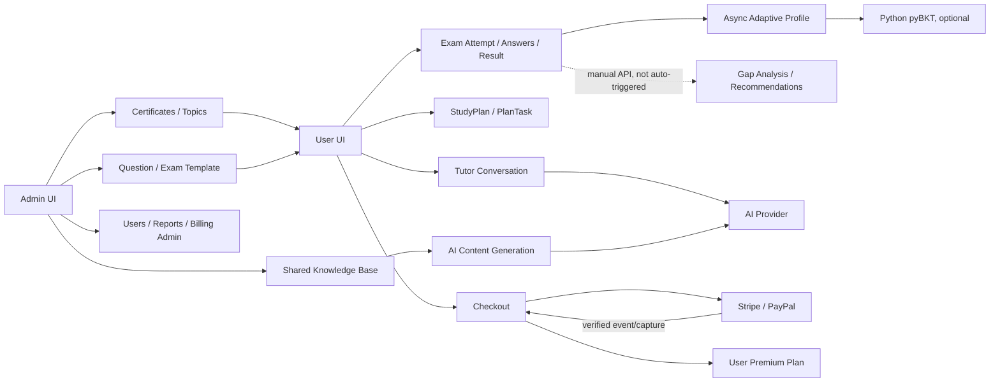
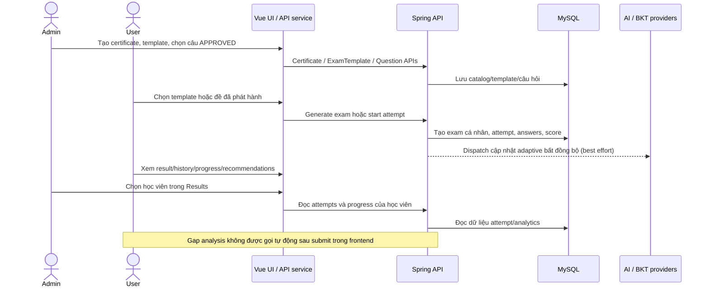

# Bản đồ nghiệp vụ Adaptive Learning

**Ngày đối chiếu:** 2026-10-28  
**Phạm vi:** ánh xạ nghiệp vụ Admin ↔ User từ source hiện có; không sửa API, giao diện hoặc logic trong lần khảo sát này.  
**Quy ước trạng thái:** “Có code” xác nhận có đường đi trong source; không đồng nghĩa đã chạy với dịch vụ thật. “Một phần/đứt liên kết” chỉ rõ phần nào có và phần nào thiếu. “Chưa xác minh runtime” nghĩa là chưa có bằng chứng triển khai/E2E tương ứng.

## 1. Mục tiêu thực tế

Repository hướng tới nền tảng luyện thi cá nhân theo chứng chỉ/kỳ thi: Admin cấu hình danh mục và nội dung đánh giá; User chọn đề, làm bài, nhận kết quả và xem tiến độ. Source có thêm AI Tutor, sinh nội dung, kho tri thức, Speaking transcript, Study Planner và thanh toán Premium. Vòng lặp “kết quả → phân tích → gợi ý học tiếp” chỉ được hiện thực một phần: cập nhật hồ sơ adaptive được dispatch sau submit; gap-analysis là API riêng, không được frontend tự gọi sau submit.

Không thấy một module khóa học/bài học/chapter độc lập. Màn “Khóa học” hiện liệt kê chứng chỉ và tỷ lệ hoàn thành suy ra từ đề; “Kế hoạch học” lưu mục tiêu cùng các task lịch mẫu, không phải giáo trình hay lịch do AI tối ưu.

## 2. Phạm vi và kiến trúc

- Repository root không có `README.md`. `AdaptiveLearningFE/README.md` còn nội dung template Vue chung, không phải mô tả đáng tin cậy của sản phẩm. `Adaptive Learning/BUSINESS.md`, `PHASES.md`, `BILLING.md` và `docs/project-analysis/*` là tài liệu tham khảo/định hướng; khi khác source thì source được ưu tiên. Ví dụ, một số tài liệu mô tả tài khoản mặc định hoặc luồng AI/planner chưa được xác nhận bởi code.
- Frontend: Vue 3/Vite; routes trong `AdaptiveLearningFE/src/router`; shell User và state phần lớn nằm trong `features/User/pages/Home.vue`; Admin shell và các section nằm trong `features/Admin/pages/Home.vue`; API clients ở `src/services`; Pinia store `src/stores/user.js` giữ phiên đăng nhập/role.
- Backend: một ứng dụng Spring Boot/Java 17, REST JSON dưới `/api/v1`, MySQL; JPA cho phần lớn entity và MyBatis `UserMapper.xml` cho người dùng. Đây là monolith theo package/module, không phải các backend độc lập.
- BKT: `Adaptive Learning/pybkt/app.py`, Python `ThreadingHTTPServer`, `/health` và `/v1/mastery/estimate`; được gọi qua `BktClient`.
- Cấu hình local dùng `ddl-auto: update`; các script SQL trong `src/main/resources/db` chỉ là nâng cấp thủ công, không thấy Flyway/Liquibase đầy đủ. Docker Compose định nghĩa backend, MySQL, frontend và pyBKT.
- AI, SMTP, Google, Stripe và PayPal cần cấu hình ngoài. Việc thấy provider client trong source không xác nhận credential, mạng, tài khoản merchant hoặc chất lượng kết quả runtime.

## 3. Vai trò và quyền

| Vai trò | Quyền theo source | Ranh giới thực tế |
|---|---|---|
| `ROLE_USER` | Đăng ký/xác minh/login; xem catalog; tạo đề cá nhân từ exam template; làm bài; xem lịch sử, progress, recommendations; dùng Planner; Tutor/Speaking và payment khi entitlement cho phép. | Attempt, plan, tutor, tài liệu riêng và payment có kiểm tra owner ở service/controller. Premium được xác định từ user plan/role, không từ frontend. |
| `ROLE_ADMIN` | Route `/admin`; quản lý users, certs, templates/exams, knowledge base, subscription plans/billing; xem analytics và kết quả học tập. Một số rubric/jobs/content-generation/question operations chỉ có backend API. | Global path guard trong `SecurityConfig` chặn `/api/v1/admin/**`; nhiều controller còn có method guard. Không có role Teacher/classroom trong code đã kiểm tra. |

Auth/signup, verify, resend, login, Google config/login và webhook/PayPal return là các ngoại lệ allowlist; `/auth/profile` không nằm trong allowlist và cần JWT. User có thể tạo tài khoản `ROLE_USER`; bootstrap Admin phụ thuộc biến môi trường `BOOTSTRAP_ADMIN_USERNAME`/`BOOTSTRAP_ADMIN_PASSWORD`, không dựa vào tài khoản mặc định được ghi trong tài liệu cũ. Xem `SecurityConfig.java`, `UserServiceImpl.java`, `AuthController.java`.

## 4. Bản đồ module

Các nét đứt/nhánh optional thể hiện liên kết chưa tự động hoặc còn phụ thuộc dịch vụ. `RagService` được gọi trong Content Generation; `TutorServiceImpl` nhận `contextJson` từ request nhưng không gọi RAG service trực tiếp.

## 5. Luồng tổng thể Admin ↔ User

**Bước hoàn chỉnh trong code:** Admin tạo catalog/template/đề; User làm attempt; Admin có màn xem kết quả theo user; frontend tải history/progress/recommendations.  
**Điểm chưa liền mạch:** câu hỏi CRUD/review và AI content generation chưa có UI quản trị tương ứng; gap-analysis không nối tự động vào submit/UI; BKT có fallback heuristic; các endpoint AI grading, Speaking và một số adaptive APIs chưa có User UI.

## 6. Ánh xạ menu Admin ↔ User

| Nhóm nghiệp vụ | Menu Admin | Menu User | Dữ liệu đầu vào | Luồng xử lý | Kết quả / nơi đọc | Trạng thái thực tế |
|---|---|---|---|---|---|---|
| Danh mục kỳ thi | `Kỳ thi & chứng chỉ` | `Khóa học`, `Bài kiểm tra` | Certificate, Topic, thang điểm/kỹ năng | Admin tạo/cập nhật certificate; code có Topic CRUD admin API. User đọc danh sách certificates/topics. | Certificate/topic hiển thị ở Courses, form kế hoạch và exam templates. | Certificate UI/API có. Topic GET có trong Admin UI; Topic write API có nhưng không thấy client gọi mutation từ Admin Home. |
| Ngân hàng câu hỏi | Không có menu riêng; Exam Builder truy vấn câu hỏi đã duyệt | Không thấy User browse question bank riêng | Question, certificate/topic, type/difficulty, đáp án, trạng thái | `QuestionController` có CRUD/admin approve/reject; User chỉ nhận câu thuộc đề và API ẩn đáp án khi chưa Admin. | Question gắn với `exam_questions`, được trả trong exam detail/attempt. | Backend có; UI quản trị tạo/sửa/duyệt câu và contentgen chưa được nối rõ trong Admin Home. |
| Đề/template | `Bài kiểm tra` | `Bài kiểm tra` | ExamTemplate/sections, câu APPROVED, cấu trúc/type/difficulty | Exam Builder tạo template, đọc candidates APPROVED, preview; hành động phát hành gọi `generateExamFromTemplate`. User đọc active template, tạo đề sở hữu riêng hoặc làm đề PUBLISHED được cấp. | `ExamTemplate`, `Exam`, `ExamQuestion`, attempts/results. | Có đường code trực tiếp. Admin UI xây template; backend tạo Exam PUBLISHED khi gọi generate. Không phải mọi đề được tạo là nội dung AI. |
| Bài làm/kết quả | `Kết quả học tập` | `Bài kiểm tra`, `Lịch sử`, `Thống kê tiến độ` | Exam, attempt, answers, expiry, violations | User start → autosave → submit/scoring; Admin chọn user và gọi attempts/progress. | `ExamAttempt`, `AttemptAnswer`, `AttemptEvent`, result/progress. | Core API/UI có; E2E sản phẩm không được xác minh trong tài liệu này. Screenshot người dùng cho thấy một lần tạo đề lỗi. |
| Phân tích/adaptive | `Tổng quan hệ thống`, `Kết quả học tập` | Dashboard/progress/recommendations | Attempt answers/scores, Question/Topic, profile | Attempt submit dispatch async adaptive update; analytics analyze là endpoint riêng. User Home gọi progress/recommendations; Admin gọi overview/user progress. | `GapAnalysis`, `Recommendation`, `LearningProgress`, `LearnerProfile`. | Một phần: profile update tự dispatch; gap-analysis không tự chạy; FE không gọi adaptive recommend/forecast hoặc analyze endpoint trong luồng Home. |
| Study Planner | Không có menu đối ứng | `Kế hoạch học` (route `/plans`) | Title, certificate, target score, exam date, hours/week | User tạo StudyPlan; backend sinh task mẫu; User xem task/summary, cập nhật pending/completed/skipped, complete/archive. | `StudyPlan`, `PlanTask`; chỉ thuộc user. | API/UI có, nhưng task là checklist mẫu theo ngày/skill, không gắn trực tiếp lesson/exam/practice và không được Admin điều khiển. |
| Kho tri thức | `Kho kiến thức` | Không có màn hình RAG riêng; Tutor là UI gần nhất | Shared document PDF/text, certificate/topic, chunks | Admin upload/quản lý/tắt nguồn. RAG search/retrieval tồn tại; Content Generation gọi retrieval. | `StudyDocument`, `DocumentChunk`; shared KB có active flag. | Admin KB có. Không có cầu nối RAG tự động từ Tutor UI đến RagService; vector/embedding search không có bằng chứng. |
| Content generation | Không có menu riêng; `adminService` có wrapper | Không có | Certificate/topic, question type, difficulty, count, instruction | Backend `/content-generation` gọi RAG và AI, lưu kết quả, apply thành câu hỏi nháp. | `ContentGeneration`, Question drafts. | Backend/API + FE service wrapper có; Admin Home không gọi `generateQuestions`/`applyGeneratedQuestions` trong UI được khảo sát. |
| AI grading/jobs/rubric | Không có menu riêng | Không có màn hình chấm Writing | Answer/attempt/question/rubric | `/ai/grade` tạo job; scheduler xử lý job; rubric/jobs admin APIs. | `AiEvaluation`, `AiJob`, `Rubric`. | Backend có; không thấy Admin hoặc User service/UI cho các endpoint AI này. |
| AI Tutor | Không có menu Tutor ở Admin; KB là nguồn quản trị riêng | `Trợ lý AI` (Premium) | Conversation, message, optional `contextJson` | User tạo conversation, gửi câu hỏi, provider trả answer/citations. | `TutorConversation`, `TutorMessage`. | UI/API có; tutor dùng supplied context/history, không retrieve KB tự động. |
| Speaking | Không có menu | Không có menu/FE service | Transcript text, attempt/question, optional rubric | Backend nhận transcript và gọi AI evaluation; premium entitlement kiểm soát. | `SpeakingSubmission`, `SpeakingEvaluation`. | Backend MVP có; không có audio/STT và không tìm thấy User UI/API client. |
| Practice packages | Không có menu/quản lý rõ ở Admin Home | Không có view riêng | Package/questions | Backend có Admin CRUD và User GET; `learningService.practicePackages` khai báo wrapper. | `PracticePackage`. | API và wrapper có; không thấy UI nào gọi package API. Recommendations chưa chứng minh liên kết thực thi package. |
| Tài khoản/entitlement | `Quản lý tài khoản`, `Gói cước & Thanh toán` | `Cài đặt`, `Nâng cấp Premium` | User role/status/plan/quota, payment | Admin đọc/sửa role/status/user plan/quota và payments. User đọc entitlement, checkout, payment status/history. | `tbl_users`, `payments`, `payment_webhook_events`. | Có nhiều API/UI. Admin `SubscriptionPlan` management không phải nguồn giá checkout/entitlement; checkout hiện dùng `BillingProperties`. |
| Thông báo payment | Không có menu | Chuông trên Home | Verified payment transition | Payment success lưu notification, SSE push sau transaction commit; User đọc inbox/mark read. | `user_notifications`, liên kết paymentId. | Code/API/UI có; SSE registry ở memory một instance, chưa có pub/sub xuyên nhiều backend instance. |

### Cấu trúc menu hiện tại

**Admin** (`Admin/pages/Home.vue`): Tổng quan hệ thống, Kết quả học tập, Kỳ thi & chứng chỉ, Bài kiểm tra, Kho kiến thức, Quản lý tài khoản, Gói cước & Thanh toán. Không có menu cho Topics CRUD, Question workflow, contentgen, rubrics/jobs, practice packages hay speaking.

**User** (`router/User/user.js`, User Home): Trang chủ, Kế hoạch học, Khóa học, Bài kiểm tra, Lịch sử, Thống kê tiến độ, Trợ lý AI, Cài đặt, Bảng giá và payment status. `/history` là route riêng; shell sidebar không nhất thiết hiển thị nó như menu cấp một.

## 7. Các luồng nghiệp vụ đầu cuối

### A. Tài khoản và phân quyền

1. **Mục tiêu:** tạo account learner và cấp JWT sau xác thực.
2. **Tác nhân:** User, Google, SMTP; Admin quản lý account sau đó.
3. **Bắt đầu:** `/register`, Google sign-in hoặc Admin tạo managed user.
4. **Bước:** Auth UI → `userService` → `AuthController`; signup tạo unverified user BCrypt, gửi OTP hash/5 phút; verify một lần; login password/Google trả JWT; profile qua JWT.
5. **Dữ liệu:** `tbl_users`, `email_verifications` (code hash, expiry, attempt/resend counters).
6. **Đầu ra:** LoginResponse/profile; Admin account list/update role/status/plan.
7. **Admin ↔ User:** Admin tạo user qua admin endpoint hoặc thay đổi role/status; signup tự gán ROLE_USER.
8. **Ngoại lệ:** duplicate email, OTP sai/hết hạn/rate limit, SMTP unavailable; backend validation DTO.
9. **Trạng thái:** source + tests có; Gmail delivery/Google provider live chưa được xác minh. `BUSINESS.md` cũ nói Gmail-only/default account, nhưng DTO/code hiện khác; không dùng mô tả cũ làm sự thật.
10. **Evidence:** `module/users/controller/AuthController.java`, `UserServiceImpl.java`, `EmailVerificationService.java`, DTOs, `SecurityConfig.java`, `UserMapper.xml`, `features/Auth/*`, `services/userService.js`.

### B. Catalog, câu hỏi và phát hành đề

1. **Mục tiêu:** chuẩn bị nguồn câu hỏi có trạng thái và cung cấp đề cho User.
2. **Tác nhân:** Admin, User, database.
3. **Bắt đầu:** Admin tạo certificate/topic; Exam Builder.
4. **Bước:** Admin tạo `ExamTemplate` và sections; Builder GET câu hỏi đã APPROVED theo certificate/topic/type/difficulty; preview lấy candidates; nút phát hành gọi template generate, service tạo Exam PUBLISHED, owner user nullable tùy caller. User GET active templates rồi POST generate để nhận Exam PUBLISHED sở hữu riêng.
5. **Dữ liệu:** `certificates`, `topics`, `questions`, `exam_templates`, `exam_template_sections`, `exams`, `exam_questions`.
6. **Đầu ra:** danh sách User templates/exams trong Tests view.
7. **Admin ↔ User:** cùng template/catalog là nguồn; User được cấp đề riêng từ template. Admin không có một menu question bank độc lập rõ ràng trong navigation.
8. **Ngoại lệ:** thiếu câu APPROVED đúng skill/type/difficulty, inactive topic/template, quota hết; ảnh người dùng có thông báo chung “không thể tạo đề” và title template hỏng, nhưng không có request/response log để xác định nguyên nhân.
9. **Trạng thái:** template/generate path có trong UI/API. Root cause ảnh screenshot chưa xác minh runtime; không kết luận do quota vì ảnh hiển thị quota còn.
10. **Evidence:** `ExamBuilderDialog.vue`, `adminService.js`, `ExamTemplateController.java`, `ExamTemplateServiceImpl.java`, `ExamController.java`, `QuestionController.java`, `TestsView.vue`, `Home.vue:createPracticeExam`.

### C. Attempt, scoring, analytics

1. **Mục tiêu:** làm đề và ghi nhận kết quả.
2. **Tác nhân:** User, AttemptService, Question/Exam, DB.
3. **Bắt đầu:** User chọn exam PUBLISHED/owned exam.
4. **Bước:** start kiểm tra owner/status/access/quota; answer PATCH upsert; detail trả answers để restore; submit khóa attempt, lưu đáp án cuối cùng và score; result/history đọc riêng; expiry scheduler đánh dấu expired; violations được ghi.
5. **Dữ liệu:** `exam_attempts`, `attempt_answers`, `attempt_events`.
6. **Đầu ra:** result score/counts; frontend history/progress.
7. **Admin ↔ User:** Admin Results gọi `/admin/users/{id}/attempts` và `/progress`; User tự xem history/progress.
8. **Ngoại lệ:** wrong owner, đề chưa publish, quota, expiry, submit duplicate, race; service tests hiện có một số coverage.
9. **Trạng thái:** core attempt API/frontend có. `AttemptController.submit` dispatch AdaptiveUpdateDispatcher khi mới submit; không thấy gọi AnalyticsService.analyzeAttempt. Analytics API phân tích manual riêng; frontend không khai báo/call analyze/analysis endpoint.
10. **Evidence:** `AttemptController.java`, `AttemptServiceImpl.java`, entities, `AnalyticsController.java`, `AnalyticsServiceImpl.java`, AdminController, `learningService.js`, User Home/Exam views.

### D. Adaptive/BKT và recommendations

1. **Mục tiêu:** lưu năng lực theo learner/certificate và đề xuất kỹ năng yếu.
2. **Tác nhân:** submit attempt, async executor, Java BktClient, Python pyBKT.
3. **Bắt đầu:** attempt mới submit gọi async dispatcher; các API profile/recommend/forecast là route riêng.
4. **Bước:** heuristic từ câu objective đã chấm → cohort interactions → BKT estimate; nếu BKT unavailable/unready, heuristic giữ lại. Recommendations sort weakest ability; forecast công thức heuristic.
5. **Dữ liệu:** `learner_profiles`; input liên kết attempt/answer/question/topic.
6. **Đầu ra:** AdaptiveController profile/recommend/forecast; Home hiển thị Analytics progress và recommendations, không gọi `adaptiveRecommendations` wrapper hiện có.
7. **Admin ↔ User:** Admin xem aggregate analytics và user progress; chưa có menu cấu hình/duyệt ability.
8. **Ngoại lệ:** thiếu attempt/answer/topic, BKT fallback, async failure chỉ log; không có durable retry/outbox cho update dispatcher.
9. **Trạng thái:** adaptive update sau submit có code; không bảo đảm khi process chết/provider lỗi. BKT có mock tests/health path; calibration thực tế không được chứng minh. Gap analysis riêng, không auto-trigger.
10. **Evidence:** `AttemptController.java`, `AdaptiveUpdateDispatcher.java`, `AdaptiveServiceImpl.java`, `BktClient.java`, `pybkt/app.py`, analytics/adaptive controllers và tests.

### E. AI Tutor, RAG, sinh nội dung, Speaking

1. **Tutor:** User `/tutor` tạo conversation/message; service lưu user message, lấy tối đa 10 message gần nhất và `contextJson` người gọi gửi; gọi AI đồng bộ; lưu answer/citations JSON. Premium bắt buộc. Tutor không inject/call RagService.
2. **RAG:** Admin upload shared PDF/TXT/MD, gắn certificate/topic, active/deactivate/delete; backend extract PDF text, chunk 700 ký tự/overlap 120 và keyword search. User có API tài liệu riêng nhưng không có UI RAG trong service/screens khảo sát.
3. **Content generation:** Admin API nhận certificate/topic/type/difficulty/count/instructions; service retrieve shared KB context qua RagService, gọi AI và lưu bản sinh/apply thành câu hỏi draft. Admin Home không có call tới `generateQuestions` hoặc `applyGeneratedQuestions`; wrapper chỉ có trong `adminService`.
4. **AI grading/jobs:** AI endpoints có grade/evaluation/jobs/retry/rubric; `AiJobScheduler` poll PENDING/RETRYING. Không thấy user/admin screens hoặc FE service bao phủ các API này.
5. **Speaking:** Premium API nhận transcript text trong submission và service prompt AI chỉ đánh giá transcript; không tìm thấy UI/service frontend, upload audio hoặc speech-to-text.
6. **Dữ liệu:** `tutor_conversations/messages`, `study_documents/document_chunks`, `content_generations`, `questions`, `rubrics`, `ai_jobs/evaluations`, `speaking_submissions/evaluations`.
7. **Trạng thái:** API/backend paths khác nhau về mức hoàn chỉnh; không gọi “vector search/embedding” (không có code) và không gọi “audio/STT” (không có flow). AI provider runtime/chất lượng chưa được chứng minh.
8. **Evidence:** controllers/services tương ứng trong `module/{tutor,rag,contentgen,ai,speaking}`, `AdminKnowledgeBaseController.java`, `TutorView.vue`, `adminService.js`.

### F. Planner

1. **Mục tiêu:** User ghi mục tiêu học, ngày thi và quỹ thời gian.
2. **Bước:** `/plans` tạo StudyPlan; backend tạo task mẫu phân bổ theo ngày/giờ và skill; User đọc tasks/summary, đổi `PENDING/COMPLETED/SKIPPED`, complete khi không còn pending, archive.
3. **Dữ liệu:** `study_plans`, `plan_tasks`, `user_id`.
4. **Admin ↔ User:** không có Admin menu cho learner StudyPlan. `AdminBillingController /admin/plans` quản lý `SubscriptionPlan`, là dữ liệu gói dịch vụ khác, không phải StudyPlan.
5. **Trạng thái:** Planner API/UI có và ownership đã được test. Tasks là mẫu khung; không lấy gap-analysis/BKT, không gắn lesson/practice/exam ID, không có AI schedule.
6. **Evidence:** `PlannerController.java`, `PlannerServiceImpl.java`, `StudyPlan.java`, `PlanTask.java`, `PlansView.vue`, `/api/v1/plans` wrappers trong `learningService.js`.

### G. Billing/Premium

1. **Mục tiêu:** User checkout, nhận entitlement sau xác minh.
2. **Bước:** Pricing GET entitlements; checkout tạo PENDING từ server-configured price/currency; provider strategy tạo Checkout/Order; verified webhook hoặc server-side PayPal capture kiểm tra identity/amount/currency; payment status và `tbl_users.plan` cập nhật; user PaymentStatus poll API, chuông nhận payment-success notification.
3. **Admin ↔ User:** Admin xem user billings/payments và có endpoint sửa subscription plan/quota; User checkout theo `BillingProperties` (`PREMIUM_PRICE`, VND) và configured providers.
4. **Điểm lệch:** `SubscriptionPlan` Admin CRUD được lưu trong `subscription_plans`; `EntitlementService` lấy premium price/currency từ BillingProperties và provider registry, không đọc SubscriptionPlan. Thay giá/gói ở Admin UI không chứng minh thay đổi checkout thực tế.
5. **Trạng thái:** payment strategy/service, webhook verification, history/status, notification backend/UI có code và unit/simulation tests. Live provider/merchant settlement chưa xác minh. Admin plans/entity riêng có nguy cơ gây hiểu nhầm.
6. **Evidence:** `PaymentService.java`, provider strategies, `PaymentController.java`, `PaymentWebhookController.java`, `EntitlementService.java`, `AdminBillingController.java`, `PaymentStatus.vue`, `Pricing.vue`, `paymentService.js`, `notificationService.js`.

## 8. Ma trận truy vết dữ liệu

| Dữ liệu/nghiệp vụ | Nơi tạo | Nơi lưu | Nơi sử dụng | Bên chịu trách nhiệm | Điểm thiếu liên kết |
|---|---|---|---|---|---|
| User/account/role/verified | User signup, Google, Admin create | `tbl_users`; OTP `email_verifications` | JWT/security, account admin, entitlement | User/Admin/System | Docs cũ về default account/Gmail-only không khớp source. |
| Certificate/Topic | Admin UI certificate; Topic admin API/initializer | `certificates`, `topics` | Templates, question, course cards, analytics | Admin tạo; User đọc | Admin Home tải topics nhưng không tìm thấy topic create/update client call. |
| Question | Admin question API hoặc contentgen apply | `questions` | Exam Builder lọc APPROVED, User attempt | Admin/System AI draft | FE Admin CRUD/review/contentgen workflow không khép kín. |
| Exam Template/Exam/ExamQuestion | Admin builder tạo template; User hoặc Admin generate đề | `exam_templates`, `exam_template_sections`, `exams`, `exam_questions` | User tests/attempts; Admin exam list | Admin template, System exam instance | Admin Builder “preview” tạo/deactivate template; phát hành/generate endpoint tạo Exam PUBLISHED. |
| Attempt/Answer/Event/Result | User attempt | `exam_attempts`, `attempt_answers`, `attempt_events` | User result/history; Admin results; adaptive | User/System | Analytics analyze là thao tác/API riêng; không auto-created bởi submit. |
| Gap/Recommendation/Progress | Analytics analyze/progress logic | `gap_analyses`, `recommendations`, `learning_progress` | User/ Admin dashboards | System | UI dùng progress/recommendations; gap analysis API không thấy UI call. |
| Learner ability/BKT | Adaptive async update | `learner_profiles`; cohort lấy từ attempts/answers | Adaptive APIs | System/BKT | FE không gọi profile/forecast/recommend adapter; fallback heuristic. |
| Study plan/task | User `/plans`; task sinh bởi PlannerService | `study_plans`, `plan_tasks` | User Planner/dashboard | User/System | Không nối task với nội dung thực hoặc Admin. |
| Tutor conversation/message | User Tutor | `tutor_conversations`, `tutor_messages` | Tutor UI/API, AI provider | User/System | `contextJson` caller-supplied; shared KB không retrieve tự động. |
| RAG docs/chunks | User private upload hoặc Admin shared KB upload | `study_documents`, `document_chunks` | Private search; content-generation retrieval | User/Admin/System | User private docs không có UI; Tutor bridge không có. |
| AI jobs/evaluation/rubrics | Admin rubric; learner grade request | `ai_jobs`, `ai_evaluations`, `rubrics` | AI API/scheduler | User/Admin/System | Không có frontend consumer rõ ràng. |
| Speaking | User API transcript/evaluation | `speaking_submissions`, `speaking_evaluations` | Controller/service | User/System AI | Không có FE form; audioUrl field không chứng minh audio upload/STT. |
| Billing/subscription/entitlement | Checkout/webhook; Admin plan API | `payments`, `payment_webhook_events`, `subscription_plans`; entitlement trong `tbl_users` | User pricing/history; Admin billing | User/Admin/Provider/System | `subscription_plans` và cấu hình entitlement hiện không đồng nhất. |
| Notification | Verified first payment success | `user_notifications` | User bell/inbox/SSE, payment detail | System/User | SSE emitter registry in-memory: chưa phân tán đa instance. |

## 9. Điểm đứt gãy và UX

| ID | Mức | Vấn đề/bằng chứng | Ảnh hưởng | Hướng xử lý (đề xuất, chưa triển khai) |
|---|---|---|---|---|
| MAP-001 | High, chưa xác minh nguyên nhân | Ảnh User cung cấp tại `/tests` cho thấy title template bị hiển thị hỏng (`lo[L[`) và alert “Không thể tạo đề luyện tập”. `TestsView/Home.createPracticeExam` chuyển lỗi API sang alert chung; không có request/response/runtime logs. Ảnh quota hiển thị còn lượt nên không đủ bằng chứng kết luận quota. | User không biết template hỏng do data, thiếu câu APPROVED phù hợp, provider hay server. | Ghi correlation/log không chứa secret, hiển thị message API an toàn; kiểm tra template record và response lỗi ở môi trường test. |
| MAP-002 | High | User menu “Khóa học” trỏ tới `CoursesView` liệt kê certificate/đề và tính completion từ exams/history; không có course/lesson/chapter entity/API được xác minh. | Tên menu khiến User kỳ vọng có bài học thực tế; luồng học không đi từ nội dung sang nhiệm vụ. | Xác định product scope: đổi tên thành chứng chỉ/đề hoặc xây module lessons sau khi chốt yêu cầu. |
| MAP-003 | High | AI Content Generation backend + wrapper có, Admin Home không gọi generate/apply; không có workflow xem/duyệt nội dung AI đầy đủ trong UI. | Admin không thực hiện được workflow AI qua menu hiện tại; dữ liệu endpoint khó khám phá. | Thêm workspace riêng có preview/status/review chỉ sau khi API contract và review nghiệp vụ chốt. |
| MAP-004 | High | Admin Knowledge UI mô tả nguồn cho Tutor; source `TutorServiceImpl` không gọi `RagService`, chỉ dùng `contextJson` và lịch sử. | Admin nạp tri thức nhưng không đảm bảo Tutor sử dụng tài liệu đó. | Nối retrieval có citations/permission hoặc sửa mô tả UI theo capability thật. |
| MAP-005 | High | `adaptive`/`forecast`/`analysis` APIs có; `learningService` có wrapper adaptive recommend nhưng Home chỉ dùng analytics progress/recommendations; `analyze` không được gọi từ frontend. | UI hiển thị tiến độ nhưng không minh bạch vòng gap/BKT/forecast; gợi ý không chứng minh được là từ adaptive engine. | Chốt trigger analytics (manual hay auto) và UI/API contract trước khi nối; kiểm thử persisted profile và fallback. |
| MAP-006 | Medium | `/plans` là StudyPlan learner; Admin `/admin/plans` là SubscriptionPlan; BillingProperties là nguồn giá checkout. | Cùng từ “plan” cho hai nghiệp vụ; Admin có thể nghĩ sửa gói là thay giá checkout trong khi không phải. | Đổi tên domain/menu gói dịch vụ và làm rõ nguồn giá; hoặc nối SubscriptionPlan với entitlement bằng migration/acceptance đã duyệt. |
| MAP-007 | Medium | Practice endpoints và `learningService.practicePackages` có nhưng không thấy màn User/Admin gọi; recommendations không tự start package theo code được kiểm tra. | Gói luyện chưa nối thành hành động học tiếp hoàn chỉnh. | Chốt mapping Recommendation → PracticePackage → Exam/attempt và ownership rồi mới xây UI. |
| MAP-008 | Medium | `/ai` rubrics/jobs/evaluations và `/speaking` endpoints không có client/views tương ứng rõ ràng. | Admin/User không có đường thao tác/tự phục vụ qua web; Speaking có nguy cơ bị hiểu nhầm là thu âm. | Thêm màn dựa trên contract; nêu transcript-only đến khi có audio/STT. |
| MAP-009 | Medium | `TopicController`/QuestionController có mutation API nhưng service wrapper/Admin section chưa phủ topic CRUD/question review tương ứng; ExamBuilder chỉ tiêu thụ câu APPROVED. | Chuẩn bị data phụ thuộc API/manual DB thay vì full Admin workflow. | Bổ sung UI catalog/workflow sau khi xác định người chịu trách nhiệm approve và trạng thái hợp lệ. |
| MAP-010 | Low/Medium | `BUSINESS.md`, README frontend template và một số docs mô tả flow/default account chưa khớp source; `PHASES.md` có test status cũ. | Developer/Admin có thể vận hành theo nghiệp vụ đã lỗi thời. | Ghi ngày/source-of-truth, sửa tài liệu riêng theo code đã xác minh. |
| MAP-011 | Medium | Content generation controller trả HTTP 202 nhưng service gọi `processGeneration` ngay trong submit path (không phải hàng đợi durable theo chứng cứ hiện có). | UI/client có thể hiểu là background job trong khi request còn làm việc đồng bộ. | Đổi semantics HTTP hoặc thiết kế durable job nếu thực sự cần async. |

### Ghi nhận screenshot

Ảnh do người dùng cung cấp cho thấy trang `/tests`, Free quota còn 5 lượt, template title ký tự hỏng và một lỗi tạo đề chung. Đây là bằng chứng UX/runtime do người dùng ghi nhận, không xác định được endpoint/status body hay root cause; không đánh dấu quota, template API hay database là nguyên nhân khi chưa có trace.

## 10. Đề xuất cấu trúc menu thống nhất

Không triển khai thay đổi menu trong nhiệm vụ này.

| Menu hiện tại | Vai trò | Nhận xét | Đề xuất nhóm | Quan hệ phía còn lại |
|---|---|---|---|---|
| Admin `Tổng quan hệ thống` | Giám sát | Dùng analytics API; có nút xem dữ liệu minh họa được gắn nhãn demo. | Giữ trong `Báo cáo`. | Tổng hợp attempts/progress của User; không thay dữ liệu gốc. |
| Admin `Kết quả học tập` | Theo dõi người học | Chọn user rồi gọi attempts/progress. | Giữ trong `Báo cáo người học`. | Đối ứng User History/Progress theo cùng nguồn attempt. |
| Admin `Kỳ thi & chứng chỉ` | Catalog | Cert CRUD UI có; topics hiện chủ yếu tải/read cho builder. | Giữ trong `Nội dung & catalog`; làm rõ Topic CRUD thiếu UI. | User Courses/catalog và filter template. |
| Admin `Bài kiểm tra` | Tác giả/template/đề | Builder tạo template; user generation tạo Exam. | Đổi tên nhóm thành `Ngân hàng & đề thi` (đề xuất). | User `Bài kiểm tra` dùng template/đề PUBLISHED. |
| Admin `Kho kiến thức` | Shared corpus | Có upload/manage shared documents, nhưng Tutor chưa trực tiếp retrieve. | Giữ riêng `AI & tri thức`; mô tả consumer thật. | Content generation đang gọi retrieve; Tutor chưa. |
| Admin `Quản lý tài khoản` | Vận hành | Role/status/plan/quota và xem report theo user. | Giữ `Người dùng & quyền`. | User Auth/Settings/entitlements. |
| Admin `Gói cước & Thanh toán` | Billing | CRUD subscription catalog không hiện là nguồn checkout price. | Tách `Gói dịch vụ` và `Giao dịch/quota` hoặc hợp nhất nguồn trước. | User Pricing/payment history/entitlement. |
| User `Trang chủ` | Học viên | Tổng quan progress, tests, plan, recommendations. | Giữ; CTA tới action liên quan. | Admin chỉ xem aggregates/results. |
| User `Khóa học` | Người học | Hiện là certificate/exam-derived view, chưa phải khóa học lesson. | Đổi tên thành `Chứng chỉ` hoặc xây lesson flow. | Admin Certificate catalog. |
| User `Kế hoạch học` | Người học | StudyPlan checklist, không phải AI/adaptive route. | Giữ tên rõ là `Kế hoạch ôn tập`. | Không đối ứng Admin; khác hẳn subscription plan. |
| User `Bài kiểm tra`, `Lịch sử`, `Thống kê tiến độ` | Luyện/đánh giá | Luồng attempt/result có; analysis khác endpoint. | Giữ thành nhóm `Luyện tập & kết quả`. | Admin Exam Builder/Results. |
| User `Trợ lý AI` | Học viên Premium | Conversation API dùng supplied context, chưa RAG bridge. | Giữ; không hứa Tutor đọc tự động toàn bộ KB. | Admin KB chỉ gián tiếp qua Content Generation hiện tại. |

## 11. Danh sách chức năng theo mức độ

| Trạng thái | Chức năng |
|---|---|
| **Có code + test cụ thể** | OTP/JWT/service tests; attempt lifecycle/ownership tests; planner lifecycle integration; analytics/adaptive unit tests; AI grading/jobs tests; tutor/RAG/contentgen/speaking unit tests; payment/entitlement tests; VND checkout mock simulation. Điều này không xác nhận provider/live E2E. |
| **Có UI/API nhưng cần E2E hoặc external config** | Signup email delivery/Google; exam create-to-attempt on a user account; Admin result screens; checkout→real provider webhook; SSE in a browser session; pyBKT real cohort readiness. |
| **Một phần/đứt liên kết** | Gap analysis auto/use in FE; adaptive recommend/forecast FE; Admin question/topic review CRUD; AI contentgen UI; tutor→RAG retrieval; practice package UI; speaking UI; Admin SubscriptionPlan→actual checkout price. |
| **Chưa thấy trong source** | Course lessons/chapters; Teacher/classes; vector DB/embedding search; audio recording/STT; AI schedule planner; analytics auto trigger after submit (không được tạo mặc định). |
| **Chưa xác minh runtime** | Live email/AI/BKT model quality/Stripe/PayPal settlements; cause of screenshot’s create-exam failure; data on deployed database; multi-instance scheduler or external messaging. |

## 12. Công việc ưu tiên P0–P3

| ID / Priority | Việc | Phụ thuộc | Tiêu chí nghiệm thu | Evidence cần đối chiếu |
|---|---|---|---|---|
| MAP-T01 / P0 | Triage screenshot tạo đề lỗi và template title hỏng | API response/log đã redacted, template record ID | Reproduce với user test; có status/error code rõ; title chính xác; create từ template hoạt động hoặc có thông báo nguyên nhân xác định. | `TestsView.vue`, `Home.vue:createPracticeExam`, ExamTemplate/Exam APIs, server logs không PII. |
| MAP-T02 / P1 | Khép kín Admin authoring: question create/edit/review, topic CRUD, template publish | Chốt workflow draft/review/approve và ownership | Admin UI gọi API đúng; chỉ APPROVED questions được publish; User nhìn thấy đề đúng certificate/topic. | QuestionController/Service, TopicController/Service, ExamBuilderDialog, Admin Home. |
| MAP-T03 / P1 | Chốt đường Analytics ↔ Adaptive ↔ User UI | Quyết định business trigger analyze sau submit (manual/automatic) | Một attempt được định nghĩa rõ cập nhật gì, khi nào; owner-safe; UI phân biệt heuristic/BKT/unavailable; error được quan sát hoặc retry. | AttemptController, AnalyticsController, AdaptiveUpdateDispatcher, BktClient, User Home. |
| MAP-T04 / P1 | Thống nhất source of truth cho subscription price/features | Business owner xác nhận plan model | Admin thay đổi plan có tác dụng quan sát được ở Entitlement/Pricing hoặc bỏ CRUD không được dùng; migration/test cũ/mới. | `SubscriptionPlan`, AdminBillingController, BillingProperties, EntitlementService. |
| MAP-T05 / P1 | Nối Admin Content Generation UI với lifecycle backend | Chốt review/approval | Tạo → xem trạng thái/kết quả/nguồn → kiểm sửa → apply draft → review/publish; thao tác idempotent/owner. | `ContentGenerationController/Service`, `adminService.js`, Admin Home. |
| MAP-T06 / P2 | Làm rõ RAG consumers và scope dữ liệu | Chọn có muốn Tutor retrieval hay chỉ contentgen | Admin UI nêu đúng consumer; nếu Tutor dùng KB, retrieval có ACL/source citations và test tài liệu khác certificate/owner. | `RagServiceImpl`, `TutorServiceImpl`, `ContentGenerationServiceImpl`. |
| MAP-T07 / P2 | Nối PracticePackage/Recommendation thành hành động cụ thể | Xác định recommendation target package/exam | User mở package được đề xuất, start, làm attempt, completion cập nhật recommendation; API ownership và empty/error states. | PracticeController/Service, Analytics recommendation, `learningService.js`. |
| MAP-T08 / P2 | Nối AI jobs/rubric và Speaking vào UI hoặc xác định là API-only | Chốt entitlement, audio/transcript product scope | Màn trạng thái job/evaluation, retry admin đúng role; Speaking UI không tuyên bố audio nếu chỉ transcript. | AiController/Scheduler, SpeakingController, frontend services/views. |
| MAP-T09 / P2 | Thiết lập automated browser/contract regression và data fixtures | Chọn test runner + isolated DB/provider mocks | Chạy route guard, Empty/loading/401/403, Admin→publish→User attempt, payment notification link trong CI; không dùng production data. | `package.json` scripts, routers, services, Postman mocks/tests. |
| MAP-T10 / P3 | Đồng bộ BUSINESS/PHASES/README và thuật ngữ menus | Sau khi business flow được chốt | Tài liệu có owner/date/source links; không chứa default credential fiction; phân biệt StudyPlan/SubscriptionPlan. | `BUSINESS.md`, `PHASES.md`, README files, Admin/User menus. |
| MAP-T11 / P3 | Xác định course/lesson scope | Product decision | Hoặc đổi tên Courses thành chứng chỉ/đề, hoặc thêm entities/API/material lesson có liên kết và acceptance. | `CoursesView.vue`, certificate/exam modules. |

## 13. Tiêu chí nghiệm thu tổng thể

- Mỗi Admin action có source/API/data ownership rõ; mỗi User action có route/service/API/status rõ.
- Certificate/topic/question/template ID đi xuyên suốt tới exam/attempt/result; không dùng sample data ngoài trạng thái demo được gắn nhãn.
- Chỉ question đã duyệt được phát hành; quota và entitlement nguồn backend.
- User và Admin chỉ đọc dữ liệu đúng scope; role guard và ownership có integration tests.
- Gap analysis trigger được thống nhất; adaptive/BKT fallback và độ hiệu chuẩn hiển thị trung thực.
- Tutor/RAG/AI/Speaking màn nào cũng phù hợp capability thật và không ngầm hứa chức năng chưa có.
- Billing dùng payment provider event đã verify, kiểm tra amount/currency/idempotency; Admin catalog gói phải thống nhất với nguồn entitlement.
- Các luồng được kiểm chứng bằng API/browser test trong profile DB/mock cô lập; external live provider được báo riêng.

## 14. File/API làm bằng chứng

- Frontend routes/guards: `AdaptiveLearningFE/src/router/{Admin,User,Auth}`, `src/config/permission.js`.
- Admin shell/services: `features/Admin/pages/Home.vue`, `features/Admin/components/ExamBuilderDialog.vue`, `src/services/adminService.js`.
- User shell/views/services: `features/User/pages/Home.vue`, `components/views/*`, `src/services/learningService.js`, `paymentService.js`, `notificationService.js`.
- Auth/store/HTTP: `features/Auth/pages/*`, `src/services/userService.js`, `src/services/Axios.js`, `src/stores/user.js`.
- Security/config: `Adaptive Learning/src/main/java/adaptivelearning/config/app/SecurityConfig.java`, `JwtAuthenticationFilter.java`, `application-local.yml`, `application-dev.yml`, `docker-compose.yml`.
- Module controllers/entities/services: `Adaptive Learning/src/main/java/adaptivelearning/module/{users,certificates,topics,questions,exams,attempts,analytics,adaptive,planner,practice,ai,contentgen,tutor,rag,speaking,billing,notifications}`.
- Python BKT: `Adaptive Learning/pybkt/app.py`, `requirements.txt`, Java `adaptive/module/adaptive/service/BktClient.java`.
- Tests/mocks: `Adaptive Learning/src/test/java`, `postman/mocks`, `postman/simulations`; unit/simulation coverage is not live-provider proof.
- Docs to treat as context rather than authority when inconsistent: `Adaptive Learning/BUSINESS.md`, `PHASES.md`, `BILLING.md`, `docs/project-analysis/*`, `AdaptiveLearningFE/README.md`.
