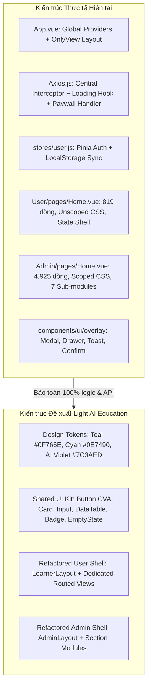

# KẾ HOẠCH TỔNG THỂ REDESIGN GIAO DIỆN — PHONG CÁCH LIGHT AI EDUCATION
**Dự án:** Adaptive Learning Web Client  
**Thư mục mã nguồn:** `AdaptiveLearningFE/`  
**Tài liệu tham chiếu:** [FRONTEND_ARCHITECTURE.md](file:///d:/AdaptiveLearning/AdaptiveLearningFE/FRONTEND_ARCHITECTURE.md), [FRONTEND_ROUTES_AND_ROLES.md](file:///d:/AdaptiveLearning/AdaptiveLearningFE/FRONTEND_ROUTES_AND_ROLES.md)  
**Tác giả:** Senior UI/UX Designer & Senior Vue.js Frontend Architect  
**Trạng thái:** Kế hoạch kiến trúc (Chờ phê duyệt trước khi sửa mã nguồn)  

---

## MỤC LỤC
1. [PHASE 1 — PHÂN TÍCH ĐỐI SOÁT TRƯỚC KHI THIẾT KẾ](#1-phase-1--phân-tích-đối-soát-trước-khi-thiết-kế)
2. [PHASE 2 — THIẾT LẬP DESIGN SYSTEM THEO PHONG CÁCH LIGHT AI EDUCATION](#2-phase-2--thiết-lập-design-system-theo-phong-cách-light-ai-education)
3. [PHASE 3 — BẢN THIẾT KẾ CHI TIẾT TỪNG PHÂN VÙNG](#3-phase-3--bản-thiết-kế-chi-tiết-từng-phân-vùng)
   - [3.1. Phân vùng Auth (Xác thực)](#31-phân-vùng-auth-xác-thực)
   - [3.2. Phân vùng User (Cổng người học)](#32-phân-vùng-user-cổng-người-học)
   - [3.3. Phân vùng Admin (Cổng quản trị viên)](#33-phân-vùng-admin-cổng-quản-trị-viên)
4. [PHASE 4 — KẾ HOẠCH TRIỂN KHAI 13 GIAI ĐOẠN (ROADMAP)](#4-phase-4--kế-hoạch-triển-khai-13-giai-đoạn-roadmap)
5. [MA TRẬN RỦI RO NGHIỆP VỤ & NGUYÊN TẮC BẢO TOÀN](#5-ma-trận-rủi-ro-nghiệp-vụ--nguyên-tắc-bảo-toàn)

---

## 1. PHASE 1 — PHÂN TÍCH ĐỐI SOÁT TRƯỚC KHI THIẾT KẾ

Quá trình đối soát trực tiếp mã nguồn thực tế tại [AdaptiveLearningFE/](file:///d:/AdaptiveLearning/AdaptiveLearningFE/) với các tài liệu phân tích xác nhận các phát hiện kiến trúc then chốt sau:



### Bảng Đối soát & Nhận diện Sự khác biệt giữa Tài liệu và Mã nguồn Thực tế

| Thành phần | Trạng thái trong Tài liệu cũ | Mã nguồn Thực tế Xác minh | Kết luận & Quyết định Kiến trúc |
| :--- | :--- | :--- | :--- |
| **Hệ thống Layout** | Có `Default.vue` (Header + Footer) và `OnlyView.vue` | 100% routes đều gán `meta.layout: 'only-view'`. `Default.vue` là dead code chứa dummy links primitive doc. | Giữ `OnlyView.vue` ở root. Tách shell của User và Admin thành `LearnerLayout.vue` và `AdminLayout.vue` thực thụ trong UI Kit. |
| **Màu thương hiệu** | Đề cập màu Xanh ngọc `--ds-primary: #0F766E` | Mã nguồn [User/pages/Home.vue](file:///d:/AdaptiveLearning/AdaptiveLearningFE/src/features/User/pages/Home.vue) hardcode `--blue: #2d68f3` và `#2868f4` ở khắp nơi. | **Cần chuẩn hóa dứt khoát:** Chuyển đổi toàn diện sang bảng màu **Light AI Education** (`#0F766E` Teal chủ đạo kết hợp `#7C3AED` AI Accent). |
| **Hệ thống Lớp phủ** | Thư mục `src/components/ui/` có cả dialog, dropdown, toast | Các folder shadcn boilerplate (`dialog`, `toast`, `dropdown-menu`...) **không được import**. Toàn bộ app dùng [src/components/ui/overlay/](file:///d:/AdaptiveLearning/AdaptiveLearningFE/src/components/ui/overlay/). | Giữ nguyên API và logic của `src/components/ui/overlay/`, chỉ thay thế stylesheet sang giao diện sáng. |
| **Điều hướng User** | Tưởng chừng là các trang riêng lẻ theo URL | Các URL `/home`, `/plans`, `/courses`, `/tests`, `/progress`, `/tutor` đều load [User/pages/Home.vue](file:///d:/AdaptiveLearning/AdaptiveLearningFE/src/features/User/pages/Home.vue) và hoán đổi `activeView`. | Bảo toàn cơ chế `homeContextKey` và `activeView` để không làm gián đoạn phòng thi và các luồng đang chạy. |
| **Phân hệ Admin** | Tưởng chừng có các trang admin con | Toàn bộ 7 phân hệ nằm chung trong 1 file monolithic [Admin/pages/Home.vue](file:///d:/AdaptiveLearning/AdaptiveLearningFE/src/features/Admin/pages/Home.vue) dài 4.925 dòng, chuyển tab bằng query param `section`. | Không đập đi xây lại đột ngột; thực hiện refactor bọc layout an toàn theo từng phase. |
| **Xử lý lỗi HTTP 403** | Có cơ chế xử lý lỗi phân quyền | [Axios.js](file:///d:/AdaptiveLearning/AdaptiveLearningFE/src/services/Axios.js#L58) gọi `router.push('/403')`, nhưng router không có route này, dẫn đến rơi vào fallback 404. | Bổ sung trang `403.vue` vào [src/features/InappropriatePath/](file:///d:/AdaptiveLearning/AdaptiveLearningFE/src/features/InappropriatePath/). |
| **Đổi mật khẩu** | Tưởng chừng có API đổi mật khẩu | Cả User Home và Admin Home đều dùng `setTimeout(..., 400)` giả lập đổi mật khẩu thành công. | Ghi nhận tính năng đang ở dạng Mockup, giữ nguyên mockup an toàn không can thiệp backend. |

---

## 2. PHASE 2 — THIẾT LẬP DESIGN SYSTEM THEO PHONG CÁCH LIGHT AI EDUCATION

Triết lý cốt lõi của **Light AI Education**:  
*Tập trung tối đa vào độ tập trung của người học, giảm tải mỏi mắt khi học lâu, sử dụng tương phản tối ưu, các khối màu Pastel dịu nhẹ và điểm xuyết ánh Tím Violet để truyền cảm hứng về Trí tuệ Nhân tạo thông minh.*

### 2.1. Bảng màu Chuẩn mực (Color Palette)

| Phân loại | Tên Token | Giá trị Hex | Giá trị HSL | Ứng dụng trong Giao diện |
| :--- | :--- | :--- | :--- | :--- |
| **Primary (Chủ đạo)** | `--brand-primary` | `#0F766E` | `175° 77% 26%` | Nút hành động chính (Primary Button), active tab, icon trọng tâm, thanh tiến độ chính. |
| **Primary Hover** | `--brand-primary-hover`| `#115E59` | `175° 69% 22%` | Trạng thái hover/focus của nút chính. |
| **Primary Soft** | `--brand-primary-soft` | `#E6F7F5` | `171° 53% 94%` | Nền chip, badge đang chọn, highlight hàng bảng, nền avatar học viên. |
| **Secondary** | `--brand-secondary` | `#0E7490` | `192° 82% 31%` | Tiêu đề phụ, thẻ kỹ năng mở rộng, liên kết điều hướng thông tin. |
| **AI Accent** | `--ai-accent` | `#7C3AED` | `262° 83% 58%` | Điểm nhấn Trợ lý AI (Tutor), nhãn gợi ý thích ứng, icon Sparkles, gói Premium. |
| **AI Accent Soft** | `--ai-accent-soft` | `#F5F3FF` | `255° 100% 98%` | Nền tin nhắn Trợ lý AI, khung tính năng gợi ý thông minh, viền glow nhẹ. |
| **Background (Nền)**| `--bg-app` | `#F8FAFC` | `210° 40% 98%` | Nền canvas toàn bộ ứng dụng (Slate 50), dịu mắt hơn màu trắng tinh thuần. |
| **Surface (Bề mặt)**| `--surface-card` | `#FFFFFF` | `0° 0% 100%` | Bề mặt thẻ Card, hàng bảng Table, Panel, Modal dialog, Topbar, Sidebar. |
| **Surface Muted** | `--surface-muted` | `#F1F5F9` | `210° 40% 96%` | Nền ô input, nền thanh tiến độ chưa chạy, nền mã code câu hỏi. |
| **Text Primary** | `--text-primary` | `#0F172A` | `222° 47% 11%` | Tiêu đề chính h1-h4, nội dung câu hỏi thi, số liệu KPI quan trọng. |
| **Text Secondary** | `--text-secondary` | `#64748B` | `215° 16% 47%` | Nhãn phụ, mô tả hướng dẫn, ngày tháng, văn bản giải thích. |
| **Border Subtle** | `--border-subtle` | `#E2E8F0` | `214° 32% 91%` | Viền ngăn cách giữa các cột, viền thẻ card, viền hàng table. |
| **Success** | `--status-success` | `#10B981` | `160° 84% 39%` | Trạng thái Hoạt động, Đã nộp bài, Điểm đạt, Thanh toán thành công. |
| **Warning** | `--status-warning` | `#F59E0B` | `38° 92% 50%` | Đang chấm điểm, Chờ xác minh, Cảnh báo thời gian làm bài dưới 5 phút. |
| **Danger** | `--status-danger` | `#EF4444` | `0° 84% 60%` | Hết giờ, Đã khóa, Lỗi thanh toán, Nút xóa / Rời phòng thi. |

### 2.2. Quy chuẩn Typography
- **Font Family:** `--font-sans: 'Be Vietnam Pro', system-ui, -apple-system, BlinkMacSystemFont, 'Segoe UI', Roboto, sans-serif;`
- **Tỷ lệ Phân cấp chữ (Scale & Line-height):**
  - `Display / Hero Title`: `30px` (Desktop) / `24px` (Mobile) | Font-weight: `700` | Line-height: `1.25`
  - `Page Heading (h1)`: `24px` | Font-weight: `700` | Line-height: `1.3`
  - `Section Heading (h2)`: `18px` | Font-weight: `600` | Line-height: `1.4`
  - `Card Title (h3)`: `15px` | Font-weight: `600` | Line-height: `1.4`
  - `Body Text (p)`: `14px` | Font-weight: `400` | Line-height: `1.6`
  - `Small / Meta Text`: `12px` | Font-weight: `500` | Line-height: `1.5`
  - `Overline / Kicker`: `11px` | Font-weight: `700` | Letter-spacing: `0.08em` | Text-transform: `uppercase`

### 2.3. Quy chuẩn Khối & Hiệu ứng (Spacing, Radius & Shadows)
- **Spacing:** Hệ thống lưới 4px cơ bản: `4px (1)`, `8px (2)`, `12px (3)`, `16px (4)`, `20px (5)`, `24px (6)`, `32px (8)`, `48px (12)`.
- **Border Radius:**
  - `radius-sm`: `6px` (Badge, Chip nhỏ, Input checkbox).
  - `radius-md`: `10px` (Input, Button, Select dropdown, Tooltip).
  - `radius-lg`: `14px` (Card thông thường, Tab container, Khung chat tin nhắn).
  - `radius-xl`: `18px` (Modal, Drawer header, Thẻ nổi bật hero banner).
  - `radius-full`: `9999px` (Pill tag, Avatar tròn).
- **Shadows (Bóng đổ nhẹ nhàng - Micro Elevation):**
  - `--shadow-card`: `0 1px 3px 0 rgba(15, 23, 42, 0.04), 0 1px 2px -1px rgba(15, 23, 42, 0.04);`
  - `--shadow-card-hover`: `0 8px 20px -4px rgba(15, 23, 42, 0.07), 0 4px 8px -2px rgba(15, 23, 42, 0.03);`
  - `--shadow-overlay`: `0 20px 48px -8px rgba(15, 23, 42, 0.12), 0 8px 16px -4px rgba(15, 23, 42, 0.04);`
  - `--shadow-focus-ring`: `0 0 0 3px rgba(15, 118, 110, 0.18);`

### 2.4. Quy chuẩn Trạng thái UI (States Specification)
- **Loading State:** Thay thế toàn bộ chữ tĩnh "Đang tải..." bằng **Skeleton Shimmer** (`bg-slate-100 animate-pulse rounded-md`) cho danh sách thẻ, bảng dữ liệu và biểu đồ.
- **Empty State:** Thiết kế module `EmptyState.vue` đồng nhất: Icon vòng tròn viền mềm `#F1F5F9`, tiêu đề đậm 15px, mô tả ngắn gọn màu `#64748B`, và nút hành động Call-to-action (CTA) rõ ràng.
- **Error State:** Hiển thị thông báo nội dòng (inline callout) có nền đỏ pastel `#FEF2F2`, viền `#FCA5A5`, icon cảnh báo và nút thử lại (Retry).
- **Success State:** Badge / Toast nền xanh ngọc pastel `#ECFDF5`, viền `#A7F3D0`, icon CheckCircle2.

---

## 3. PHASE 3 — BẢN THIẾT KẾ CHI TIẾT TỪNG PHÂN VÙNG

### 3.1. Phân vùng Auth (Xác thực)

```
+-----------------------------------------------------------------------+
|  Brand: Adaptive Learning [GraduationCap] (Teal #0F766E)              |
|                                                                       |
|                     [ Card Trắng Nổi Bật - 460px ]                   |
|                     +---------------------------------------+         |
|                     | Tiêu đề: Đăng nhập / Đăng ký         |         |
|                     | Mô tả: Tiếp tục hành trình học tập    |         |
|                     | [ Nút Google Sign-in chuẩn GSI ]      |         |
|                     | ----------- hoặc với email ----------- |         |
|                     | [ Input Username / Email ]            |         |
|                     | [ Input Mật khẩu [Eye/EyeOff] ]       |         |
|                     | [x] Ghi nhớ đăng nhập   Quên mật khẩu?|         |
|                     | [ Nút Primary: ĐĂNG NHẬP ]            |         |
|                     | Chưa có tài khoản? Đăng ký ngay       |         |
|                     +---------------------------------------+         |
+-----------------------------------------------------------------------+
```

#### A. Trang Đăng nhập ([Login.vue](file:///d:/AdaptiveLearning/AdaptiveLearningFE/src/features/Auth/pages/Login.vue) & [LoginUi.vue](file:///d:/AdaptiveLearning/AdaptiveLearningFE/src/features/Auth/components/Login/LoginUi.vue))
1. **Bố cục:** Căn giữa màn hình dạng Single-Column Focus trên nền `#F8FAFC`. Card đăng nhập rộng tối đa 440px, viền kính `#E2E8F0`, đổ bóng mềm.
2. **Phân cấp thông tin:**
   - Logo thương hiệu + Biểu tượng AI Sparkle màu Teal trên đầu.
   - Tiêu đề "Đăng nhập tài khoản" (22px bold) + phụ đề thân thiện.
   - Nút đăng nhập Google một chạm (nạp Google GSI dynamic client).
   - Vạch ngăn "hoặc tiếp tục với tài khoản".
   - Form Vee-Validate: Tên đăng nhập và Mật khẩu (có toggle hiện/ẩn mật khẩu).
3. **CTA:**
   - *CTA chính:* Nút "Đăng nhập" (Màu Teal `#0F766E`, hover `#115E59`, bo góc 10px).
   - *CTA phụ:* Liên kết "Đăng ký ngay" chuyển sang `/register`.
4. **Bảo toàn nghiệp vụ:** Giữ nguyên bắt mã lỗi `AUTH-ERR-420` để chuyển ngay sang `/verify-email`.

#### B. Trang Đăng ký ([Register.vue](file:///d:/AdaptiveLearning/AdaptiveLearningFE/src/features/Auth/pages/Register.vue))
1. **Bố cục:** Tương đồng trang đăng nhập, card mở rộng 520px cho form đăng ký.
2. **Form Fields:** Họ và tên, Email, Mật khẩu (thanh chỉ báo độ mạnh mật khẩu trực quan), Xác nhận mật khẩu, Checkbox Điều khoản.
3. **CTA chính:** Nút "Tạo tài khoản học viên" -> tự động chuyển hướng kèm query sang `/verify-email`.

#### C. Trang Xác minh Email OTP ([VerifyEmail.vue](file:///d:/AdaptiveLearning/AdaptiveLearningFE/src/features/Auth/pages/VerifyEmail.vue))
1. **Bố cục:** Card bảo mật 460px với icon phong bì thư `MailCheck`.
2. **Trải nghiệm OTP:** Ô nhập mã OTP 6 số to rõ dạng khối tách rời, có đồng hồ đếm ngược thời gian hết hạn (`expiresIn`) và thời gian chờ gửi lại (`resendIn`).
3. **Bảo toàn:** Giữ nguyên hàm `submitCode` và `resendCode`.

---

### 3.2. Phân vùng User (Cổng Người học)

#### A. Shell Người học — LearnerLayout (Tách từ [Home.vue](file:///d:/AdaptiveLearning/AdaptiveLearningFE/src/features/User/pages/Home.vue))
- **Sidebar bên trái (256px cố định, responsive trượt trên Mobile):**
  - Đầu trang: Brand Logo `Adaptive Learning` với màu Teal `#0F766E`.
  - Menu dọc 7 mục: Trang chủ (`dashboard`), Lộ trình (`plans`), Khóa học (`courses`), Bài kiểm tra (`tests`), Tiến độ & Lịch sử (`progress`), Trợ lý AI (`tutor`, gắn huy hiệu Sparkle tím và ổ khóa nếu Free), Cài đặt (`settings`).
  - Chân Sidebar: Thẻ Mini Quota hiển thị số lượt làm đề còn lại đối với gói Free + nút Nâng cấp nhanh.
- **Topbar trên cùng (Chiều cao 68px, sticky glassmorphism):**
  - Thanh tìm kiếm thông minh (Global search) tích hợp phím tắt nhanh (`Ctrl + K`).
  - Nút Nâng cấp gói học (Vàng/Tím sang trọng với icon Crown) cho người dùng Free.
  - Nút Chuông thông báo (Bell) có chấm đỏ khi có gợi ý học tập mới.
  - Dropdown Người dùng: Avatar bo tròn với chấm trạng thái trực tuyến (Sẵn sàng/Bận/Vắng mặt), Menu đổi trạng thái, Tắt thông báo, Cài đặt cá nhân, Đổi mật khẩu, Hỗ trợ và Đăng xuất.

#### B. Chi tiết từng Màn hình Học tập

```mermaid
graph TD
    DashboardView[1. Dashboard: Hero Banner + Lộ trình tiếp tục + Kỹ năng hàng đầu + Gợi ý AI]
    PlansView[2. Plans: Form tạo mục tiêu + Timeline lộ trình 3 bước Bắt đầu-Học-Xong]
    CoursesView[3. Courses: Lưới chứng chỉ + % hoàn thành bài thi + Nút vào làm đề]
    TestsView[4. Tests: Quota banner + Đề đang làm + Đề thi chuẩn + Lịch sử gần đây]
    ExamSessionView[5. Exam Session: Đồng hồ đếm ngược + Auto-save 350ms + Nộp bài]
    ExamResultView[6. Exam Result: Điểm đạt / Max + Số câu đúng/sai/trống + Về trang chủ]
    ProgressView[7. Progress: Biểu đồ cột xu hướng + Vòng tròn điểm TB + Kỹ năng thành thạo]
    TutorView[8. Tutor: Danh sách chat + Khung hội thoại AI Markdown + Prompt gợi ý]
```



1. **Trang chủ Dashboard ([DashboardView.vue](file:///d:/AdaptiveLearning/AdaptiveLearningFE/src/features/User/components/views/DashboardView.vue)):**
   - *Hero Welcome Banner:* Nền gradient Teal nhẹ nhàng (`linear-gradient(135deg, #F0FDFA 0%, #E6F7F5 100%)`), chữ đen đậm rõ nét, 3 thẻ số liệu thống kê nhanh có viền nổi.
   - *Thẻ "Tiếp tục học tập":* Thẻ lớn hiển thị lộ trình đang chạy, thanh tiến độ xanh mượt, nút CTA "Mở lộ trình".
   - *Thẻ "Kỹ năng học tập":* Vòng tròn điểm trung bình conic gradient tinh tế, danh sách thanh đo tỷ lệ thành thạo kỹ năng.
   - *Lưới "Gợi ý của AI":* Thẻ bo góc 14px, gắn huy hiệu ưu tiên (Cao/Vừa/Thấp) và nút mũi tên bắt đầu ngay.
2. **Lộ trình học ([PlansView.vue](file:///d:/AdaptiveLearning/AdaptiveLearningFE/src/features/User/components/views/PlansView.vue)):**
   - Form tạo lộ trình: Modal hoặc mở rộng gọn gàng với input ngày thi (`date`), điểm mục tiêu và giờ cam kết.
   - Danh sách kế hoạch: Thanh tiến độ 3 bước trực quan (`RoadmapTrack`).
3. **Khóa học & Chứng chỉ ([CoursesView.vue](file:///d:/AdaptiveLearning/AdaptiveLearningFE/src/features/User/components/views/CoursesView.vue)):**
   - Lưới thẻ chứng chỉ (IELTS, TOEIC, THPT...) với màu pastel nhận diện riêng từng môn.
   - Hiển thị tỷ lệ hoàn thành đề thi dựa trên các lượt thi đã nộp.
4. **Bài kiểm tra ([TestsView.vue](file:///d:/AdaptiveLearning/AdaptiveLearningFE/src/features/User/components/views/TestsView.vue)):**
   - Hộp cảnh báo hạn mức gói Free với thanh tiến độ lượt tạo đề.
   - Phân nhóm rõ ràng: "Bài đang làm dang dở" -> "Tạo đề luyện tập theo template" -> "Đề thi chính thức".
5. **Phòng thi Trực tuyến ([ExamSessionView.vue](file:///d:/AdaptiveLearning/AdaptiveLearningFE/src/features/User/components/views/ExamSessionView.vue)) — PHÒNG THI TẬP TRUNG CAO ĐỘ:**
   - *Bố cục:* Loại bỏ toàn bộ sidebar gây phân tâm. Chia 2 cột: Cột trái (Nội dung câu hỏi cuộn mượt), Cột phải cố định (Bảng câu hỏi Question Palette Grid + Đồng hồ đếm ngược).
   - *Đồng hồ thi:* Hiển thị nổi bật, tự động đổi màu cam/đỏ khi dưới 300 giây.
   - *Chỉ báo lưu bài:* Icon mây hoặc chữ nhỏ "Đã lưu đáp án lúc HH:mm:ss" hiển thị ngay góc bài làm.
   - *Bảo toàn tuyệt đối:* Debounce 350ms gọi `learningService.saveAnswer`, Modal `confirm()` khi nhấn "Rời bài thi", xử lý hết giờ tự động thu bài.
6. **Kết quả thi ([ExamResultView.vue](file:///d:/AdaptiveLearning/AdaptiveLearningFE/src/features/User/components/views/ExamResultView.vue)):**
   - Card vinh danh kết quả với huy hiệu CheckCircle2 lớn, điểm số to 48px, 3 thẻ số liệu Đúng - Sai - Bỏ trống có màu sắc tương ứng.
7. **Thống kê tiến độ ([ProgressView.vue](file:///d:/AdaptiveLearning/AdaptiveLearningFE/src/features/User/components/views/ProgressView.vue)):**
   - Biểu đồ điểm số được làm mới với cột bo góc trên và tooltip hiển thị điểm chi tiết khi di chuột.
   - Danh sách phân tích kỹ năng BKT (Bayesian Knowledge Tracing).
8. **Trợ lý AI ([TutorView.vue](file:///d:/AdaptiveLearning/AdaptiveLearningFE/src/features/User/components/views/TutorView.vue)):**
   - Giao diện chat hiện đại: Khung tin nhắn người dùng màu Teal nhạt `#E6F7F5`, khung câu trả lời AI màu trắng có border mờ viền tím.
   - Khung gõ tin nhắn có nút đính kèm gợi ý câu hỏi mẫu.
9. **Bảng giá ([Pricing.vue](file:///d:/AdaptiveLearning/AdaptiveLearningFE/src/features/User/pages/Pricing.vue)) & Trạng thái thanh toán ([PaymentStatus.vue](file:///d:/AdaptiveLearning/AdaptiveLearningFE/src/features/User/pages/PaymentStatus.vue)):**
   - Cột so sánh Free vs Premium rõ ràng, làm nổi bật gói Premium bằng viền phát sáng Gradient Teal/Violet.
   - Trang kết quả thanh toán có animation xoay polling trạng thái giao dịch mượt mà.

---

### 3.3. Phân vùng Admin (Cổng Quản trị viên)

#### A. Shell Quản trị — AdminLayout (Tách từ [Admin/pages/Home.vue](file:///d:/AdaptiveLearning/AdaptiveLearningFE/src/features/Admin/pages/Home.vue))
- **Sidebar tối giản chuẩn Enterprise:** Chiều rộng 260px, nền trắng `#FFFFFF`, viền phải `#E2E8F0`. Menu 7 phân hệ có active indicator màu Teal `#0F766E`.
- **Header thanh thoát:** Chứa breadcrumb vị trí trang hiện tại, ô tìm kiếm nhanh, nút refresh dữ liệu, chuông thông báo và menu tài khoản cán bộ.

#### B. Thiết kế Chi tiết 7 Phân hệ Quản trị
1. **Báo cáo tổng quan (`overview`):**
   - Bộ chọn thời gian và kỳ thi dạng pill button.
   - 4 thẻ KPI đầu trang: Tỷ lệ hoàn thành lượt thi, Điểm TB, Tỷ lệ đạt, Học viên hoạt động.
   - Biểu đồ SVG điểm số và lượt thi được tối ưu lại trục toạ độ, nhãn chữ rõ nét, màu đường line xanh ngọc sắc sảo.
2. **Quản lý tài khoản (`accounts`):**
   - Bảng người dùng có phân trang, avatar chữ cái đầu.
   - Dropdown đổi vai trò và gói cước trực tiếp ngay trên từng dòng dữ liệu (inline actions) với feedback toast ngay lập tức.
3. **Quản trị Gói cước & Tài chính (`billing`):**
   - Tab switcher hiện đại phân định rõ 3 khu vực: Quản lý gói (`plans`), Hạn mức học viên (`users`), Lịch sử giao dịch (`payments`).
   - Tích hợp Drawer slide-over trượt từ phải sang khi xem lịch sử thanh toán cá nhân của một học viên.
4. **Báo cáo kết quả học viên (`results`):**
   - Bộ lọc chọn học viên kết hợp thanh tìm kiếm thông minh.
   - Bảng lịch sử thi chi tiết. Nút "Chi tiết" mở Modal xem từng câu hỏi thi và đáp án của học viên đó.
5. **Chứng chỉ & Kỳ thi (`programs`):**
   - Bảng quản lý danh mục kỳ thi. Bộ nút tạo mẫu nhanh (IELTS, TOEIC, THPT) khi danh mục đang trống.
   - Modal thêm/sửa chứng chỉ có validation rõ ràng.
6. **Quản lý Bài kiểm tra & Soạn thảo nâng cao (`exams` & [ExamBuilderDialog.vue](file:///d:/AdaptiveLearning/AdaptiveLearningFE/src/features/Admin/components/ExamBuilderDialog.vue)):**
   - Bảng danh sách đề thi chính thức.
   - Modal ExamBuilderDialog đa bước:
     - Bước 1: Cấu hình thông số đề thi & phân bổ section.
     - Bước 2: Danh sách câu hỏi ứng viên (Candidate questions) với checkbox chọn câu hỏi đưa vào đề.
     - Bước 3: Chế độ thi mô phỏng (Simulation mode) cho phép admin tự giải thử đề trước khi xuất bản.
7. **Kho tri thức AI RAG (`knowledge`):**
   - Vùng kéo thả file PDF nạp tri thức cho AI với thanh tiến trình tải lên.
   - Bảng tài liệu đã nạp kèm số lượng chunks và nút toggle bật/tắt hoạt động của tài liệu đối với mô hình RAG.

---

## 4. PHASE 4 — KẾ HOẠCH TRIỂN KHAI 13 GIAI ĐOẠN (ROADMAP)

Kế hoạch chuyển đổi giao diện được phân tách thành 13 phase tuần tự, tuân thủ nghiêm ngặt nguyên tắc **Không làm gián đoạn mã nguồn hiện có, xây dựng nền tảng trước, chuyển đổi từng phần sau và nghiệm thu an toàn**:

```mermaid
gantt
    title Lộ trình 13 Phase Triển khai Redesign Light AI Education
    dateFormat  X
    axisFormat  P%X
    
    section Nền tảng UI Kit
    Phase 1: Design Tokens & Global CSS :active, 1, 2
    Phase 2: Shared UI Components Kit   :2, 3
    
    section Xác thực & Khung Shell
    Phase 3: Auth Pages (Login, Register, OTP) :3, 4
    Phase 4: Learner Shell & Dashboard         :4, 5
    
    section Nghiệp vụ Người học
    Phase 5: Plans, Courses, Tests             :5, 6
    Phase 6: Exam Session & Result (Phòng thi) :6, 7
    Phase 7: Progress, History & AI Tutor      :7, 8
    Phase 8: Settings, Pricing & Payment       :8, 9
    
    section Quản trị viên
    Phase 9: Admin Shell & Overview            :9, 10
    Phase 10: Accounts & Billing               :10, 11
    Phase 11: Results, Programs & Exams        :11, 12
    Phase 12: Knowledge Base RAG               :12, 13
    
    section Hoàn thiện & Nghiệm thu
    Phase 13: Responsive, A11y & Regression    :13, 14
```

---

### Chi tiết Từng Giai đoạn Triển khai

#### Phase 1: Design Tokens và Global Styles
- **File dự kiến sửa:** [src/assets/index.css](file:///d:/AdaptiveLearning/AdaptiveLearningFE/src/assets/index.css), [tailwind.config.js](file:///d:/AdaptiveLearning/AdaptiveLearningFE/tailwind.config.js).
- **Phạm vi được phép sửa:** Bổ sung biến CSS Custom Properties mới cho bảng màu Light AI Education, font chữ Be Vietnam Pro, border radius và shadow tokens. Cập nhật bảng màu `theme.extend.colors` trong Tailwind.
- **Component phụ thuộc:** Toàn bộ ứng dụng.
- **Nghiệp vụ cần bảo toàn:** Không xóa các biến HSL cũ đang được Reka UI và `overlays.css` tham chiếu.
- **Điều kiện nghiệm thu:** Nền trang hiển thị màu `#F8FAFC`, font chữ Be Vietnam Pro hiển thị sắc nét, Tailwind build thành công không có lỗi cú pháp.
- **Rủi ro kiểm tra:** Lỗi biên dịch PostCSS hoặc mất style của các overlay hiện có.

#### Phase 2: Shared UI Components
- **File dự kiến sửa/tạo mới trong UI Kit:**
  - Chuẩn hóa: [src/components/ui/button/Button.vue](file:///d:/AdaptiveLearning/AdaptiveLearningFE/src/components/ui/button/Button.vue), [src/components/ui/input/Input.vue](file:///d:/AdaptiveLearning/AdaptiveLearningFE/src/components/ui/input/Input.vue).
  - Tách mới: `src/components/common/UiCard.vue`, `src/components/common/Badge.vue`, `src/components/common/EmptyState.vue`, `src/components/common/Skeleton.vue`, `src/components/common/PageHeader.vue`.
  - Cập nhật style: [src/components/ui/overlay/overlays.css](file:///d:/AdaptiveLearning/AdaptiveLearningFE/src/components/ui/overlay/overlays.css) (chuyển sang giao diện sáng, bo góc mượt mà).
- **Phạm vi:** Tạo các component dùng chung tái sử dụng theo tokens mới.
- **Nghiệp vụ cần bảo toàn:** Giữ nguyên 100% API của các component trong `src/components/ui/overlay/` (Modal, Drawer, Confirm, Toast).
- **Điều kiện nghiệm thu:** Màn hình `/dev/overlays` ([OverlayDemo.vue](file:///d:/AdaptiveLearning/AdaptiveLearningFE/src/features/Admin/pages/OverlayDemo.vue)) hoạt động trơn tru với giao diện sáng mới.

#### Phase 3: Auth Pages (Login, Register, Verify Email)
- **File dự kiến sửa:**
  - [src/features/Auth/components/Login/LoginUi.vue](file:///d:/AdaptiveLearning/AdaptiveLearningFE/src/features/Auth/components/Login/LoginUi.vue)
  - [src/features/Auth/pages/Login.vue](file:///d:/AdaptiveLearning/Auth/pages/Login.vue)
  - [src/features/Auth/pages/Register.vue](file:///d:/AdaptiveLearning/AdaptiveLearningFE/src/features/Auth/pages/Register.vue)
  - [src/features/Auth/pages/VerifyEmail.vue](file:///d:/AdaptiveLearning/AdaptiveLearningFE/src/features/Auth/pages/VerifyEmail.vue)
- **Phạm vi:** Cập nhật lại markup và CSS của card xác thực sang phong cách sáng, áp dụng Button và Input mới.
- **Nghiệp vụ cần bảo toàn:**
  - Luồng nạp Google Client ID động qua API `userService.googleConfig()`.
  - Cơ chế tự động chuyển sang trang verify khi nhận mã lỗi `AUTH-ERR-420`.
  - Bộ đếm thời gian hết hạn mã OTP và thời gian chờ gửi lại trong VerifyEmail.
- **Điều kiện nghiệm thu:** Đăng nhập, đăng ký và xác minh email hoạt động chính xác với backend; Google Sign-In hiển thị và nhận credential thành công.

#### Phase 4: Learner Shell và Dashboard
- **File dự kiến sửa:**
  - Tách shell: Tạo layout riêng hoặc chuẩn hóa header/sidebar trong [src/features/User/pages/Home.vue](file:///d:/AdaptiveLearning/AdaptiveLearningFE/src/features/User/pages/Home.vue).
  - Redesign: [src/features/User/components/views/DashboardView.vue](file:///d:/AdaptiveLearning/AdaptiveLearningFE/src/features/User/components/views/DashboardView.vue).
- **Phạm vi:** Cập nhật Sidebar, Topbar, User Profile Menu và View Dashboard theo bảng màu Teal `#0F766E`. Loại bỏ thẻ `<style>` không scoped gây rò rỉ toàn cục.
- **Nghiệp vụ cần bảo toàn:** Giữ nguyên `provide(homeContextKey)` và cơ chế chuyển view qua `home.showView`.
- **Điều kiện nghiệm thu:** Màn hình `/home` hiển thị đúng chào hỏi, thống kê, lộ trình tiếp tục và danh sách gợi ý AI.

#### Phase 5: Plans, Courses và Tests
- **File dự kiến sửa:**
  - [src/features/User/components/views/PlansView.vue](file:///d:/AdaptiveLearning/AdaptiveLearningFE/src/features/User/components/views/PlansView.vue)
  - [src/features/User/components/views/CoursesView.vue](file:///d:/AdaptiveLearning/AdaptiveLearningFE/src/features/User/components/views/CoursesView.vue)
  - [src/features/User/components/views/TestsView.vue](file:///d:/AdaptiveLearning/AdaptiveLearningFE/src/features/User/components/views/TestsView.vue)
- **Phạm vi:** Cập nhật danh sách lộ trình, timeline 3 mốc, thẻ khóa học chứng chỉ, banner hạn mức Free và danh sách đề thi.
- **Nghiệp vụ cần bảo toàn:** Luồng tạo lộ trình mới qua API `createPlan`, luồng tạo đề từ template qua `createPracticeExam` kèm kiểm tra hạn mức Free.
- **Điều kiện nghiệm thu:** Người dùng tạo được kế hoạch mới, lọc được chứng chỉ và bấm bắt đầu đề thi trơn tru.

#### Phase 6: Exam Session và Exam Result (Trọng tâm cốt lõi)
- **File dự kiến sửa:**
  - [src/features/User/components/views/ExamSessionView.vue](file:///d:/AdaptiveLearning/AdaptiveLearningFE/src/features/User/components/views/ExamSessionView.vue)
  - [src/features/User/components/views/ExamResultView.vue](file:///d:/AdaptiveLearning/AdaptiveLearningFE/src/features/User/components/views/ExamResultView.vue)
- **Phạm vi:** Thiết kế giao diện phòng thi tập trung (ẩn sidebar, thêm bảng điều hướng câu hỏi bên phải, đồng hồ đếm ngược nổi bật). Redesign bảng điểm kết quả thi.
- **Nghiệp vụ bắt buộc bảo toàn:**
  - Auto-save debounce 350ms gọi `learningService.saveAnswer`.
  - Hộp thoại xác nhận bắt buộc khi bấm "Rời bài thi" qua `useConfirm()`.
  - Tự động nộp bài khi nhận mã `ATTEMPT-ERR-410` (hết giờ).
  - Nộp bài thi qua `learningService.submitAttempt` và hiển thị chính xác kết quả.
- **Điều kiện nghiệm thu:** Làm thử 1 bài thi từ đầu đến cuối: trả lời câu hỏi tự động lưu, đếm ngược đồng hồ chính xác, nộp bài chuyển sang màn hình kết quả đầy đủ điểm số.

#### Phase 7: Progress, History và AI Tutor
- **File dự kiến sửa:**
  - [src/features/User/components/views/ProgressView.vue](file:///d:/AdaptiveLearning/AdaptiveLearningFE/src/features/User/components/views/ProgressView.vue)
  - [src/features/User/components/views/TutorView.vue](file:///d:/AdaptiveLearning/AdaptiveLearningFE/src/features/User/components/views/TutorView.vue)
- **Phạm vi:** Cập nhật biểu đồ điểm số, phân tích kỹ năng BKT, danh sách lịch sử thi, khung chat gia sư AI và các prompt gợi ý.
- **Nghiệp vụ cần bảo toàn:** Khóa tính năng Tutor đối với tài khoản Free (`!isPremium`), gửi tin nhắn chat qua `learningService.askTutor`.
- **Điều kiện nghiệm thu:** Học viên xem được lịch sử các lần thi trước, chat với gia sư AI phản hồi đúng định dạng.

#### Phase 8: Settings, Pricing và Payment Status
- **File dự kiến sửa:**
  - [src/features/User/components/views/SettingsView.vue](file:///d:/AdaptiveLearning/AdaptiveLearningFE/src/features/User/components/views/SettingsView.vue)
  - [src/features/User/pages/Pricing.vue](file:///d:/AdaptiveLearning/AdaptiveLearningFE/src/features/User/pages/Pricing.vue)
  - [src/features/User/pages/PaymentStatus.vue](file:///d:/AdaptiveLearning/AdaptiveLearningFE/src/features/User/pages/PaymentStatus.vue)
- **Phạm vi:** Redesign trang bảng giá cước Paywall so sánh tính năng Free vs Premium, thiết kế trang đối soát thanh toán và trang cài đặt cá nhân.
- **Nghiệp vụ cần bảo toàn:** Luồng checkout chuyển hướng cổng thanh toán, cơ chế polling kiểm tra giao dịch mỗi 2.5s với timeout 60s.
- **Điều kiện nghiệm thu:** Chuyển đổi gói và theo dõi trạng thái giao dịch thanh toán chuẩn xác.

#### Phase 9: Admin Shell và Báo cáo Overview
- **File dự kiến sửa:** Phần shell điều hướng và section `overview` trong [src/features/Admin/pages/Home.vue](file:///d:/AdaptiveLearning/AdaptiveLearningFE/src/features/Admin/pages/Home.vue).
- **Phạm vi:** Áp dụng bảng màu sáng chuẩn doanh nghiệp cho Sidebar, Topbar, 4 thẻ KPI báo cáo và biểu đồ đường/cột kết hợp SVG.
- **Nghiệp vụ cần bảo toàn:** Bộ lọc theo kỳ thi và khoảng thời gian (7d, 30d, 90d, all), chế độ xem dữ liệu mẫu (`showAnalyticsSample`).
- **Điều kiện nghiệm thu:** Admin xem được biểu đồ phân tích và chuyển đổi các khoảng thời gian mượt mà.

#### Phase 10: Accounts và Billing
- **File dự kiến sửa:** Section `accounts` và `billing` trong [Admin/pages/Home.vue](file:///d:/AdaptiveLearning/AdaptiveLearningFE/src/features/Admin/pages/Home.vue).
- **Phạm vi:** Cập nhật bảng danh sách người dùng, thanh đo quota học viên, Drawer xem lịch sử giao dịch cá nhân và bảng quản lý gói cước.
- **Nghiệp vụ cần bảo toàn:** Các thao tác inline update: đổi vai trò (`updateUserRole`), đổi gói (`updateUserPlan`), khóa/mở khóa tài khoản, tạo/sửa gói cước, reset quota.
- **Điều kiện nghiệm thu:** Quản trị viên cập nhật vai trò, gói cước và hạn mức của người dùng thành công với phản hồi tức thì.

#### Phase 11: Results, Programs và Exams
- **File dự kiến sửa:**
  - Section `results`, `programs`, `exams` trong [Admin/pages/Home.vue](file:///d:/AdaptiveLearning/AdaptiveLearningFE/src/features/Admin/pages/Home.vue)
  - [src/features/Admin/components/ExamBuilderDialog.vue](file:///d:/AdaptiveLearning/AdaptiveLearningFE/src/features/Admin/components/ExamBuilderDialog.vue)
- **Phạm vi:** Cập nhật giao diện quản lý chứng chỉ, lịch sử thi của học viên và trình soạn thảo đề thi nâng cao ExamBuilderDialog.
- **Nghiệp vụ cần bảo toàn:** Cơ chế lưu nháp vào `localStorage` của ExamBuilderDialog, chế độ thi mô phỏng (simulation mode) và chọn câu hỏi ứng viên.
- **Điều kiện nghiệm thu:** Admin soạn và xuất bản được 1 đề thi mới; kiểm tra được chi tiết bài làm của học viên.

#### Phase 12: Kho tri thức AI (Knowledge Base RAG)
- **File dự kiến sửa:** Section `knowledge` trong [Admin/pages/Home.vue](file:///d:/AdaptiveLearning/AdaptiveLearningFE/src/features/Admin/pages/Home.vue).
- **Phạm vi:** Cập nhật vùng kéo thả nạp file PDF, danh sách tài liệu RAG, Drawer chỉnh sửa tài liệu và trạng thái bật/tắt hoạt động.
- **Nghiệp vụ cần bảo toàn:** Upload file multipart PDF với timeout 120s, toggle trạng thái active qua API `setKnowledgeDocumentActive`.
- **Điều kiện nghiệm thu:** Kéo thả và nạp file PDF vào kho tri thức thành công; hiển thị đầy đủ số lượng đoạn chunks.

#### Phase 13: Responsive, Accessibility (A11y) và Regression Testing
- **File dự kiến sửa:** Toàn bộ hệ thống giao diện, bổ sung file [src/features/InappropriatePath/pages/403.vue](file:///d:/AdaptiveLearning/AdaptiveLearningFE/src/features/InappropriatePath/pages/) và đăng ký route `/403`.
- **Phạm vi:** Tinh chỉnh hiển thị trên Mobile (375px), Tablet (768px, 900px), Laptop (1200px) và màn hình lớn. Bổ sung nhãn `aria-label`, kiểm tra độ tương phản màu sắc đạt chuẩn WCAG 2.1 AA.
- **Kiểm thử hồi quy (Regression Testing):**
  - Chạy `npm run build` xác nhận không có lỗi biên dịch bundle.
  - Kiểm thử toàn bộ 19 routes và các chuyển hướng phân quyền.
  - Kiểm tra không còn rò rỉ CSS giữa các phân vùng.
- **Điều kiện nghiệm thu:** Ứng dụng chạy mượt mà trên cả desktop và mobile, không phát sinh bất kỳ lỗi console hay lỗi mạng.

---

## 5. MA TRẬN RỦI RO NGHIỆP VỤ & NGUYÊN TẮC BẢO TOÀN

Khi thực hiện theo kế hoạch trên, toàn bộ nhóm phát triển phải tuân thủ nghiêm ngặt 8 nguyên tắc bảo toàn sau:

| STT | Nghiệp vụ Cốt lõi | Điểm có Nguy cơ đứt gãy nếu làm sai | Giải pháp Kỹ thuật Bảo toàn Tuyệt đối |
| :---: | :--- | :--- | :--- |
| **1** | **Google Identity Services (GSI)** | Nút Google bị mất do can thiệp vào container gắn thẻ script. | Giữ nguyên thẻ `<div ref="googleButton">` và hàm khởi tạo `window.google.accounts.id.initialize`. |
| **2** | **Auto-Save Bài thi (350ms)** | Làm mất đáp án bài thi nếu thay đổi sự kiện `@input` hoặc `@change`. | Giữ nguyên cơ chế `saveTimers = new Map()` và hàm `saveAnswer` trong phòng thi. |
| **3** | **Cảnh báo Rời phòng thi** | Học viên vô tình bấm back trình duyệt hoặc link ngoài làm mất bài. | Bắt buộc giữ hộp thoại xác nhận `useConfirm()` trước khi huỷ `attempt.value`. |
| **4** | **Xử lý Hết giờ thi** | Bài thi bị treo khi hết giờ mà không lưu điểm. | Giữ nguyên xử lý mã lỗi `ATTEMPT-ERR-410` để tự động thu bài và chuyển view `result`. |
| **5** | **Paywall & Quota Hạn mức** | Học viên Free dùng vượt số đề hoặc bị kẹt luồng nâng cấp. | Giữ nguyên interceptor trong [Axios.js](file:///d:/AdaptiveLearning/AdaptiveLearningFE/src/services/Axios.js) bắt `PREMIUM_REQUIRED` và `FREE_LIMIT_REACHED`. |
| **6** | **Payment Polling** | Trang thanh toán báo lỗi giả hoặc không cập nhật quyền lợi. | Giữ nguyên khoảng thời gian polling 2.5s và điều kiện timeout 60s trong [PaymentStatus.vue](file:///d:/AdaptiveLearning/AdaptiveLearningFE/src/features/User/pages/PaymentStatus.vue). |
| **7** | **Lưu nháp Soạn đề thi** | Quản trị viên mất dữ liệu cấu hình đề phức tạp khi reload. | Giữ nguyên key `localStorage` `adaptive-learning.exam-builder-draft.v1:admin` trong [ExamBuilderDialog.vue](file:///d:/AdaptiveLearning/AdaptiveLearningFE/src/features/Admin/components/ExamBuilderDialog.vue). |
| **8** | **Route Guards & Phân quyền** | Lộ trang quản trị cho học viên hoặc vòng lặp redirect vô tận. | Không can thiệp vào logic của [permission.js](file:///d:/AdaptiveLearning/AdaptiveLearningFE/src/config/permission.js) và các mảng quyền `ROLE_USER` / `ROLE_ADMIN`. |

---
*Tài liệu kế hoạch đã được thiết lập hoàn chỉnh. Mọi hoạt động chỉnh sửa mã nguồn chỉ được phép bắt đầu sau khi có sự xác nhận chính thức từ quản trị dự án.*
