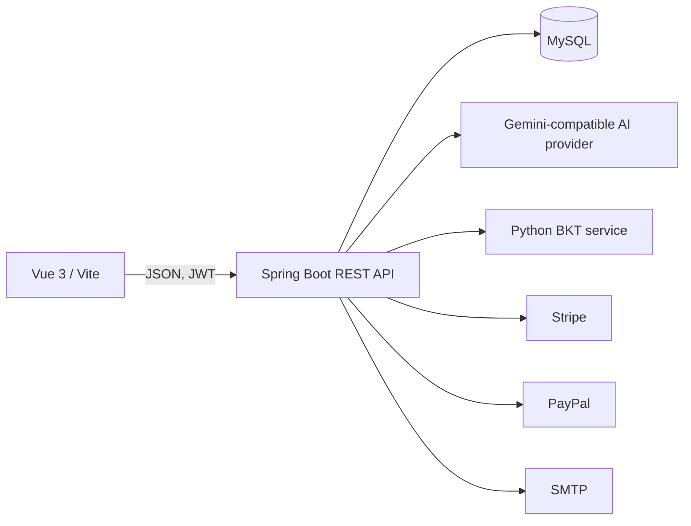

# Project Overview

## Scope and purpose

Adaptive Learning is a learning and assessment platform. Its evidenced product surface includes user accounts, certificates/topics, question and exam management, timed attempts, progress analytics, adaptive recommendations, tutoring, planning, document search, speaking submissions, and premium entitlements. `Adaptive Learning/BUSINESS.md` is a product/roadmap document and includes proposed examples; it is not proof that every described scenario is wired end to end.

## Runtime architecture

The browser entry is `AdaptiveLearningFE/src/main.js`; API calls are centralized in `src/services` and `src/services/Axios.js`. The backend entry is `Adaptive Learning/src/main/java/adaptivelearning/AdaptiveLearningApplication.java` (Spring Boot, Java 17); it enables async and scheduling and calls `initAdminUser()` at startup. Backend HTTP defaults to port 9090 in `src/main/resources/application-local.yml`. The BKT HTTP service is in `Adaptive Learning/pybkt/app.py` and uses Python's `ThreadingHTTPServer` on port 8001, not FastAPI. Docker Compose describes MySQL, backend, frontend, and BKT containers.

## Persistence and integrations

The backend uses MySQL through Spring Data JPA entities/repositories and MyBatis for user operations (`UserMapper.xml`). `ddl-auto: update` is configured locally; no complete versioned migration history was established in the inspected resources. Integrations visible in code include Google ID-token verification, SMTP email verification, an AI provider abstraction with Gemini routing in `module/ai/gateway/OpenAiProvider.java`, Python BKT via `BktClient`, and Stripe/PayPal payment strategies.

## Delivery status

The repository contains executable code and tests for several core services, but code presence does not establish deployment or production readiness. Backend tests exist for users, analytics, billing, and PDF extraction; the frontend package has build/dev scripts but no test script. See [completeness and risks](06-completeness-and-risks.md) for evidence limits and known configuration concerns.
