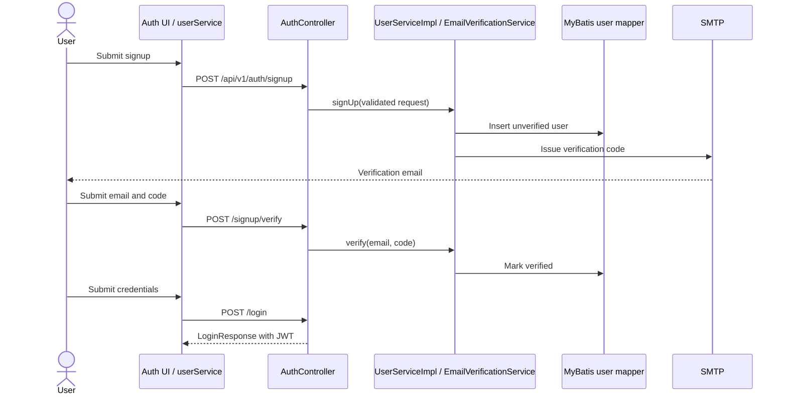

# Business Flows

“Verified” below means the path is visible in repository code, not exercised against live dependencies. Paths are relative to repository root.

## 1. Signup, verification, and login

**Purpose/trigger:** A user submits signup or login in the Auth screens. `AuthController` exposes `/api/v1/auth/signup`, `/signup/verify`, `/signup/resend`, `/login`, `/google`, and `/profile`.

**Flow:** `AuthController` validates request DTOs; `UserServiceImpl.signUp` normalizes email, rejects an already verified account, persists an unverified user with BCrypt password, and asks `EmailVerificationService` to issue verification. Verification then marks the account verified. Password login checks enabled/verified state, authenticates via Spring's `AuthenticationManager`, and returns a JWT from `JwtService`. Google login verifies the ID token, finds/creates a user, and issues the same application JWT. `SecurityConfig` is stateless and adds `JwtAuthenticationFilter` before username/password auth; the auth routes are allowlisted.



**Data/state:** `User` has role, enabled/deleted and email-verification access state; verification records are persisted separately. Exact mail delivery reliability and throttling are not established by this trace. `UserServiceImpl.initAdminUser()` seeds `admin/admin` and `user/user` when there are no admins; this is a serious deployment configuration concern.

## 2. Exam attempt and scoring

**Trigger:** Learner selects a published exam. Frontend wrappers are in `AdaptiveLearningFE/src/services/learningService.js`; backend endpoints are in `AttemptController`.

1. `POST /api/v1/attempts/start` derives user ID from JWT and calls `AttemptServiceImpl.startAttempt`.
2. Service checks exam existence/status, consumes free exam quota through `EntitlementService`, then creates `ExamAttempt` with `IN_PROGRESS`, start time, and expiry based on exam duration.
3. `PATCH /{id}/answers` verifies ownership and active/not-expired state, then saves the answer.
4. `POST /{id}/submit` optionally saves supplied final answers, sets submission time/status and scores answers in the same request. Objective answers are checked against question answers; the method marks attempt `GRADING` then `GRADED` and stores score/answer correctness.
5. At five recorded violations, `recordViolation` sets `VIOLATED` and invokes scoring. A scheduled method checks in-progress attempts every 60 seconds and marks overdue attempts `EXPIRED`.
6. After submit, controller dispatches adaptive update asynchronously. Analytics is a separate endpoint and is not shown auto-triggered by submit.

```mermaid
sequenceDiagram
  actor Learner
  participant FE as Learning UI
  participant API as AttemptController
  participant S as AttemptServiceImpl
  participant Ent as EntitlementService
  participant DB as MySQL/JPA
  participant Async as AdaptiveUpdateDispatcher
  Learner->>FE: Start exam
  FE->>API: POST /attempts/start
  API->>S: startAttempt(userId, examId)
  S->>Ent: consumeExamQuota(userId)
  S->>DB: Save IN_PROGRESS attempt with expiry
  DB-->>FE: Attempt details
  Learner->>FE: Save answers / submit
  FE->>API: PATCH answers, then POST submit
  API->>S: saveAnswer / submitAttempt
  S->>DB: Save answers; score; mark GRADED
  API-->>FE: Result
  API-)Async: updateAfterAttempt(userId, attemptId)
```

**Limits:** Need inspect `scoreAttempt` for question types; do not assume ESSAY is integrated with AI grading. The expiry scheduler only marks state in the located code; automatic final scoring on expiry was not confirmed. Duplicate submit behavior depends on `ensureActive` and should be tested.

## 3. Gap analysis and progress

An authenticated caller posts `/api/v1/analytics/attempts/{id}/analyze`. `AnalyticsController` calls `AnalyticsServiceImpl.analyzeAttempt`; the service loads the attempt/answers and related question/topic data, groups accuracy, persists `GapAnalysis`, and creates recommendations according to thresholds (strong/developing/weak/critical). Separate endpoints return one attempt's analysis, current-user progress by certificate, and recommendations; recommendation status can be moved to started/completed. Unit coverage exists in `AnalyticsServiceImplTest`. Automatic invocation after submit is not evidenced.

## 4. Adaptive profile and BKT

After submit, controller calls `AdaptiveUpdateDispatcher.updateAfterAttempt` on named executor `adaptiveTaskExecutor`. The dispatcher catches/logs exceptions; no durable queue/retry is shown. `AdaptiveServiceImpl.updateProfile` verifies attempt ownership, resolves certificate via the exam's first question, updates per-topic heuristic ability from objectively scored answers, builds cohort interactions from `SUBMITTED`/`GRADED` attempts, calls `BktClient`, uses returned mastery only when ready, then saves JSON profile and total-attempt count. On absent/unready BKT result, heuristic values remain. Recommendation chooses up to three weakest abilities and maps <0.4 to EASY, <0.7 to MEDIUM, otherwise HARD. Forecast is a heuristic scale calculation, not an externally calibrated exam score.

## 5. Premium checkout

Authenticated client posts provider to `/api/v1/payments/checkout`. `PaymentService.checkout` rejects premium/admin accounts, requires configured price and USD, creates a local `PENDING` payment, then asks the selected provider strategy to create checkout and stores provider identifiers/URL. A success return URL is not itself proof of payment. Stripe/PayPal webhook handling verifies/parses the raw event via its strategy, deduplicates by provider event ID, validates payment identity and amount/currency, and atomically updates payment and premium entitlement. PayPal return confirms with provider before processing. See [BILLING.md](../../Adaptive%20Learning/BILLING.md) and `PaymentService`.

## Other documented flows: partial/needs verification

`BUSINESS.md` describes AI tutor, content generation, Speaking, RAG, planner and richer adaptive product flows. Source files exist, but the actual endpoint/service path and integration differ by module. In particular, the located writing grading method calls the provider synchronously; async jobs are specific to the job API. Do not infer audio transcription, vector search, or AI-generated planner schedules absent an implementation trace.
