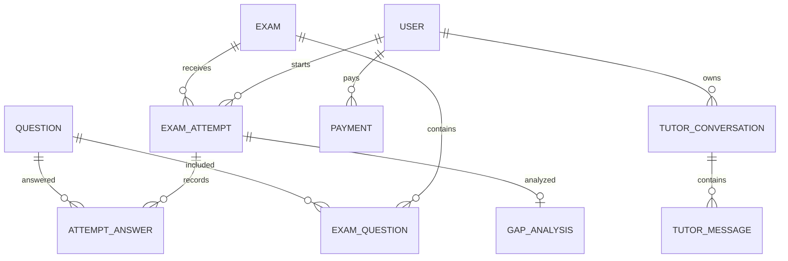

# Data Model

## Persistence model

MySQL is configured in `application-local.yml`; Spring Data JPA entities use `ddl-auto: update`, and user data is accessed through MyBatis (`UserMapper.xml`) in addition to the `User` entity. Explicit schema migrations appear limited in the inspected resource tree (one user-role SQL upgrade); generated schema should not be treated as a reviewed migration history. Entity relationships are often represented as scalar IDs rather than JPA `@ManyToOne` mappings, so associations below are logical references, not necessarily database foreign keys.

| Area | Main entities/tables | Key data |
|---|---|---|
| Identity | `User`, `EmailVerification` | username/email, password hash, role, enabled/deleted, verified state, plan/quota fields, verification expiry/code state |
| Catalog | `Certificate`, `Topic` | certificates and hierarchical/topic metadata |
| Content | `Question`, `Exam`, `ExamQuestion`, `ExamTemplate` | question content/options/answer/type/skill/difficulty/state; exam timing/status; ordered exam-question links |
| Attempts | `ExamAttempt`, `AttemptAnswer`, `AttemptEvent` | owner/exam/status/timestamps/scores/violations; answer JSON/correctness/points/time/order; event type/payload |
| Analytics | `GapAnalysis`, `Recommendation`, `LearningProgress`, `PracticePackage` | JSON accuracy/mastery snapshots, recommendation state/priority and practice links |
| AI/content | `Rubric`, `AiJob`, `AiEvaluation`, `ContentGeneration` | rubric criteria/version, job state/retry/idempotency key, evaluation/result, generated JSON/status |
| Adaptive | `LearnerProfile` | user/certificate, ability-by-skill JSON, attempts and update timestamp |
| Tutor/RAG | `TutorConversation`, `TutorMessage`, `StudyDocument`, `DocumentChunk` | owner/context/messages/citations; document ownership and chunk text/index/keywords |
| Speaking/planner | `SpeakingSubmission`, `SpeakingEvaluation`, `StudyPlan`, `PlanTask` | transcript/evaluation, plan parameters/status, scheduled task/status |
| Billing | `Payment`, `PaymentWebhookEvent` | user/provider/amount/currency/state/provider IDs/raw event payload; event dedupe identity |

## Observed links and state

`ExamAttempt.examId` refers to an exam, `AttemptAnswer.attemptId` to an attempt, and `AttemptAnswer.questionId` to a question. `ExamQuestion` joins exams and questions with order. `GapAnalysis` stores attempt/user/certificate IDs and JSON aggregates; recommendations may refer to gap analysis and practice package IDs. Payments are linked to users and webhook events are uniquely looked up by provider/event ID in service logic. Inspect entity annotations/repository constraints before assuming all these are enforced by foreign keys or unique indexes.

Known states from shared enums/service transitions include attempt `IN_PROGRESS -> GRADING -> GRADED`, violation `VIOLATED`, and expiry `EXPIRED`; payment `PENDING`, `SUCCEEDED`, `FAILED`, `REFUNDED`; question content review states; and plan/task completion states. Exact allowed transitions are implemented per service, not centrally modeled.

The diagram communicates observed logical references; it does not certify physical FK constraints. JSON columns are used for answers, analytics, profile abilities and provider payloads. Transactional service methods exist for attempts, analytics, billing, user operations and others; no cross-system transaction can atomically include AI/payment providers. Concurrency and uniqueness behavior should be verified against DB indexes and service transaction boundaries before changing quotas, webhook dedupe, or answer submission.
